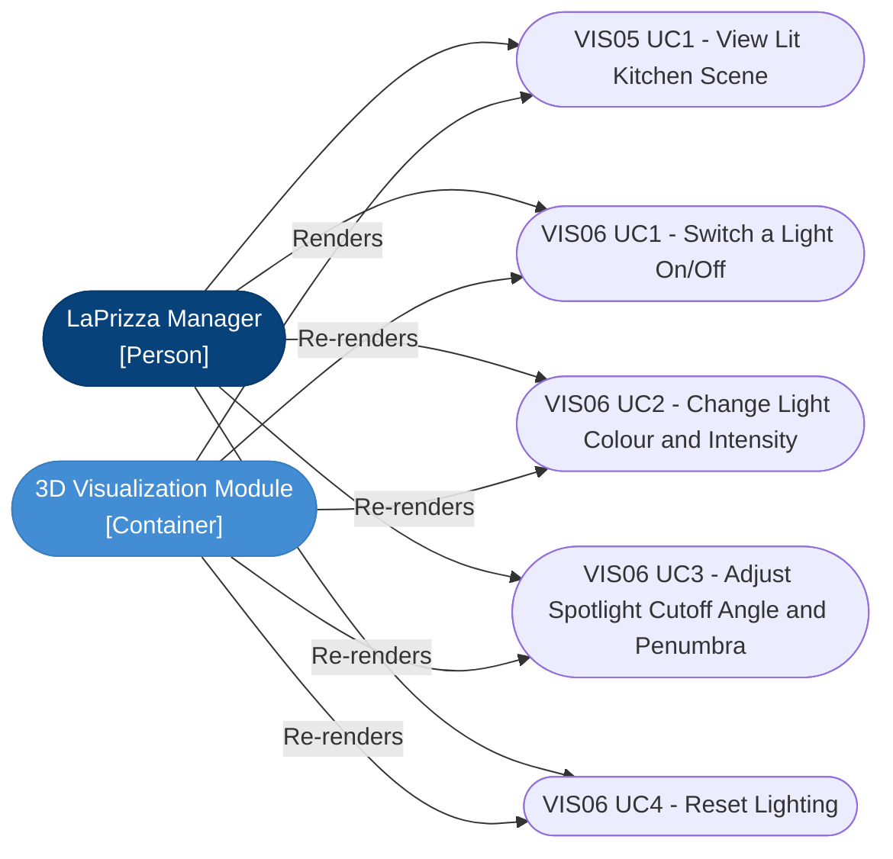

# Scene Lighting - Design Diagrams (Mermaid)

The scene lighting (VIS05) makes the 3D kitchen visible and easy to read: five light sources at fixed positions, shadows from two of them, the same look from any zoom level or camera angle. The lighting controls (VIS06) add a lil-gui panel to switch each light on and off and change its colour, intensity and, for spotlights, cutoff angle and penumbra. Both are client-side only: everything happens in the browser, in the **3D Visualization** module embedded in the **Web Application**. They call no endpoint of their own; the kitchen layout comes from the active kitchen configuration ([WEB06 UC3](../kitchen-configuration/get-active-kitchen-configuration.md)).

Process View (SAD), Level 3, documented as C4 dynamic diagrams of the **Web Application** and **3D Visualization** containers.

## Use Cases

The use cases are described in the Use Case Views: [VIS05](../../analysis/use-case-views.md#vis05-scene-lighting) and [VIS06](../../analysis/use-case-views.md#vis06-interactive-light-controls).

## Diagrams

| Use case | Trigger | Pages | Result | Document |
|---|---|---|---|---|
| [VIS05 UC1 - View Lit Kitchen Scene](./view-lit-kitchen-scene.md) | The viewer is mounted | `/visualization3d`, `/kitchen-configurations` | Kitchen rendered with the default lighting and shadows | `view-lit-kitchen-scene.md` |
| [VIS06 UC1 - Switch a Light On/Off](./switch-light-on-off.md) | "On" checkbox of a folder | `/visualization3d`, `/kitchen-configurations` | Light at its intensity or at 0; its other controls enabled or disabled | `switch-light-on-off.md` |
| [VIS06 UC2 - Change Light Colour and Intensity](./change-light-colour-and-intensity.md) | "Color" picker or "Intensity" slider | `/visualization3d`, `/kitchen-configurations` | Light redrawn with the new colour or intensity | `change-light-colour-and-intensity.md` |
| [VIS06 UC3 - Adjust Spotlight Cutoff Angle and Penumbra](./adjust-spotlight-angle-and-penumbra.md) | "Cutoff angle (°)" or "Penumbra" slider of a spotlight | `/visualization3d`, `/kitchen-configurations` | Spotlight cone redrawn | `adjust-spotlight-angle-and-penumbra.md` |
| [VIS06 UC4 - Reset Lighting](./reset-lighting.md) | "Reset" button | `/visualization3d`, `/kitchen-configurations` | Default lighting restored in the panel and in the scene | `reset-lighting.md` |

## Light sources

Defined by `SceneLighting` (`kitchen-scene.jsx`) with the values of `DEFAULT_LIGHTING` (`lighting-defaults.js`). `width`, `length` and `height` are the kitchen dimensions (`content.dimensions`, defaulting to 10, 10 and 5 when missing). The positions never depend on the camera.

| Light | Three.js | Position and target | Shadows | Default colour and intensity | Role |
|---|---|---|---|---|---|
| Ambient light | `ambientLight` | - | No | `#ffffff`, 0.35 | Base visibility from any angle |
| Hemisphere light | `hemisphereLight`, ground colour `#3a2a22` | - | No | `#ffffff`, 0.45 | Base visibility, no pitch-black faces |
| Directional light ("sun") | `directionalLight` | `[width × 0.6, height × 3, length × 0.6]`, aimed at the origin | Yes: 2048 × 2048 map, orthographic frustum ±`max(width, length) × 0.75`, near 0.5, far = distance to the origin + half the floor diagonal + 1, bias −0.0005, normal bias 0.03 | `#ffffff`, 1.1 | Volume and contours of the whole kitchen |
| Spotlight (kitchen) | `spotLight`, decay 0 | `[0, height × 0.95, length × 0.25]`, target `[0, 0, 0]` | Yes: 1024 × 1024 map, bias −0.0005, normal bias 0.03 | `#ffffff`, 3, cutoff angle 60°, penumbra 0.6 | Focal light and extra depth |
| Spotlight (assembly line) | `spotLight`, decay 0 | `[x, height × 0.95, z + 1]`, target = assembly line placement `[x, y, z]` (room centre when there is no line) | No | `#ffffff`, 2, cutoff angle 60°, penumbra 0.7 | Highlights the assembly line at a lower cost |

The background is `#2a1512` and the floor receives shadows.

## GUI controls

Defined by `LightingControls` (`lighting-controls.jsx`), a lil-gui panel (`three/examples/jsm/libs/lil-gui.module.min.js`) titled "Lighting", open by default, in the top-right corner of the viewer (scrolls inside the viewer when it is taller). One folder per light source, in this order, after a Reset button at the root:

| Folder | Controls | Intensity | Cutoff angle | Penumbra |
|---|---|---|---|---|
| Ambient light | On, Color, Intensity | 0 to 2, step 0.01 | - | - |
| Hemisphere light | On, Color, Intensity | 0 to 2, step 0.01 | - | - |
| Directional light | On, Color, Intensity | 0 to 3, step 0.01 | - | - |
| Spotlight (kitchen) | On, Color, Intensity, Cutoff angle (°), Penumbra | 0 to 10, step 0.01 | 5° to 90°, step 1 | 0 to 1, step 0.01 |
| Spotlight (assembly line) | On, Color, Intensity, Cutoff angle (°), Penumbra | 0 to 10, step 0.01 | 5° to 90°, step 1 | 0 to 1, step 0.01 |
| (root) | Reset | - | - | - |

Data flow: a control changes the panel's own state object (a copy of `DEFAULT_LIGHTING`), `gui.onChange(emit)` sends a fresh copy (`structuredClone`) to `onChange`, which is `setLighting` of `KitchenScene`, and `SceneLighting` re-renders with the new props. The Three.js renderer draws the change on the next frame.

## Business rules shown in the diagrams

- **Ambient light and at least one spotlight:** the scene has an ambient light, a hemisphere light, a directional light and two spotlights.
- **Depth without overexposure or excessive darkness:** a weak base light (ambient 0.35, hemisphere 0.45 with a dark ground colour) keeps every face visible, while the directional light and the spotlights shape volume and contours.
- **Shadows without significant performance degradation:** only two lights cast shadows (2048 and 1024 maps), the canvas pixel ratio is capped at 2 (`dpr={[1, 2]}`) and `ShadowGroup` marks each mesh once (`userData.shadowsSet`), checking the group every 30 frames. The check is periodic because meshes can be remounted when their textures finish loading (VIS04). No frame rate measurement is documented.
- **Consistent across zoom levels and camera angles:** light positions are derived from the room, not from the camera. The shadow frustum covers the whole floor. The camera controls (VIS07, [Camera Interaction](../camera-interaction/README.md)) keep the camera within distance, angle and pan limits derived from the kitchen dimensions, always above the floor.
- **No active configuration:** `KitchenViewer` shows "No active kitchen configuration to display." and no scene is created (WEB06, [ADR-0025](../../adr/0025-active-configuration-endpoint-and-no-fallback-policy.md)). If only the assembly line cannot be loaded, the kitchen is shown with a warning and the line spotlight aims at the room centre.
- **Access:** the viewer is shown on `/visualization3d` and `/kitchen-configurations`, which both require the `kitchen:read` permission (Manager and Employee).
- **One folder per light source** with an "On" checkbox, a colour picker and an intensity slider with per-light limits; the two spotlight folders add the cutoff angle (degrees in the panel, radians in Three.js) and the penumbra.
- **A light that is off** keeps its place in the scene with intensity 0 (`level(light) = enabled ? intensity : 0`), so the shaders are not recompiled. Its colour, intensity, cutoff angle and penumbra controls are disabled (`sync()`), and enabled again when it is switched on.
- **Reset** copies `DEFAULT_LIGHTING` back into the panel state, refreshes every control (`updateDisplay()`), re-applies the enabled or disabled state and sends the defaults to the scene.
- **No persistence:** the settings are kept only in memory. They go back to the defaults whenever the viewer is mounted again (for example after an activation on the Kitchen Configuration page, which remounts the viewer, [ADR-0027](../../adr/0027-viewer-reload-mechanism-in-the-frontend.md)), and no endpoint is called.

## Related ADRs

| ADR | Decision | Status |
|---|---|---|
| [ADR-0007](../../adr/0007-web-application-%28spa%29-technology-and-structure.md) | Web Application (SPA) technology and structure | Accepted |
| [ADR-0025](../../adr/0025-active-configuration-endpoint-and-no-fallback-policy.md) | Active configuration endpoint and no-fallback policy | Accepted |
| [ADR-0030](../../adr/0030-adoption-of-r3f-for-3d-module-integration.md) | Adoption of R3F for 3D module integration | Accepted |
| [ADR-0037](../../adr/0037-scene-lighting-setup.md) | Scene lighting setup: fixed world-space lights, two shadow casters | Accepted |
| [ADR-0038](../../adr/0038-lighting-controls-with-lil-gui.md) | Lighting controls with the lil-gui bundled in Three.js, state lifted to the scene | Accepted |
| [ADR-0054](../../adr/0054-perspective-camera-controls-with-limits-derived-from-the-kitchen.md) | Perspective camera controls with limits derived from the kitchen (VIS07) | Accepted |
| [ADR-0018](../../adr/0018-internationalization-of-the-web-application-%28english-and-portuguese%29.md) | Internationalization of the Web Application (English and Portuguese) | Accepted |
| [ADR-0027](../../adr/0027-viewer-reload-mechanism-in-the-frontend.md) | Viewer reload mechanism: state-based React key reset | Accepted |

## Notation key

| Notation | Meaning |
|---|---|
| Actor (stick figure) | Person using the system, with the role shown in the label |
| Shaded box "Web Application" | Container (React, Vite) that holds the page components |
| Shaded box "3D Visualization" | Container (WebGL, Three.js) that holds the viewer and the scene |
| Participant label | `Name`, followed by `[Type: technology]` |
| Solid arrow | Call or request |
| Dashed arrow | Return value or response |
| Arrow to the same participant | Work done inside that component |
| Number on an arrow | Order of the interaction (autonumber) |
| `alt` / `else` frame | Alternative flows, only one of them runs |
| `loop` frame | Flow that repeats |
| `opt` frame | Optional flow |
| `Note` | Reference to another diagram or a remark |

## Element catalogue

| Element | Type | Technology | Responsibility | Used in |
|---|---|---|---|---|
| Manager | Person | - | Back-office user with the MANAGER role | [VIS05 UC1](./view-lit-kitchen-scene.md), [VIS06 UC1](./switch-light-on-off.md), [UC2](./change-light-colour-and-intensity.md), [UC3](./adjust-spotlight-angle-and-penumbra.md), [UC4](./reset-lighting.md) |
| Visualization3dPage | Component | React page | Page `/visualization3d` (route guard: `kitchen:read`); shows the `KitchenViewer` | [VIS05 UC1](./view-lit-kitchen-scene.md) |
| KitchenConfigurationPage | Component | React page | WEB06 page; also embeds the `KitchenViewer`, so the lit scene appears there too | [VIS05 UC1](./view-lit-kitchen-scene.md) |
| KitchenViewer | Component | React component | Loads the active configuration and its assembly line (`useKitchenConfiguration`), shows the loading and empty states and renders `KitchenScene` | [VIS05 UC1](./view-lit-kitchen-scene.md) |
| KitchenScene | Component | React Three Fiber `Canvas` | Creates the canvas with `shadows`, `dpr={[1, 2]}` and a perspective camera (fov 50) placed by `computeCameraSetup` (VIS07); holds the `lighting` state (`DEFAULT_LIGHTING`); renders `SceneLighting`, `CameraControls`, the floor and the elements inside `ShadowGroup` | [VIS05 UC1](./view-lit-kitchen-scene.md), [VIS06 UC1](./switch-light-on-off.md), [UC2](./change-light-colour-and-intensity.md), [UC3](./adjust-spotlight-angle-and-penumbra.md), [UC4](./reset-lighting.md) |
| SceneLighting | Component | R3F lights | The five light sources at fixed world-space positions | [VIS05 UC1](./view-lit-kitchen-scene.md), [VIS06 UC1](./switch-light-on-off.md), [UC2](./change-light-colour-and-intensity.md), [UC3](./adjust-spotlight-angle-and-penumbra.md), [UC4](./reset-lighting.md) |
| ShadowGroup | Component | R3F group, `useFrame` | Every 30 frames, marks the new meshes of the group to cast and receive shadows | [VIS05 UC1](./view-lit-kitchen-scene.md) |
| CameraControls | Component | Three.js `OrbitControls` | Pan, orbit and dolly around the kitchen, within limits derived from the kitchen (VIS07, see [Camera Interaction](../camera-interaction/README.md)) | [VIS05 UC1](./view-lit-kitchen-scene.md) |
| LightingControls | Component | lil-gui (bundled with Three.js), React component | Builds the "Lighting" panel (one folder per light, Reset), keeps its own copy of the settings, enables or disables the controls of a light that is off and sends a copy of the settings on every change; destroys the panel when unmounted | [VIS06 UC1](./switch-light-on-off.md), [UC2](./change-light-colour-and-intensity.md), [UC3](./adjust-spotlight-angle-and-penumbra.md), [UC4](./reset-lighting.md) |
| DEFAULT_LIGHTING | Component | JavaScript module | Default colour, intensity, on/off and spotlight angle and penumbra of each light | [VIS05 UC1](./view-lit-kitchen-scene.md), [VIS06 UC1](./switch-light-on-off.md), [UC2](./change-light-colour-and-intensity.md), [UC3](./adjust-spotlight-angle-and-penumbra.md), [UC4](./reset-lighting.md) |
| Three.js WebGLRenderer | Component | Three.js | Renders the scene and the shadow maps on every frame | [VIS05 UC1](./view-lit-kitchen-scene.md), [VIS06 UC1](./switch-light-on-off.md), [UC2](./change-light-colour-and-intensity.md), [UC3](./adjust-spotlight-angle-and-penumbra.md), [UC4](./reset-lighting.md) |

## Notes

- The light positions and the shadow settings are fixed in code; only the values in `DEFAULT_LIGHTING` (colour, intensity, on/off, spotlight angle and penumbra) are meant to change.
- Mesh shadows are set by `ShadowGroup` and not per model, so models added later (VIS03, VIS04) cast and receive shadows without changes.
- While the models load, the scene shows a yellow wireframe cube (`Suspense` fallback).
- The panel texts ("Lighting", the folder titles, "On", "Color", "Intensity", "Cutoff angle (°)", "Penumbra", "Reset") are fixed in English in `lighting-controls.jsx` and do not go through i18next ([ADR-0018](../../adr/0018-internationalization-of-the-web-application-%28english-and-portuguese%29.md)).
- `package.json` lists `lil-gui` as a direct dependency, but the code imports the copy bundled with Three.js (`three/examples/jsm/libs/lil-gui.module.min.js`), so the direct dependency is not used.
- The user stories name the LaPrizza Manager, but the viewer and the panel are shown to every user with `kitchen:read`, which includes the Employee. The changes are local to the browser and never stored.
- Tests: there are no automated tests of the lighting or of the panel (unit or E2E); they are validated manually by opening the viewer, orbiting, zooming and using each control.
