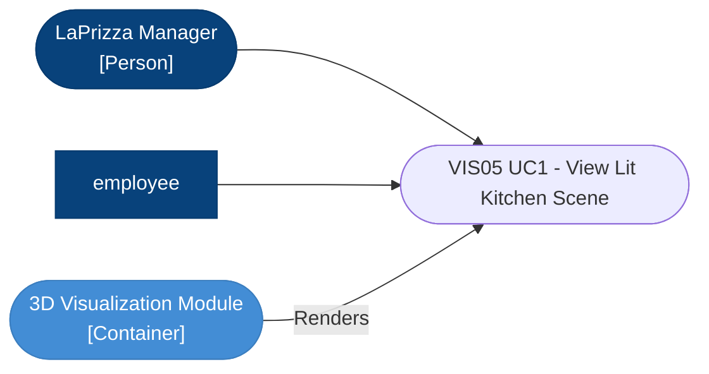

# Scene Lighting - Design Diagrams (Mermaid)

The scene lighting (VIS05) makes the 3D kitchen visible and easy to read: five light sources at fixed positions, shadows from two of them, the same look from any zoom level or camera angle. It is client-side only: everything happens in the browser, in the **3D Visualization** module embedded in the **Web Application**. It calls no endpoint of its own; the kitchen layout comes from the active kitchen configuration ([WEB06 UC3](../kitchen-configuration/get-active-kitchen-configuration.md)).

Process View (SAD), Level 3, documented as C4 dynamic diagrams of the **Web Application** and **3D Visualization** containers.

## Use Cases

The use cases are described in the [Use Case Views](../../analysis/use-case-views.md#vis05-scene-lighting).

## Diagrams

| Use case | Trigger | Pages | Result | Document |
|---|---|---|---|---|
| [VIS05 UC1 - View Lit Kitchen Scene](./view-lit-kitchen-scene.md) | The viewer is mounted | `/visualization3d`, `/kitchen-configurations` | Kitchen rendered with the default lighting and shadows | `view-lit-kitchen-scene.md` |

## Light sources

Defined by `SceneLighting` (`kitchen-scene.jsx`) with the values of `DEFAULT_LIGHTING` (`lighting-defaults.js`). `width`, `length` and `height` are the kitchen dimensions (`content.dimensions`, defaulting to 10, 10 and 5 when missing). The positions never depend on the camera.

| Light | Three.js | Position and target | Shadows | Default colour and intensity | Role |
|---|---|---|---|---|---|
| Ambient light | `ambientLight` | - | No | `#ffffff`, 0.35 | Base visibility from any angle |
| Hemisphere light | `hemisphereLight`, ground colour `#3a2a22` | - | No | `#ffffff`, 0.45 | Base visibility, no pitch-black faces |
| Directional light ("sun") | `directionalLight` | `[width × 0.6, height × 3, length × 0.6]`, aimed at the origin | Yes: 2048 × 2048 map, orthographic frustum ±`max(width, length) × 0.75`, near 0.5, far = distance to the origin + half the floor diagonal + 1, bias −0.0005, normal bias 0.03 | `#ffffff`, 1.1 | Volume and contours of the whole kitchen |
| Spotlight (kitchen) | `spotLight`, decay 0 | `[0, height × 0.95, length × 0.25]`, target `[0, 0, 0]` | Yes: 1024 × 1024 map, bias −0.0005, normal bias 0.03 | `#ffffff`, 3, cutoff angle 60°, penumbra 0.6 | Focal light and extra depth |
| Spotlight (assembly line) | `spotLight`, decay 0 | `[x, height × 0.95, z + 1]`, target = assembly line placement `[x, y, z]` (room centre when there is no line) | No | `#ffffff`, 2, cutoff angle 60°, penumbra 0.7 | Highlights the assembly line at a lower cost |

The background is `#2a1512` and the floor receives shadows.

## Business rules shown in the diagrams

- **Ambient light and at least one spotlight:** the scene has an ambient light, a hemisphere light, a directional light and two spotlights.
- **Depth without overexposure or excessive darkness:** a weak base light (ambient 0.35, hemisphere 0.45 with a dark ground colour) keeps every face visible, while the directional light and the spotlights shape volume and contours.
- **Shadows without significant performance degradation:** only two lights cast shadows (2048 and 1024 maps), the canvas pixel ratio is capped at 2 (`dpr={[1, 2]}`) and `ShadowGroup` marks each mesh once (`userData.shadowsSet`), checking the group every 30 frames. The check is periodic because meshes can be remounted when their textures finish loading (VIS04). No frame rate measurement is documented.
- **Consistent across zoom levels and camera angles:** light positions are derived from the room, not from the camera. The shadow frustum covers the whole floor. `OrbitControls` orbits around `[0, 0, 0]` with a minimum distance of 2, a maximum distance of `max(initialDistance × 1.5, max(width, length) × 2)` and a maximum polar angle of `π/2 − 0.05`, so the camera always stays above the floor.
- **No active configuration:** `KitchenViewer` shows "No active kitchen configuration to display." and no scene is created (WEB06, [ADR-0025](../../adr/0025-active-configuration-endpoint-and-no-fallback-policy.md)). If only the assembly line cannot be loaded, the kitchen is shown with a warning and the line spotlight aims at the room centre.
- **Access:** the viewer is shown on `/visualization3d` and `/kitchen-configurations`, which both require the `kitchen:read` permission (Manager and Employee).

## Related ADRs

| ADR | Decision | Status |
|---|---|---|
| [ADR-0007](../../adr/0007-web-application-%28spa%29-technology-and-structure.md) | Web Application (SPA) technology and structure | Accepted |
| [ADR-0025](../../adr/0025-active-configuration-endpoint-and-no-fallback-policy.md) | Active configuration endpoint and no-fallback policy | Accepted |
| [ADR-0030](../../adr/0030-adoption-of-r3f-for-3d-module-integration.md) | Adoption of R3F for 3D module integration | Accepted |
| [ADR-0037](../../adr/0037-scene-lighting-setup.md) | Scene lighting setup: fixed world-space lights, two shadow casters | Accepted |

## Notation key

| Notation | Meaning |
|---|---|
| Actor (stick figure) | Person using the system, with the role shown in the label |
| Shaded box "Web Application" | Container (React, Vite) that holds the page components |
| Shaded box "3D Visualization" | Container (WebGL, Three.js) that holds the viewer and the scene |
| Participant label | `Name`, followed by `[Type: technology]` |
| Solid arrow | Call or request |
| Dashed arrow | Return value or response |
| Arrow to the same participant | Work done inside that component |
| Number on an arrow | Order of the interaction (autonumber) |
| `alt` / `else` frame | Alternative flows, only one of them runs |
| `loop` frame | Flow that repeats |
| `Note` | Reference to another diagram or a remark |

## Element catalogue

| Element | Type | Technology | Responsibility | Used in |
|---|---|---|---|---|
| Manager | Person | - | Back-office user with the MANAGER role | [VIS05 UC1](./view-lit-kitchen-scene.md) |
| Visualization3dPage | Component | React page | Page `/visualization3d` (route guard: `kitchen:read`); shows the `KitchenViewer` | [VIS05 UC1](./view-lit-kitchen-scene.md) |
| KitchenConfigurationPage | Component | React page | WEB06 page; also embeds the `KitchenViewer`, so the lit scene appears there too | [VIS05 UC1](./view-lit-kitchen-scene.md) |
| KitchenViewer | Component | React component | Loads the active configuration and its assembly line (`useKitchenConfiguration`), shows the loading and empty states and renders `KitchenScene` | [VIS05 UC1](./view-lit-kitchen-scene.md) |
| KitchenScene | Component | React Three Fiber `Canvas` | Creates the canvas with `shadows`, `dpr={[1, 2]}` and a camera at `[0, height × 2, length]` (fov 50); holds the `lighting` state (`DEFAULT_LIGHTING`); renders `SceneLighting`, `OrbitControls`, the floor and the elements inside `ShadowGroup` | [VIS05 UC1](./view-lit-kitchen-scene.md) |
| SceneLighting | Component | R3F lights | The five light sources at fixed world-space positions | [VIS05 UC1](./view-lit-kitchen-scene.md) |
| ShadowGroup | Component | R3F group, `useFrame` | Every 30 frames, marks the new meshes of the group to cast and receive shadows | [VIS05 UC1](./view-lit-kitchen-scene.md) |
| OrbitControls | Component | `@react-three/drei` | Orbit and zoom around the kitchen centre, within distance and angle limits | [VIS05 UC1](./view-lit-kitchen-scene.md) |
| DEFAULT_LIGHTING | Component | JavaScript module | Default colour, intensity, on/off and spotlight angle and penumbra of each light | [VIS05 UC1](./view-lit-kitchen-scene.md) |
| Three.js WebGLRenderer | Component | Three.js | Renders the scene and the shadow maps on every frame | [VIS05 UC1](./view-lit-kitchen-scene.md) |

## Notes

- The light positions and the shadow settings are fixed in code; only the values in `DEFAULT_LIGHTING` (colour, intensity, on/off, spotlight angle and penumbra) are meant to change.
- Mesh shadows are set by `ShadowGroup` and not per model, so models added later (VIS03, VIS04) cast and receive shadows without changes.
- While the models load, the scene shows a yellow wireframe cube (`Suspense` fallback).
- Tests: there are no automated tests of the lighting (unit or E2E); it is validated manually by opening the viewer, orbiting and zooming.
