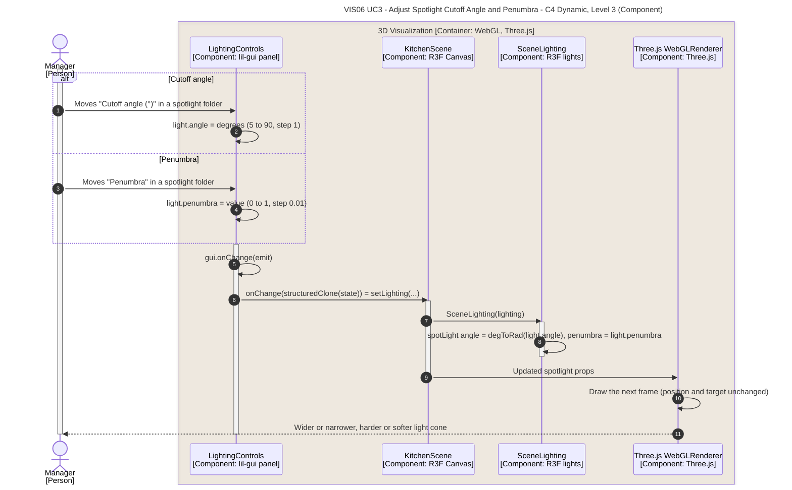

# VIS06 UC3 - Adjust Spotlight Cutoff Angle and Penumbra

| Attribute | Value |
|---|---|
| C4 view | Dynamic diagram, Level 3 (Component) |
| SAD view | Process View, Level 3 |
| Containers | Web Application, 3D Visualization |
| Endpoints | None (client-side only). The settings are not stored and no request is made. |
| Allowed roles | Users with the `kitchen:read` permission (MANAGER), who see the viewer on `/visualization3d` and `/kitchen-configurations` |
| Success response | n/a (the spotlight cone is drawn with the new angle or penumbra from the next frame) |
| Error handling | None: the sliders keep the value within their limits. Both controls are disabled while the spotlight is off ([UC1](./switch-light-on-off.md)). |
| ADRs | [ADR-0045](../../adr/0045-lighting-controls-with-lil-gui.md), [ADR-0044](../../adr/0044-scene-lighting-setup.md) |

## Description

Only the two spotlight folders, "Spotlight (kitchen)" and "Spotlight (assembly line)", have the "Cutoff angle (°)" and "Penumbra" sliders. The cutoff angle goes from 5° to 90° in steps of 1° and the penumbra from 0 to 1 in steps of 0.01. Both spotlights start at 60°; the penumbra starts at 0.6 for the kitchen spotlight and 0.7 for the assembly line spotlight.

The panel works in degrees. `SceneLighting` converts the value with `degToRad` before giving it to the Three.js `spotLight` as `angle`, and passes the penumbra as it is. As in the other controls, every change is sent to `KitchenScene` through `gui.onChange(emit)` and `setLighting`. The spotlight keeps its position and target, which are fixed by VIS05, so only the width and the softness of the cone change.

## Diagram

See the [README](./README.md) for the notation key and the element catalogue.
