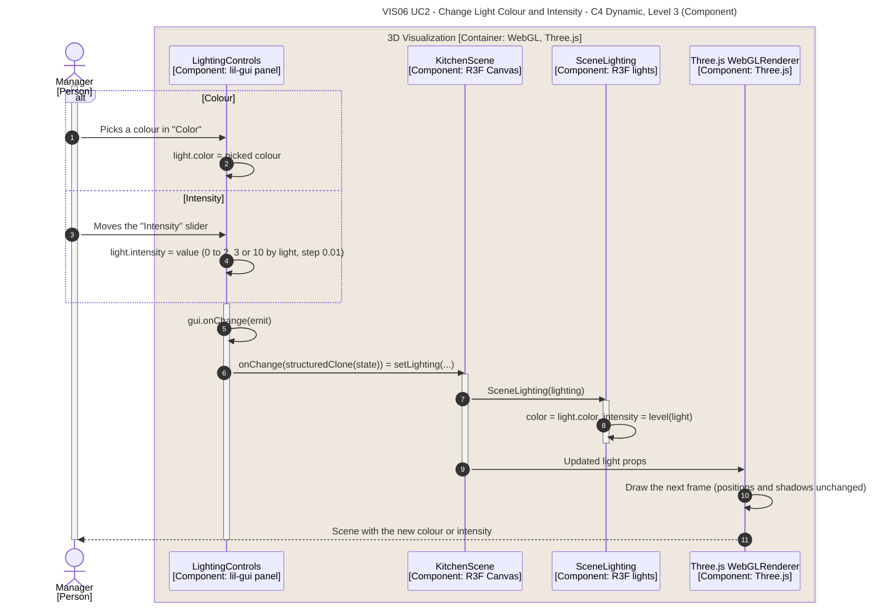

# VIS06 UC2 - Change Light Colour and Intensity

| Attribute | Value |
|---|---|
| C4 view | Dynamic diagram, Level 3 (Component) |
| SAD view | Process View, Level 3 |
| Containers | Web Application, 3D Visualization |
| Endpoints | None (client-side only). The settings are not stored and no request is made. |
| Allowed roles | Users with the `kitchen:read` permission (MANAGER), who see the viewer on `/visualization3d` and `/kitchen-configurations` |
| Success response | n/a (the light is drawn with the new colour or intensity from the next frame) |
| Error handling | None: the colour picker returns a valid colour and the slider keeps the value within its limits. Both controls are disabled while the light is off ([UC1](./switch-light-on-off.md)). |
| ADRs | [ADR-0045](../../adr/0045-lighting-controls-with-lil-gui.md), [ADR-0039](../../adr/0039-adoption-of-r3f-for-3d-module-integration.md) |

## Description

Every folder has a "Color" picker and an "Intensity" slider bound to the `color` and `intensity` of its light. The slider limits depend on the light, with a step of 0.01: ambient and hemisphere 0 to 2, directional 0 to 3, kitchen and assembly line spotlights 0 to 10. The defaults are those of `DEFAULT_LIGHTING` (0.35, 0.45, 1.1, 3 and 2, all `#ffffff`).

Each change updates the panel state and is sent to the scene at once: `gui.onChange(emit)` calls `setLighting(structuredClone(state))` on `KitchenScene`, and `SceneLighting` passes the new `color` and `intensity` (through `level(light)`) to the Three.js light. The renderer shows the change on the next frame. Only colour and intensity change: the position, target and shadow settings of the light stay as defined in VIS05.

## Diagram

See the [README](./README.md) for the notation key and the element catalogue.
