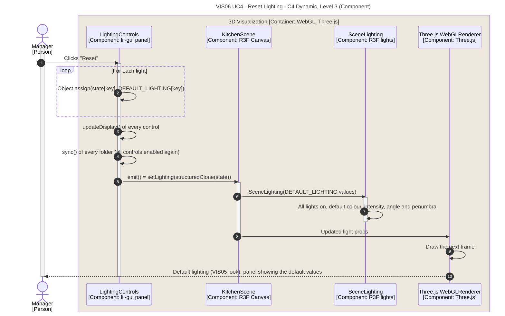

# VIS06 UC4 - Reset Lighting

| Attribute | Value |
|---|---|
| C4 view | Dynamic diagram, Level 3 (Component) |
| SAD view | Process View, Level 3 |
| Containers | Web Application, 3D Visualization |
| Endpoints | None (client-side only). The settings are not stored and no request is made. |
| Allowed roles | Users with the `kitchen:read` permission (MANAGER), who see the viewer on `/visualization3d` and `/kitchen-configurations` |
| Success response | n/a (the default lighting is restored in the panel and in the scene) |
| Error handling | None |
| ADRs | [ADR-0045](../../adr/0045-lighting-controls-with-lil-gui.md), [ADR-0044](../../adr/0044-scene-lighting-setup.md) |

## Description

The "Reset" button, at the top of the "Lighting" panel, restores the VIS05 look. For each light, `reset()` copies the values of `DEFAULT_LIGHTING` into the panel state (`Object.assign`), so every light is switched on again with its default colour, intensity, cutoff angle and penumbra. It then refreshes every control of every folder (`gui.controllersRecursive().forEach((c) => c.updateDisplay())`), runs `sync()` of each folder to enable again the controls of the lights that were off, and calls `emit()`, which sends a copy of the state to `KitchenScene` through `setLighting`.

The same defaults are also used whenever the viewer is mounted again, because the settings are kept only in memory: `KitchenScene` starts from `DEFAULT_LIGHTING` and `LightingControls` builds a new panel from a copy of it. For example, an activation on the Kitchen Configuration page remounts the viewer ([ADR-0032](../../adr/0032-viewer-reload-mechanism-in-the-frontend.md)) and the lighting goes back to the defaults.

## Diagram

See the [README](./README.md) for the notation key and the element catalogue.
