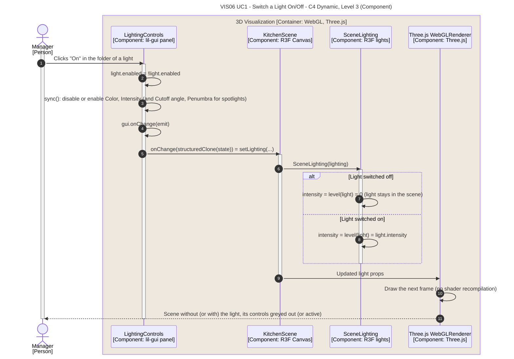

# VIS06 UC1 - Switch a Light On/Off

| Attribute | Value |
|---|---|
| C4 view | Dynamic diagram, Level 3 (Component) |
| SAD view | Process View, Level 3 |
| Containers | Web Application, 3D Visualization |
| Endpoints | None (client-side only). The settings are not stored and no request is made. |
| Allowed roles | Users with the `kitchen:read` permission (MANAGER), who see the viewer on `/visualization3d` and `/kitchen-configurations` |
| Success response | n/a (the light is drawn at its intensity, or at 0, from the next frame) |
| Error handling | None: the checkbox only accepts on or off |
| ADRs | [ADR-0038](../../adr/0038-lighting-controls-with-lil-gui.md), [ADR-0037](../../adr/0037-scene-lighting-setup.md), [ADR-0030](../../adr/0030-adoption-of-r3f-for-3d-module-integration.md) |

## Description

Each folder of the "Lighting" panel starts with an "On" checkbox bound to the `enabled` flag of its light, in the panel's own copy of `DEFAULT_LIGHTING`. All five lights start switched on.

When the Manager clears the checkbox, lil-gui sets `enabled` to `false` and the `onChange` of the checkbox runs `sync()`, which disables the other controls of the folder: colour and intensity, and for the two spotlights also the cutoff angle and the penumbra. The change is then sent to the scene: `gui.onChange(emit)` calls `onChange(structuredClone(state))`, which is `setLighting` of `KitchenScene`. `SceneLighting` re-renders and gives the light the intensity `level(light)`, which is 0 when the light is off. The light is not removed from the scene, so Three.js does not recompile the shaders, and its colour, angle and penumbra keep their values.

Ticking the checkbox again enables the controls and the light gets back its last intensity.

## Diagram

See the [README](./README.md) for the notation key and the element catalogue.
