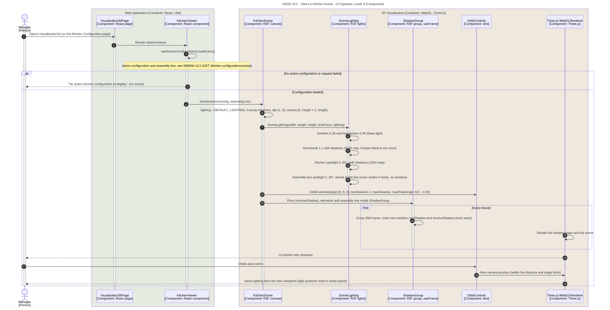

# VIS05 UC1 - View Lit Kitchen Scene

| Attribute | Value |
|---|---|
| C4 view | Dynamic diagram, Level 3 (Component) |
| SAD view | Process View, Level 3 |
| Containers | Web Application, 3D Visualization |
| Endpoints | None (client-side only). The kitchen layout comes from `GET /kitchen-configurations/active` (see [WEB06 UC3](../kitchen-configuration/get-active-kitchen-configuration.md)). |
| Allowed roles | Users with the `kitchen:read` permission (MANAGER), required by the `/visualization3d` and `/kitchen-configurations` routes |
| Success response | n/a (the kitchen is rendered with the default lighting and shadows) |
| Error handling | No active configuration (404) or a failed request: empty state "No active kitchen configuration to display." and no scene (WEB06). Assembly line not loaded: the kitchen is shown with a warning and the line spotlight aims at the room centre. |
| ADRs | [ADR-0030](../../adr/0030-adoption-of-r3f-for-3d-module-integration.md), [ADR-0037](../../adr/0037-scene-lighting-setup.md), [ADR-0025](../../adr/0025-active-configuration-endpoint-and-no-fallback-policy.md) |

## Description

The Manager opens the 3D Visualization page (`Visualization3dPage`) or the Kitchen Configuration page, which both render `KitchenViewer`. The viewer loads the active kitchen configuration and the assembly line it references through `useKitchenConfiguration` (WEB06 UC3). While loading it shows a status message; without an active configuration it shows the empty state and stops.

With a configuration, `KitchenScene` creates the React Three Fiber `Canvas` with `shadows` enabled, a pixel ratio between 1 and 2, the camera at `[0, height × 2, length]` (field of view 50) and the background `#2a1512`. It keeps the lighting in state, starting from `DEFAULT_LIGHTING`, and renders:

1. `SceneLighting`: the ambient light (0.35), the hemisphere light (0.45, ground `#3a2a22`), the directional light (1.1) at `[width × 0.6, height × 3, length × 0.6]` with a 2048 shadow map and a frustum fitted to the room, the kitchen spotlight (3, 60°, penumbra 0.6) at `[0, height × 0.95, length × 0.25]` aimed at the origin with a 1024 shadow map, and the assembly line spotlight (2, 60°, penumbra 0.7) above the line placement, without shadows. All positions come from the kitchen dimensions and the line placement.
2. `OrbitControls` around `[0, 0, 0]`, with a minimum distance of 2, a maximum distance that always contains the initial camera, and a maximum polar angle just under 90°.
3. The floor, which receives shadows, and the kitchen elements and the assembly line inside `ShadowGroup`.

`ShadowGroup` runs on every frame, but only every 30th frame does it traverse its meshes and mark the new ones to cast and receive shadows (`userData.shadowsSet`), so each mesh is processed once even when it is remounted after its textures load. The Three.js renderer then draws the shadow maps and the scene on every frame.

When the Manager orbits or zooms, only the camera moves. The lights keep their positions and settings, so the look is the same from every angle and distance, and the camera cannot go below the floor nor too close or too far.

## Diagram

See the [README](./README.md) for the notation key and the element catalogue.
