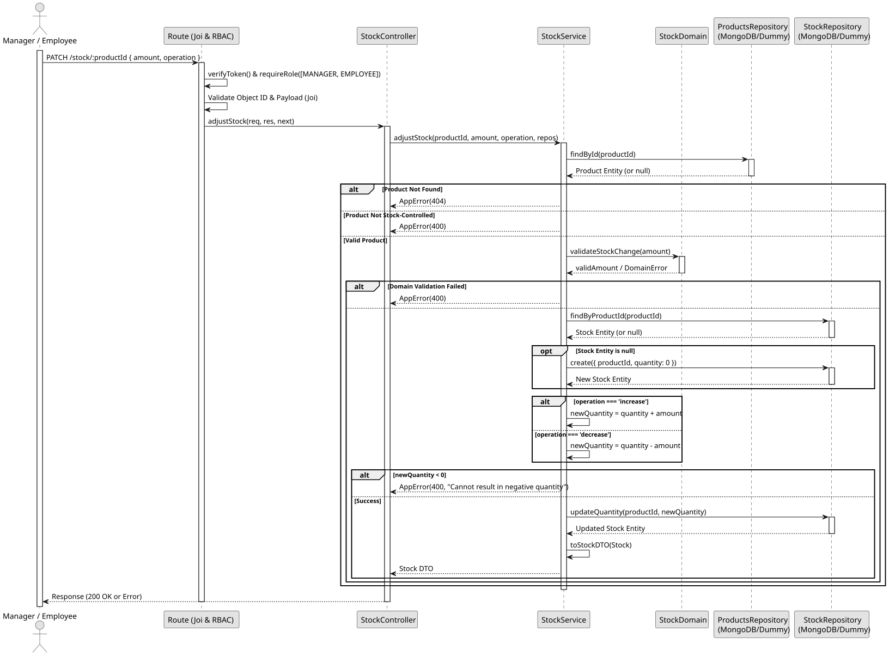

# UC3: Adjust Stock

## Use Case View

**Primary Actor:** Manager / Employee  
**Description:** Allows an authenticated manager or employee to increase or decrease the stock quantity of a stock-controlled product by a strictly positive integer amount.

**Preconditions:**

- The user must be authenticated with the `MANAGER` or `EMPLOYEE` role.
- The specified product must exist and have `stockControlled: true`.

**Main Success Scenario:**

1. The user provides a product ID, an adjustment operation (`increase` or `decrease`), and an amount.
2. The System validates that the amount is a strictly positive integer (> 0).
3. The System verifies the product exists and is stock-controlled.
4. The System fetches the current stock record, auto-creating one with `quantity: 0` if it is missing.
5. The System calculates the new quantity, ensuring a `decrease` operation does not result in a negative stock value.
6. The System updates the stock record and returns a 200 OK status.

**Alternative Flows:**

- _Missing/invalid fields, non-positive amount, or invalid operation:_ The System returns a 400 Bad Request error.
- _Decrease resulting in negative stock:_ The System returns a 400 Bad Request error.
- _Product is not stock-controlled:_ The System returns a 400 Bad Request error.
- _Non-existent product ID:_ The System returns a 404 Not Found error.
- _Unauthorized user (`CUSTOMER` or no token):_ The System returns a 401 Unauthorized or 403 Forbidden error.

**Postconditions:**

- The product's stock quantity is updated in the database.

## 1. Domain Assumptions

- The stock of a product can be adjusted using an `increase` or `decrease` operation.
- The `amount` provided must be a strictly positive integer (> 0).
- A `decrease` operation cannot result in a negative stock quantity.
- The Product must exist and must be designated as `stockControlled: true`.
- **Auto-initialization:** Similar to querying, if the stock record does not exist yet, it is created with `quantity: 0` before applying the adjustment operation.
- Users with both `MANAGER` and `EMPLOYEE` roles are authorized to adjust stock.

## 2. Solution Design

## 3. Business Test Planning

- **Isolation Strategy:** All application tests use dependency injection via isolated in-memory Dummies, avoiding Mocking libraries entirely.
- **Domain Tests (`stock.domain.test.js`):**
  - `validateStockChange rejects negative amounts, zero, decimals, and non-numbers`
  - `validateStockChange accepts strictly positive integers`
  - `validateStockQuantity rejects negative integers and accepts non-negative integers`
- **Application Tests (`stock.service.test.js`):**
  - `adjustStock successfully increases stock quantity`
  - `adjustStock successfully decreases stock quantity`
  - `adjustStock throws 400 AppError if a decrease results in a negative quantity`
  - `adjustStock throws 400 AppError if the product is not stock-controlled`
  - `adjustStock throws 404 AppError if the product does not exist`
  - `adjustStock auto-creates a stock record before applying the adjustment if missing`

## 4. Postman E2E Tests

- **Base Endpoint:** `PATCH /api/v1/stock/:productId`
- **Validated Scenarios:**
  - Request without Bearer Token -> `401 Unauthorized`
  - Request with `CUSTOMER` Bearer Token -> `403 Forbidden` (RBAC enforcement)
  - Empty payload or missing `amount`/`operation` -> `400 Bad Request` (Joi validation)
  - Invalid `operation` string (e.g., 'add') -> `400 Bad Request`
  - Negative or zero `amount` -> `400 Bad Request`
  - Invalid Product ID format -> `400 Bad Request`
  - Adjustment resulting in negative stock -> `400 Bad Request`
  - Product not stock-controlled -> `400 Bad Request`
  - Non-existent Product ID -> `404 Not Found`
  - Valid `increase` or `decrease` operation -> `200 OK`
