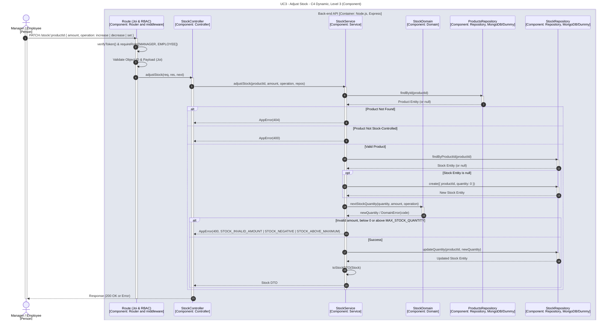

# UC3 - Adjust Stock

| Attribute | Value |
|---|---|
| C4 view | Dynamic diagram, Level 3 (Component) |
| SAD view | Process View, Level 3 |
| Container | Back-end API |
| Endpoint | `PATCH /stock/:productId` |
| Allowed roles | MANAGER, EMPLOYEE |
| Success response | 200 OK |
| Error handling | 404 (product not found), 400 (product not stock-controlled, `VALIDATION_FAILED`, `STOCK_INVALID_AMOUNT`, `STOCK_NEGATIVE` or `STOCK_ABOVE_MAXIMUM`) |

## Description

A Manager or Employee changes the stock of a stock-controlled product in one of three ways (WEB04):

| `operation` | `amount` | Result | Example (current 150) |
|---|---|---|---|
| `increase` | units received, > 0 | `quantity + amount` | 10 → 160 |
| `decrease` | units removed, > 0 | `quantity - amount` | 72 → 78 |
| `set` | counted quantity, >= 0 | `amount` | 78 → 78 (physical count, no subtraction by the user) |

The stock record is created on first use. The result must stay between 0 and `MAX_STOCK_QUANTITY` (100 000 units, `stock.domain.js`); outside that range the change is refused (`STOCK_NEGATIVE`, `STOCK_ABOVE_MAXIMUM`). The rule lives in the domain function `nextStockQuantity`.

In the SPA (`stock-adjust-form.jsx`, `stock-rules.js`), every movement of 1000 units or more (`UNUSUAL_CHANGE_UNITS`) is shown back to the user (from → to) for confirmation before it is sent; a stock out below that is confirmed as before.

## Diagram

See the [README](./README.md) for the notation key and the element catalogue.
