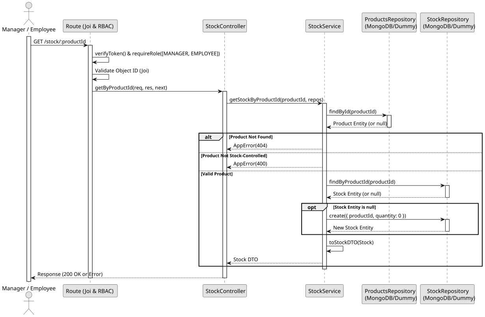

# UC2: Get Stock by Product ID

## 1. Domain Assumptions

- Stock is queried individually by its associated `productId`.
- The Product must exist and must be designated as `stockControlled: true`.
- **Auto-initialization:** If the product is stock-controlled but a stock record does not yet exist in the database, a new record with `quantity: 0` is automatically created and returned.
- The ID must conform to the MongoDB ObjectId format.
- Users with both `MANAGER` and `EMPLOYEE` roles can view stock details.

## 2. Solution Design

## 3. Business Test Planning

- **Isolation Strategy:** All application tests use dependency injection via isolated in-memory Dummies (`stock.dummy.repository.js` and `products.dummy.repository.js`), avoiding Mocking libraries entirely.
- **Application Tests (`stock.service.test.js`):**
  - `getStockByProductId returns the stock record for a valid stock-controlled product`
  - `getStockByProductId throws 404 AppError if the product does not exist`
  - `getStockByProductId throws 400 AppError if the product is not stock-controlled`
  - `getStockByProductId auto-creates a stock record with 0 quantity if it does not exist yet`

## 4. Postman E2E Tests

- **Base Endpoint:** `GET /api/v1/stock/:productId`
- **Validated Scenarios:**
  - Request without Bearer Token -> `401 Unauthorized`
  - Request with `CUSTOMER` Bearer Token -> `403 Forbidden` (RBAC enforcement)
  - Request with invalid Product ID format -> `400 Bad Request` (Joi CastError prevention)
  - Request for a product that is not stock-controlled -> `400 Bad Request`
  - Request for a non-existent Product ID -> `404 Not Found`
  - Request for a valid stock-controlled Product ID -> `200 OK` (Returns stock DTO)
