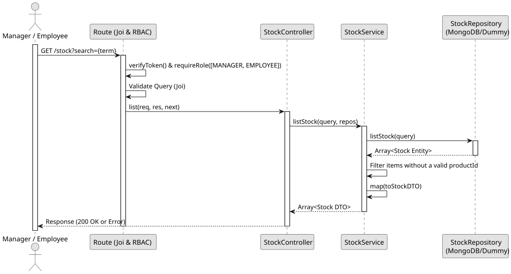

# UC1: List and Search Stock

## 1. Domain Assumptions

- The system allows listing the stock of all stock-controlled products, optionally filtered by a search term.
- The search term performs a case-insensitive partial match on the product's `name`.
- Only products that have a valid reference to a product (`productId` is populated) are returned.
- Users with both `MANAGER` and `EMPLOYEE` roles are authorized to list and search stock.

## 2. Solution Design

## 3. Business Test Planning

- **Isolation Strategy:** All application tests use dependency injection via isolated in-memory Dummies (`stock.dummy.repository.js` and `products.dummy.repository.js`), avoiding Mocking libraries entirely.
- **Application Tests (`stock.service.test.js`):**
  - `listStock returns all stock records`
  - `listStock filters by product name search query`
  - `listStock filters out stock records with orphaned/null product references`
  - `listStock correctly maps to Stock DTO`

## 4. Postman E2E Tests

- **Base Endpoint:** `GET /api/v1/stock`
- **Validated Scenarios:**
  - Request without Bearer Token -> `401 Unauthorized`
  - Request with `CUSTOMER` Bearer Token -> `403 Forbidden` (RBAC enforcement)
  - Valid request without search query -> `200 OK` (Returns all stock)
  - Valid request with matching product name search query -> `200 OK`
  - Valid request with non-matching search query -> `200 OK` (Returns `[]`)
