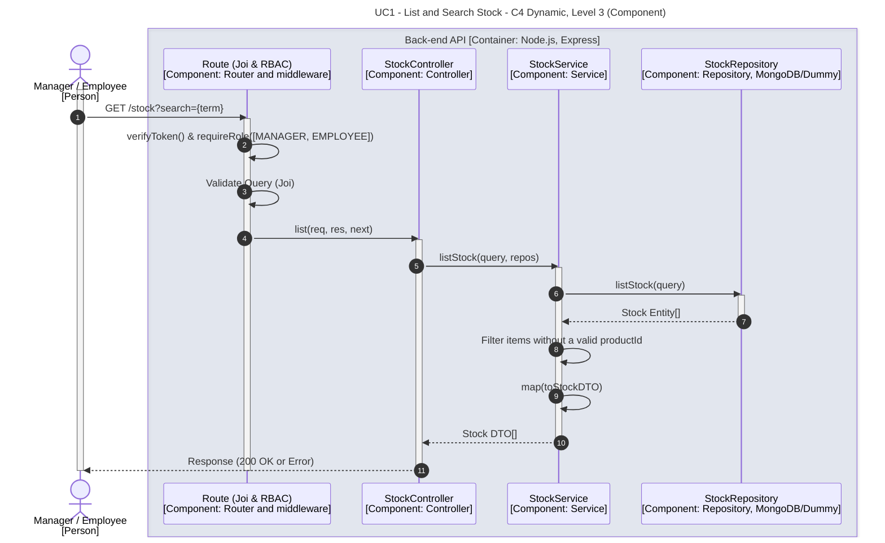

# UC1 - List and Search Stock

| Attribute | Value |
|---|---|
| C4 view | Dynamic diagram, Level 3 (Component) |
| SAD view | Process View, Level 3 |
| Container | Back-end API |
| Endpoint | `GET /stock?search={term}` |
| Allowed roles | MANAGER, EMPLOYEE |
| Success response | 200 OK |
| Error handling | Not detailed (generic error response) |

## Description

A Manager or Employee lists the stock records, optionally filtered by a search term. Items without a valid product id are filtered out before the DTOs are built.

## Diagram

See the [README](./README.md) for the notation key and the element catalogue.
