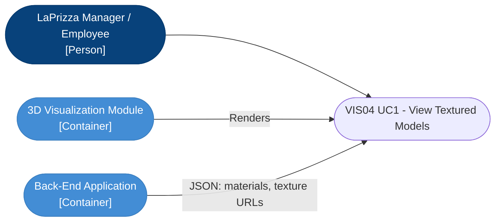

# Textures and Materials - Design Diagrams (Mermaid)

The textures and materials (VIS04) make every object of the 3D scene look realistic: the floor, the kitchen elements ([VIS02](../kitchen-configuration/README.md)) and each component of the assembly line ([VIS03](../assembly-line/README.md)) has its own textured material, with a colour map and a roughness, bump or normal map, read from the back end as JSON. The textures are loaded by the **3D Visualization** module embedded in the **Web Application**, without degrading the loading time.

Process View (SAD), Level 3, documented as a C4 dynamic diagram of the **3D Visualization** container and the asset host.

## Use Cases

The use case is described in the [Use Case Views](../../analysis/use-case-views.md#vis04-textures-and-materials).

## Diagrams

| Use case | Endpoint | Pages | Result | Document |
|---|---|---|---|---|
| [VIS04 UC1 - View Textured Models](./view-textured-models.md) | None of its own; texture files from the URLs of the JSON | `/visualization3d`, `/kitchen-configurations` | Every object drawn with its textured material | `view-textured-models.md` |

## Material format

Every object of the scene has a material in the JSON: the kitchen elements (`content.elements[].material`), the floor (`content.floor.material`) and the assembly line elements.

| Property | Rule |
|---|---|
| `colorMap` | Required: the colour (albedo) texture |
| `roughnessMap`, `bumpMap`, `normalMap` | At least one of them |
| `color`, `roughness`, `metalness` | Optional: tint (`#rrggbb`) and properties between 0 and 1 |
| `repeat` | Optional `{ x, y }` greater than zero: how many times the texture repeats on the surface |

Texture maps are asset references: absolute `http(s)` URLs or root-relative paths (`/textures/<name>/diffuse.jpg`). A material without textures, or with a colour map and no detail map, is refused by the back end with its property path (`collectRequiredTextureViolations`, `material.domain.js`).

The textures delivered with the SPA are in `frontend/public/textures/<name>/` (`diffuse.jpg`, `normal.jpg`, `rough.jpg`), 1k JPG files from Poly Haven (CC0), downloaded by `frontend/scripts/download-polyhaven-textures.mjs`: `blue_metal_plate`, `metal_plate`, `wood_table_001`, `rubber_tiles`, `polystyrene`, `red_brick`, `rock_wall_08`, `dark_wood`, `tiled_floor_001`, `beige_wall_001`.

## Business rules shown in the diagrams

- **Materials from the back end as JSON.** The material properties and the texture URLs of every object come from the kitchen and assembly line configurations; the back end refuses a material without textures with its property path ([JSON Format](../kitchen-configuration/kitchen-configuration-json-format.md#textures-are-mandatory-vis04-web04)).
- **Distinct textured materials.** Each component and each kitchen object has its own material; the JSON material always wins. A texture chosen by element type (`TEXTURE_BY_TYPE`, `TEXTURE_BY_MODEL`) is only used for configurations stored before textures became mandatory, and for the kitchen walls, which the configuration does not describe.
- **Performance.** Textures are loaded only when referenced, each file once (cache by URL), and shared by every object that uses it (one GPU upload; per-object copies only change the repeat). Anisotropic filtering is capped at 4. While textures load the object is drawn with its plain material, so the scene is never empty, and a texture that fails falls back to the plain material without breaking the scene. Materials and texture copies are disposed when an object leaves the scene.

## Related ADRs

| ADR | Decision | Status |
|---|---|---|
| [ADR-0021](../../adr/0021-asset-references-strategy.md) | Asset references strategy (URLs and root-relative paths) | Accepted |
| [ADR-0030](../../adr/0030-adoption-of-r3f-for-3d-module-integration.md) | React Three Fiber for the 3D module | Accepted |
| [ADR-0052](../../adr/0052-ui-consistency-and-input-validation-after-the-sprint-2-review.md) | UI consistency and input validation (D7: every object textured) | Accepted |

## Notation key

| Notation | Meaning |
|---|---|
| Actor (stick figure) | Person using the system, with the role shown in the label |
| Shaded box "3D Visualization" | Container (WebGL, Three.js) that holds the viewer and the scene |
| Participant label | `Name`, followed by `[Type: technology]` |
| Solid arrow | Call or request |
| Dashed arrow | Return value or response |
| Arrow to the same participant | Work done inside that component |
| Number on an arrow | Order of the interaction (autonumber) |
| `alt` / `else` frame | Alternative flows, only one of them runs |
| `loop` frame | Flow that repeats |
| `opt` frame | Optional flow |
| `Note` | Reference to another diagram or a remark |

## Element catalogue

| Element | Type | Technology | Responsibility | Used in |
|---|---|---|---|---|
| Manager / Employee | Person | - | Users with `kitchen:read` | [VIS04 UC1](./view-textured-models.md) |
| KitchenScene | Component | React Three Fiber `Canvas` | Resolves the material of the floor, the walls and every element, and renders the frame | [VIS04 UC1](./view-textured-models.md) |
| scene-textures | Component | JavaScript module, pure functions | `elementMaterial`, `floorMaterial`, `kitchenWalls`, `textureMaterial`, `TEXTURE_BY_TYPE`, `TEXTURE_BY_MODEL` | [VIS04 UC1](./view-textured-models.md) |
| WithMaterial | Component | React, drei `useTexture`, Three.js `MeshStandardMaterial` | Plain material at once; textured material when the maps are loaded; fallback on error (`TextureErrorBoundary`); disposal | [VIS04 UC1](./view-textured-models.md) |
| Model of the object | Component | R3F meshes | Kitchen, furniture or assembly line model; all its meshes share the resolved material (`Surface`) | [VIS04 UC1](./view-textured-models.md) |
| Three.js WebGLRenderer | Component | Three.js | Renders the frame | [VIS04 UC1](./view-textured-models.md) |
| Asset host | External System | Static files (nginx, Vite) or `http(s)` host | Serves the texture files referenced by the JSON | [VIS04 UC1](./view-textured-models.md) |

## Notes

- Tests:
  - Back end: `test/domain/material.domain.test.js` (colour map plus a detail map, asset references), `kitchen-configuration.domain.test.js`, `assembly-line-configuration.domain.test.js`.
  - httpyac flow `backend/test-flows/assembly-line-configuration-test-flow.http`: material without colour map refused with its path (3.6c), textured kitchen floor (5.2b).
  - Front end: `test/features/visualization3d-scene.test.js` (JSON material wins, texture by type and model, floor and walls, only downloaded textures used).
  - The rendering and the loading time are validated manually in the viewer.
