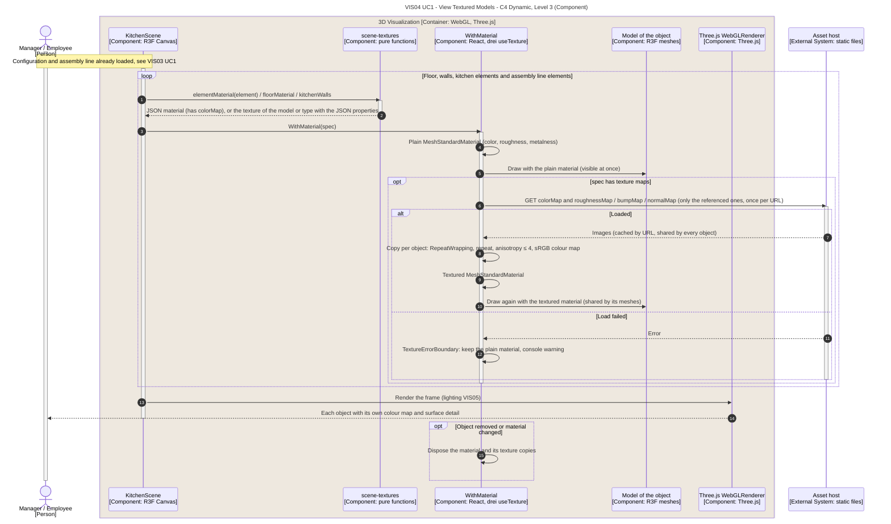

# VIS04 UC1 - View Textured Models

| Attribute | Value |
|---|---|
| C4 view | Dynamic diagram, Level 3 (Component) |
| SAD view | Process View, Level 3 |
| Containers | Web Application, 3D Visualization, asset host (static files) |
| Endpoints | None of its own. The materials come in the JSON of `GET /kitchen-configurations/active` and `GET /assembly-line-configurations/{id}` ([VIS03 UC1](../assembly-line/view-assembly-line.md)); the texture files are read from the URLs in that JSON (`/textures/<name>/…` served with the SPA, or an absolute `http(s)` URL) |
| Allowed roles | Users with the `kitchen:read` permission (MANAGER, EMPLOYEE) |
| Success response | n/a (every object is drawn with its textured material) |
| Error handling | While a texture loads: the object is drawn with its plain material (colour and properties of the JSON). A texture that cannot be loaded: the plain material stays and a warning is written to the console; the rest of the scene is not affected. Invalid materials never reach the viewer: the back end refuses them when the configuration is saved |
| ADRs | [ADR-0026](../../adr/0026-asset-references-strategy.md), [ADR-0039](../../adr/0039-adoption-of-r3f-for-3d-module-integration.md), [ADR-0055](../../adr/0055-ui-consistency-and-input-validation-after-the-sprint-2-review.md) |

## Description

For every object of the scene (floor, walls, kitchen elements and assembly line elements), `KitchenScene` resolves a material spec:

1. `elementMaterial(element)` returns the JSON material of the element when it has a `colorMap`. Configurations stored before textures became mandatory may lack it; then the texture of the furniture model or of the element type is used (`TEXTURE_BY_MODEL`, `TEXTURE_BY_TYPE`), keeping the JSON properties. `floorMaterial` does the same for the floor, with one repetition every 1.5 m, and `kitchenWalls` gives the four walls their texture, since the configuration does not describe walls.
2. `WithMaterial` creates the plain material at once (`MeshStandardMaterial` with `color`, `roughness`, `metalness`) and renders the model with it, so the object is visible immediately.
3. When the spec has texture maps, `TexturedMaterial` loads them with drei `useTexture`, only the maps the JSON references (`colorMap` → `map`, `roughnessMap`, `bumpMap`, `normalMap`). Each URL is downloaded once and cached; objects that use the same file share its image, so it is sent to the GPU once.
4. For each object it copies the loaded textures (the copy shares the image), sets `RepeatWrapping` and the `repeat` of the JSON, anisotropy up to 4, and the sRGB colour space for the colour map, and builds the textured `MeshStandardMaterial`. The model is drawn again with it; all meshes of the model share that material (`Surface`).
5. When the object leaves the scene, or the material changes, the material and its texture copies are disposed. A loading error is caught by `TextureErrorBoundary`, which keeps the plain material.

The rules on the content (a colour map plus a roughness, bump or normal map on every object; valid asset references) are checked by the back end when a kitchen or an assembly line is saved or validated (`collectRequiredTextureViolations`), with the property path of each violation ([JSON Format](../kitchen-configuration/kitchen-configuration-json-format.md#textures-are-mandatory-vis04-web04)).

## Diagram

See the [README](./README.md) for the notation key and the element catalogue.
