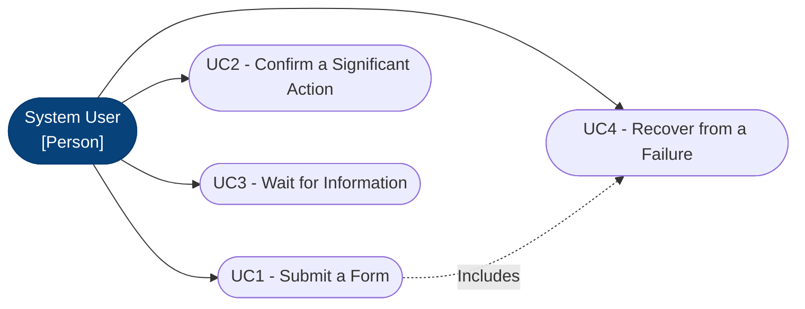

# User Feedback and Validation - Design Diagrams (Mermaid)

The User Feedback and Validation feature (WEB04) makes every page of the Web Application give the same kind of feedback: it shows when information is loading, confirms what was saved, explains what is wrong in a form and how to fix it, asks before actions with significant consequences, prevents repeated submissions, and lets the user recover from a failed request. These behaviours are shared modules of the SPA (`src/shared/forms`, `src/shared/feedback`, `src/shared/api`, `src/shared/ui/feedback`), used by every feature in the same way. The back end remains the authority for every rule: it answers with structured, translatable errors (`{ error: { status, code, message, details? } }`) that never carry internal details.

Process View (SAD), Level 3, documented as C4 dynamic diagrams of the **Web Application** and **Back-end API** containers. The Customers pages are used as the example; the other features follow the same flow with their own endpoints.

## Use Cases

The use cases are described in the [Use Case Views](../../analysis/use-case-views.md#web04-user-feedback-and-validation).

## Diagrams

| Use case | Example endpoint | Roles | Result | Document |
|---|---|---|---|---|
| [UC1 - Submit a Form](./submit-form.md) | `POST /customers`, `PATCH /customers/{id}` | Any user with the write permission of the form (here `customers:write`, MANAGER) | Saved, success toast; or errors on the fields with the typed values kept | `submit-form.md` |
| [UC2 - Confirm a Significant Action](./confirm-significant-action.md) | `PATCH /customers/{id}` (`isActive: false`), `PATCH /stock/{productId}` | MANAGER (`customers:write`, `stock:write`) | Sent only after confirmation; cancelling sends nothing | `confirm-significant-action.md` |
| [UC3 - Wait for Information](./wait-for-information.md) | `GET /customers` | Any user with the read permission of the page | Progress bar and reserved placeholder, then the data, the empty state or the error | `wait-for-information.md` |
| [UC4 - Recover from a Failure](./recover-from-failure.md) | Any request (example `GET /customers`, `POST /customers`) | Any user | Generic translated message, "Try again", warning when a write may have happened | `recover-from-failure.md` |

## Error contract

| Back-end answer | `kind` (`error-normalizer.js`) | Shown | Where |
|---|---|---|---|
| 400 / 422 with `details[{ field, type, message, limit? }]` | `validation` | Text of `feedback.validation.<type>` on each field and in the form summary; never the server `message` | Inline (form) |
| 401 | `unauthenticated` | Session ended, login page (AA04) | Session store |
| 403 | `forbidden` | "You do not have permission to perform this action."; the user is reloaded (WEB03) | Toast |
| 404 | `notFound` | Feature text (for example "The requested item could not be found.") or "unavailable" detail | Inline |
| 409 | `conflict` | Feature text or field error (for example the e-mail already in use) | Inline |
| 429 | `rateLimited` | "Too many requests. Please wait a moment." plus the time of `Retry-After` | Inline |
| 5xx (no `details`) | `server` | "The server could not complete the request. Please try again later." | Toast |
| No answer | `network` | "Could not reach the server. Check your connection." | Toast |
| Timeout (15 s reads, 30 s writes) | `timeout` | "The server took too long to respond." | Toast |

A failed write without an answer (network or timeout) adds "The operation may have been completed. Check the current data before trying again." (`outcomeUnknown`). The texts are in English and Portuguese (`message.js`, [ADR-0019](../../adr/0019-internationalization-of-the-web-application-%28english-and-portuguese%29.md)).

| Back-end component | Rule |
|---|---|
| `joiDetails` (`joi-details.js`) | Maps a Joi error to `details[{ field, type, message, limit? }]` with every violation (`abortEarly: false`); the submitted value is never copied (redacted from the message) |
| `errorHandler` (`error-handler.js`) | One JSON format for every error; 5xx answers keep only the generic status text and never include `details` ([ADR-0055](../../adr/0055-ui-consistency-and-input-validation-after-the-sprint-2-review.md) D4); `Retry-After` when the error carries it; malformed JSON is 400 `MALFORMED_JSON`; Mongoose validation and cast errors are 400 `VALIDATION_FAILED` with only the field paths |

## Business rules shown in the diagrams

- **Validate twice, explain once.** Client rules (`validators.js`: `required`, `minLength`, `maxLength`, `email`, `pattern`, `integer`, `minValue`, `maxValue`, `portuguesePhone`, `personName`, `placeName`, `sameAs`) return the same `{ type, limit? }` as the API, so client and server errors share one translation path. The same patterns are used in Joi and in the SPA ([ADR-0055](../../adr/0055-ui-consistency-and-input-validation-after-the-sprint-2-review.md) D6). The back end checks everything again.
- **Errors on the fields.** Each violation is shown under its input (`FieldError`, bound with `aria-invalid` and `aria-describedby`) and in a summary at the top with links to the inputs (`FormErrors`); the focus moves to the first invalid input (`useFieldErrors`).
- **Inputs are kept.** Form values live in the page component and are never cleared on failure; a failed operation is never shown as completed.
- **One submission at a time.** `createSubmitGuard` is a synchronous lock, so two clicks in the same tick cannot both send; the button is disabled while `submitting`.
- **Success is confirmed.** `useSubmit(..., { successKey })` shows a success toast; every toast closes after 3 s, paused while hovered or focused, and identical toasts are not stacked (at most 4).
- **Confirmation before significant actions.** `useConfirm()` opens a native `<dialog>` with the consequence; Cancel has the initial focus and Esc cancels; only one dialog at a time.
- **Loading is visible and stable.** Every request goes through one HTTP client that feeds a pending-request counter (`GlobalProgress`, shown after 0.15 s); pages and lists show a placeholder that keeps the room of the content ([ADR-0055](../../adr/0055-ui-consistency-and-input-validation-after-the-sprint-2-review.md) D2).
- **No internal details.** The UI translates errors by `kind` and `code`, never by the server text; details are only read for validation errors.
- **Safe retry.** Lists offer "Try again" (not for a 400, which would fail the same way) and keep the last data under the error; a write that may have been executed is reported as such, and the list is refreshed before the user tries again.

## Related ADRs

| ADR | Decision | Status |
|---|---|---|
| [ADR-0055](../../adr/0055-ui-consistency-and-input-validation-after-the-sprint-2-review.md) | UI consistency and input validation after the Sprint 2 review | Accepted |
| [ADR-0019](../../adr/0019-internationalization-of-the-web-application-%28english-and-portuguese%29.md) | Internationalization of the Web Application (English and Portuguese) | Accepted |
| [ADR-0007](../../adr/0007-web-application-%28spa%29-technology-and-structure.md) | Web Application (SPA) technology and structure | Accepted |
| [ADR-0010](../../adr/0010-generate-dynamic-http-client-with-orval.md) | Generated HTTP client with Orval | Accepted |
| [ADR-0036](../../adr/0036-frontend-end-to-end-%28e2e%29-testing-framework.md) | Frontend end-to-end (e2e) testing framework | Accepted |

## Notation key

| Notation | Meaning |
|---|---|
| Actor (stick figure) | Person using the system, with the role shown in the label |
| Shaded box "Web Application" | Container (React, Vite) that holds the page and the shared feedback components |
| Shaded box "Back-end API" | Container (Node.js, Express) that holds the back-end components |
| Participant label | `Name`, followed by `[Type: technology]` |
| Solid arrow | Call or request |
| Dashed arrow | Return value or response |
| Arrow to the same participant | Work done inside that component |
| Number on an arrow | Order of the interaction (autonumber) |
| `alt` / `else` frame | Alternative flows, only one of them runs |
| `opt` frame | Optional flow |
| `Note` | Reference to another diagram or a remark |

## Element catalogue

| Element | Type | Technology | Responsibility | Used in |
|---|---|---|---|---|
| System User | Person | - | Any user of a page (Guest, Customer, Employee, Manager, Administrator) | All diagrams |
| Feature page | Component | React page (example `CustomersForm`, `CustomerDetail`, `CustomersPage`) | Holds the form values, calls the validators, `useSubmit`, `useConfirm` and the generated API hooks | All diagrams |
| validators | Component | JS module (`forms/validators.js`) | Client rules, `validateForm`, `toFieldMap` | [UC1](./submit-form.md) |
| useSubmit / SubmitGuard | Component | React hook, JS module (`forms/use-submit.js`, `forms/submit-guard.js`) | One run at a time, `submitting`, normalized `error`, success toast | [UC1](./submit-form.md), [UC2](./confirm-significant-action.md) |
| useFieldErrors / FieldError / FormErrors | Component | React hook and components | Per-field error map, focus on the first invalid input, field texts and the summary with links | [UC1](./submit-form.md) |
| useConfirm / ConfirmDialogHost | Component | JS store, React component (`feedback/confirm-store.js`, `ui/feedback/confirm-dialog-host.jsx`) | Promise-based confirmation in a native `<dialog>`, queued | [UC2](./confirm-significant-action.md) |
| QueryState / Loading | Component | React components (`ui/entity/query-state.jsx`, `ui/feedback/loading.jsx`) | Placeholder with reserved room, empty and no-results states, load error with "Try again" | [UC3](./wait-for-information.md), [UC4](./recover-from-failure.md) |
| HttpClient | Component | JS module (`api/http-client.js`, instance in `api/index.js`) | Single gateway: timeouts, `ApiError` (`status`, `code`, `details`, `retryAfterSeconds`, `outcomeUnknown`), `onRequestStart` / `onRequestEnd` / `onError` hooks, session refresh on 401 | All diagrams |
| ErrorNormalizer / ErrorText | Component | JS modules (`api/error-normalizer.js`, `api/error-text.js`) | `normalizeError` (`kind`, `global`, `fieldErrors`, `formErrors`), translated texts by `kind`/`code`/`type` | All diagrams |
| FeedbackStore / ErrorReporter | Component | JS store and module (`feedback/feedback-store.js`, `feedback/error-reporter.js`) | Pending-request counter, toasts (dedupe, max 4, 3 s); global errors (network, timeout, 5xx, 403) become a toast | All diagrams |
| GlobalProgress / ToastRegion | Component | React components in the layout | Progress bar and toast region (`role="status"` / `role="alert"`) | All diagrams |
| Route (Joi & Permissions) | Component | Express router and middleware | `requirePermission`, Joi schema, `joiDetails` | [UC1](./submit-form.md), [UC2](./confirm-significant-action.md) |
| Controller / Service / Domain | Component | Express controller, Node.js modules | Business rules (for example the address and the unique e-mail of a customer, the stock limits) | [UC1](./submit-form.md), [UC2](./confirm-significant-action.md) |
| errorHandler | Component | Express middleware (`error-handler.js`) | Error JSON format, no details on 5xx | All diagrams |

## Notes

- The shared modules are in `frontend/src/shared/forms`, `frontend/src/shared/feedback`, `frontend/src/shared/api` and `frontend/src/shared/ui/feedback`; `GlobalProgress`, `ToastRegion` and `ConfirmDialogHost` are mounted once in `ui/layout.jsx`.
- Domain-specific feedback that uses these modules is documented with its feature: [Adjust Stock](../stock/adjust-stock.md) (stock limits and unusual movements, [ADR-0055](../../adr/0055-ui-consistency-and-input-validation-after-the-sprint-2-review.md) D5), [Kitchen Configuration JSON Format](../kitchen-configuration/kitchen-configuration-json-format.md#errors-in-the-editor-web04) (JSON errors with their line, D8) and the AI pages of WEB07 (progress of an execution and duplicate-submission guard, [ADR-0049](../../adr/0049-synchronous-ai-execution-with-duplicate-submission-guard.md)).
- Tests:
  - Front end (`node:test`): `test/shared/forms/submit-guard.test.js`, `validators.test.js`, `name-rules.test.js`; `test/shared/feedback/feedback-store.test.js`, `confirm-store.test.js`, `error-reporter.test.js`; `test/shared/api/error-normalizer.test.js`, `error-text.test.js`, `http-client.test.js`, `http-client-feedback.test.js`; `test/features/stock-rules.test.js`; `test/shared/json/json-locations.test.js`.
  - End-to-end (Playwright, [ADR-0036](../../adr/0036-frontend-end-to-end-%28e2e%29-testing-framework.md)): `test/e2e/web04-feedback.spec.js`: empty required fields explained without a request, loading indicator and one request on submit, API field errors bound to the input with the typed value kept, a 500 shown as a generic toast without internal details, a connection failure that warns that the write may have happened and allows a safe retry, a success toast after an update, a failed list load with a safe retry, deletion only after confirmation (cancel sends nothing, Esc does not confirm).
  - Back end: `test/middleware/error-handler.test.js`, `test/middleware/joi-details.test.js`, `test/api/api.validation-details.test.js`.
