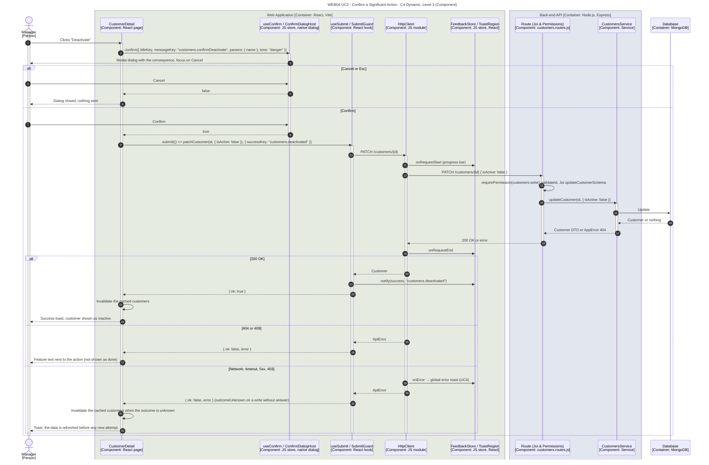

# WEB04 UC2 - Confirm a Significant Action

| Attribute | Value |
|---|---|
| C4 view | Dynamic diagram, Level 3 (Component) |
| SAD view | Process View, Level 3 |
| Containers | Web Application, Back-end API, Database |
| Endpoints | The API route of the action. Example: `PATCH /customers/{id}` with `{ isActive: false }` (deactivate a customer); also `PATCH /stock/{productId}` (stock out or unusual quantity), `DELETE /kitchen-configurations/{id}` |
| Allowed roles | The write permission of the action (example: `customers:write`, MANAGER); the button is only rendered with it (WEB03) |
| Success response | 200 OK; the page shows a success toast ("Customer … deactivated.") and the updated data |
| Error handling | Cancel or Esc: nothing is sent. 404 / 409: feature text next to the action. Network, timeout, 5xx, 403: global toast ([UC4](./recover-from-failure.md)) |
| ADRs | [ADR-0052](../../adr/0052-ui-consistency-and-input-validation-after-the-sprint-2-review.md) |

## Description

Actions with significant consequences ask for confirmation before the request is sent. The dialog says what will happen, in the language of the interface.

| Action (examples) | Page | Dialog |
|---|---|---|
| Deactivate a customer, an allergen, a product, a size, a component type, a predefined pizza, a category | Detail pages of WEB05 | "Deactivate the customer "…"? The data is kept and the customer can be reactivated later." |
| Stock out | Stock adjust form | "Remove N unit(s) of "…"? Current stock: M." |
| Stock movement of 1000 units or more (`UNUSUAL_CHANGE_UNITS`) | Stock adjust form | "The stock of "…" will change from X to Y units. This is far from a usual movement: please confirm the value." ([ADR-0052](../../adr/0052-ui-consistency-and-input-validation-after-the-sprint-2-review.md) D5) |
| Delete a kitchen or assembly line configuration, deactivate a forecast or a supplier scenario | WEB06, WEB07 pages | Name of the item and the consequence |

1. The page calls `useConfirm()` with the title, the message and its parameters, the label of the confirm button and `tone: "danger"`.
2. The `ConfirmStore` queues the request (one dialog at a time) and `ConfirmDialogHost` opens a native `<dialog>` (`showModal`): focus is trapped in it, Cancel is the first button and receives the initial focus, so a destructive action is never the default; Esc cancels.
3. Cancel or Esc resolves `false`: the page stops and nothing is sent.
4. Confirm resolves `true`: the page runs the action with `useSubmit` (one run at a time, as in [UC1](./submit-form.md)); the success is confirmed by a toast, and a failure is shown without presenting the action as done.

## Diagram

See the [README](./README.md) for the error contract, the notation key and the element catalogue.
