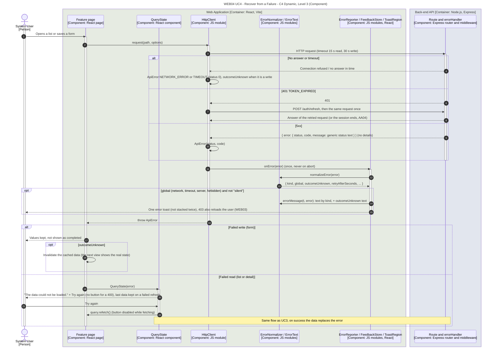

# WEB04 UC4 - Recover from a Failure

| Attribute | Value |
|---|---|
| C4 view | Dynamic diagram, Level 3 (Component) |
| SAD view | Process View, Level 3 |
| Containers | Web Application, Back-end API |
| Endpoints | Any request of the Web Application. Examples: `GET /customers` (read) and `POST /customers` (write) |
| Allowed roles | Any user |
| Success response | The retried request answers 200 and the page shows the data |
| Error handling | This use case is the error handling of the others: network failure, timeout (15 s reads, 30 s writes), 5xx, 403, 429, an expired access token |
| ADRs | [ADR-0055](../../adr/0055-ui-consistency-and-input-validation-after-the-sprint-2-review.md), [ADR-0043](../../adr/0043-secure-session-handling-in-the-api-and-the-spa.md) |

## Description

A request fails. The user must understand what happened without seeing internal details, and must be able to try again safely.

1. **One error type.** The `HttpClient` turns every failure into an `ApiError` with `status`, `code`, `details` (only kept for validation errors), `retryAfterSeconds` (from `Retry-After`) and `outcomeUnknown`. No answer is `NETWORK_ERROR` (status 0) and a request that exceeds its limit is `TIMEOUT`; both are marked `outcomeUnknown` when the request was a write, because it may have been executed. The body of a 5xx carries only the generic status text: the back end never sends `details` or stack traces (`errorHandler`).
2. **Expired session.** A 401 with `TOKEN_EXPIRED` refreshes the access token once (refresh cookie) and repeats the request; if that fails, the session ends and the login page explains it (AA04).
3. **Classification.** `normalizeError` gives the `kind`: `network`, `timeout`, `server` and `forbidden` are global (no form can explain them); the others are explained where the request was made.
4. **Global errors.** The `HttpClient` calls `onError` once per failed request (never for an abort); the `ErrorReporter` turns a global error into one error toast, translated by `kind` ("Could not reach the server. Check your connection.", "The server took too long to respond.", "The server could not complete the request. Please try again later.", "You do not have permission to perform this action."). Identical toasts are not stacked. A 403 also reloads the user, so the menu and the buttons follow the current permissions (WEB03). Requests marked `feedback: "silent"` (for example `GET /auth/me`) never raise a toast.
5. **A failed write.** The form keeps its values and is not shown as completed. When the outcome is unknown, the message adds "The operation may have been completed. Check the current data before trying again." and the page invalidates its cached data, so the next view shows the real state before the user repeats the action.
6. **A failed read.** `QueryState` shows "The data could not be loaded." with **Try again**, which repeats the query (disabled while it runs). A 400 is not retried, because it would fail the same way. When a refresh fails, the last data stays on screen below the error. A 429 adds the waiting time taken from `Retry-After`.

## Diagram

See the [README](./README.md) for the error contract, the notation key and the element catalogue.
