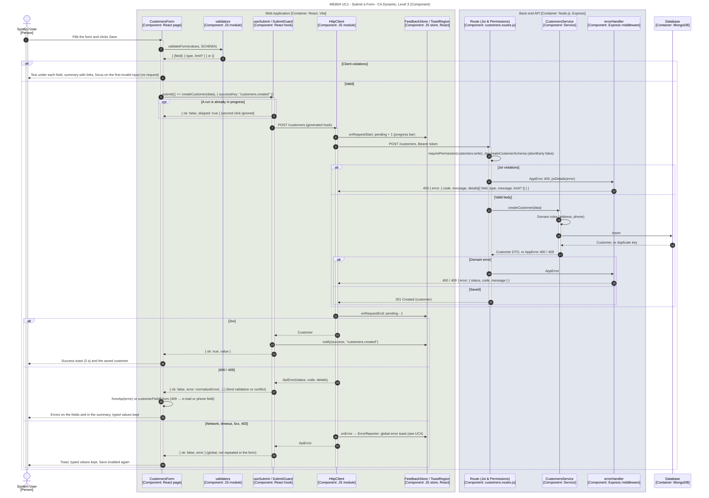

# WEB04 UC1 - Submit a Form

| Attribute | Value |
|---|---|
| C4 view | Dynamic diagram, Level 3 (Component) |
| SAD view | Process View, Level 3 |
| Containers | Web Application, Back-end API, Database |
| Endpoints | The API route of the form. Example: `POST /customers` (create) or `PATCH /customers/{id}` (edit) of the Customers page |
| Allowed roles | The write permission of the form (example: `customers:write`, MANAGER); the form is only rendered with it (WEB03) |
| Success response | 201 Created / 200 OK with the saved resource; the page shows a success toast ("Customer … created.") and the saved data |
| Error handling | Client violations: shown on the fields, no request. 400 `details[{ field, type, message, limit? }]`: shown on the fields and in the summary. 409 (e-mail or phone already in use): shown on the field concerned. 404: feature text. Network, timeout, 5xx, 403: global toast ([UC4](./recover-from-failure.md)). In every failure the typed values are kept |
| ADRs | [ADR-0055](../../adr/0055-ui-consistency-and-input-validation-after-the-sprint-2-review.md), [ADR-0019](../../adr/0019-internationalization-of-the-web-application-%28english-and-portuguese%29.md) |

## Description

The user fills a form and saves it. The Customers form (`customers-form.jsx`) is the example; every form of the SPA uses the same modules.

1. **Client validation.** `validateForm(values, SCHEMA)` applies the rules of each field (for a customer: required name with the person-name pattern, e-mail, Portuguese phone number, address with place names and maximum lengths). Each rule returns `{ type, limit? }`, the same descriptor the API uses. With any violation, `useFieldErrors` stores the map, the first invalid input receives the focus, the text appears under each field (`FieldError`, `aria-invalid`, `aria-describedby`) and in the summary at the top (`FormErrors`, "Please correct the following fields." with links to the inputs). No request is sent.
2. **One submission at a time.** `useSubmit().submit(action, { successKey })` runs the request inside a `SubmitGuard`: a second click while a run is in progress is ignored (`skipped`), and the button is disabled while `submitting`.
3. **Request.** The generated hook (Orval) calls the single `HttpClient`: `onRequestStart` increments the pending counter that drives `GlobalProgress` ([UC3](./wait-for-information.md)); writes have a 30 s timeout.
4. **Back end.** The route checks the permission and validates the body with Joi (`abortEarly: false`); every violation becomes a `details` entry built by `joiDetails` (`field`, `type`, a technical `message` without the submitted value, `limit`), answered as 400 by `errorHandler`. The service then applies the domain rules (for a customer, the address check and the unique e-mail and phone, 409).
5. **Success.** `submit` resolves `{ ok: true }`, the store shows a success toast (3 s, paused on hover or focus), the cached list is invalidated and the page shows the saved data.
6. **Failure.** `normalizeError` turns the `ApiError` into a `kind`. A `validation` error is mapped to the fields (`fromApi`), with the text of `feedback.validation.<type>`; a 409 of the Customers form is mapped to the e-mail or phone field after a search (`customerFieldErrors`). Errors that no form can explain (network, timeout, 5xx, 403) are global: they are reported once as a toast by the `ErrorReporter` ([UC4](./recover-from-failure.md)) and not repeated in the form. The form values are never cleared, and a failed operation is never shown as completed.

## Diagram

See the [README](./README.md) for the error contract, the notation key and the element catalogue.
