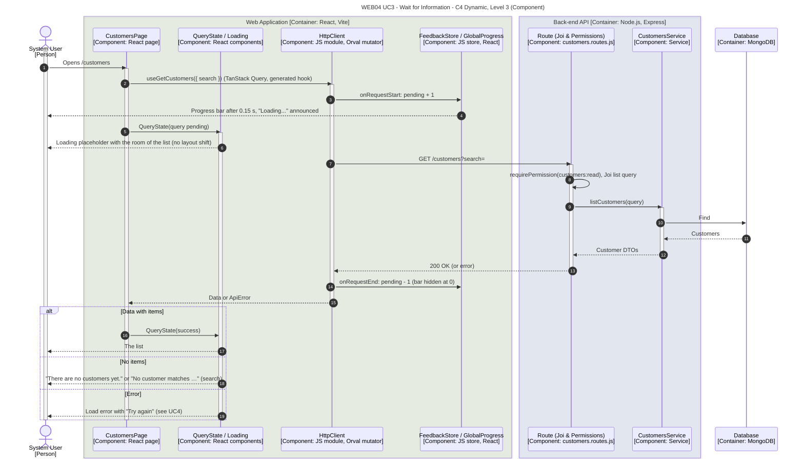

# WEB04 UC3 - Wait for Information

| Attribute | Value |
|---|---|
| C4 view | Dynamic diagram, Level 3 (Component) |
| SAD view | Process View, Level 3 |
| Containers | Web Application, Back-end API, Database |
| Endpoints | The read routes of the page. Example: `GET /customers?search=` of the Customers page |
| Allowed roles | The read permission of the page (example: `customers:read`, MANAGER) |
| Success response | 200 OK with the data; the page shows the list, the empty state ("There are no customers yet.") or "No customer matches "…"." |
| Error handling | Load failure: message with "Try again", the last data kept when a refresh fails ([UC4](./recover-from-failure.md)). Detail not found or invalid id: "This customer does not exist." with a link back to the list |
| ADRs | [ADR-0055](../../adr/0055-ui-consistency-and-input-validation-after-the-sprint-2-review.md) (D2), [ADR-0010](../../adr/0010-generate-dynamic-http-client-with-orval.md) |

## Description

The user opens a page or a list, or a request is in progress.

1. **Global progress.** Every request goes through the single `HttpClient`, whose `onRequestStart` and `onRequestEnd` hooks increment and decrement the pending counter of the `FeedbackStore` (it never goes below zero, so an unbalanced call cannot leave it stuck). `GlobalProgress`, at the top of the layout, shows a thin bar while the counter is above zero, after 0.15 s so that fast requests do not flash, and announces "Loading..." to screen readers (`role="status"`).
2. **Placeholder that keeps the room.** While the query is pending, `QueryState` renders `Loading` with a spinner and "Loading..." in a block of reserved height (`page` 60vh, `region` 16rem), so the layout does not move when the data arrives. While the session is being restored, protected pages show the same placeholder (WEB03).
3. **Data.** When the answer arrives, `QueryState` renders the content, the empty state, or the "no results" text for a search.
4. **Failure.** The error is handled as in [UC4](./recover-from-failure.md).

Buttons that start a write show their own progress (disabled while `submitting`, [UC1](./submit-form.md)); long AI executions show their own progress text (WEB07).

## Diagram

See the [README](./README.md) for the notation key and the element catalogue.
