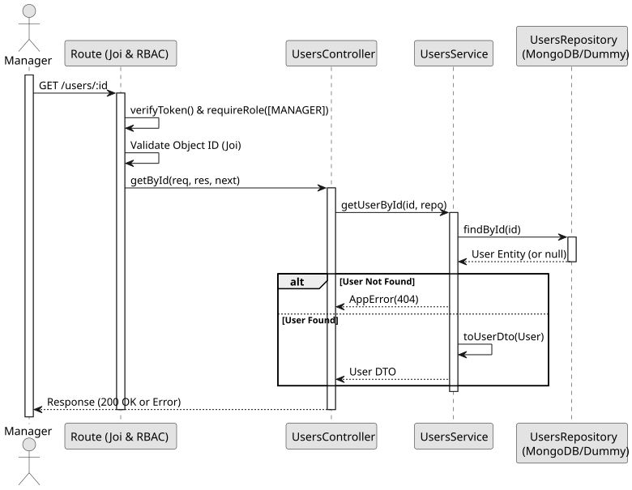

# UC4: View User Details

## Use Case View
**Primary Actor:** LaPrizza Manager  
**Description:** Allows a manager to view the full details of a specific user using their unique identifier.

**Preconditions:**
* The Manager must be authenticated and authorized.
* The provided user ID must conform to the MongoDB ObjectId format.

**Main Success Scenario:**
1. The Manager requests a specific user by ID.
2. The System validates the ID format (Joi).
3. The System retrieves the user from the database.
4. The System maps the raw entity to a safe DTO.
5. The System returns the user details.

**Alternative Flows:**
* *Invalid ID format:* The System throws a 400 Bad Request error.
* *User not found:* The System throws a 404 Not Found error.

**Postconditions:**
* The Manager receives a single User DTO without sensitive data.

## 1. Domain Assumptions
* Users can be queried individually by their unique ID.
* The ID must conform to the MongoDB ObjectId format.
* Only users with the `MANAGER` role can view individual user details.

## 2. Solution Design

## 3. Business Logic Testing Planning
* **Isolation Strategy:** All application tests use dependency injection via isolated in-memory Dummies (`users.dummy.repository.js`), avoiding Mocking libraries entirely.
* **Application Tests (`users.service.test.js`):**
    * `getUserById returns user or throws 404`

## 4. Postman E2E Tests
* **Base Endpoint:** `GET /api/v1/users/:id`
* **Validated Scenarios:**
  * Request without Bearer Token -> `401 Unauthorized`
  * Request with EMPLOYEE Bearer Token -> `403 Forbidden` (RBAC)
  * Request with invalid ID format -> `400 Bad Request` (Joi CastError prevention)
  * Request with non-existent ID -> `404 Not Found`
  * Request with valid ID by MANAGER -> `200 OK`
