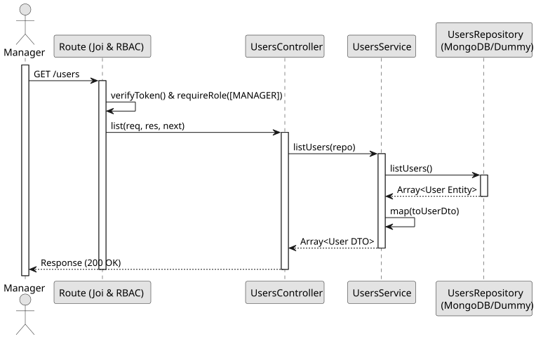

# UC3: List Users

## Use Case View
**Primary Actor:** LaPrizza Manager  
**Description:** Allows a manager to view all registered users in the system.

**Preconditions:**
* The Manager must be authenticated and authorized.

**Main Success Scenario:**
1. The Manager requests the user list.
2. The System queries the database for all user records.
3. The System maps the raw entities to safe Data Transfer Objects (DTOs).
4. The System returns the list of all users, omitting sensitive data like passwords.

**Alternative Flows:**
* *No users found:* The System returns an empty array.

**Postconditions:**
* The Manager receives an array of User DTOs.

## 1. Domain Assumptions
* The system allows listing all users registered in the database.
* To ensure security, sensitive fields (like `password`) are never exposed in the response.
* Only users with the `MANAGER` role can view the user list.

## 2. Solution Design

## 3. Business Logic Testing Planning
* **Isolation Strategy:** All application tests use dependency injection via isolated in-memory Dummies (`users.dummy.repository.js`), avoiding Mocking libraries entirely.
* **Application Tests (`users.service.test.js`):**
    * `listUsers returns array of users from repository`

## 4. Postman E2E Tests
* **Base Endpoint:** `GET /api/v1/users`
* **Validated Scenarios:**
  * Request without Bearer Token -> `401 Unauthorized`
  * Request with EMPLOYEE Bearer Token -> `403 Forbidden` (RBAC)
  * Valid request by MANAGER -> `200 OK` (Returns array of DTOs without passwords)
