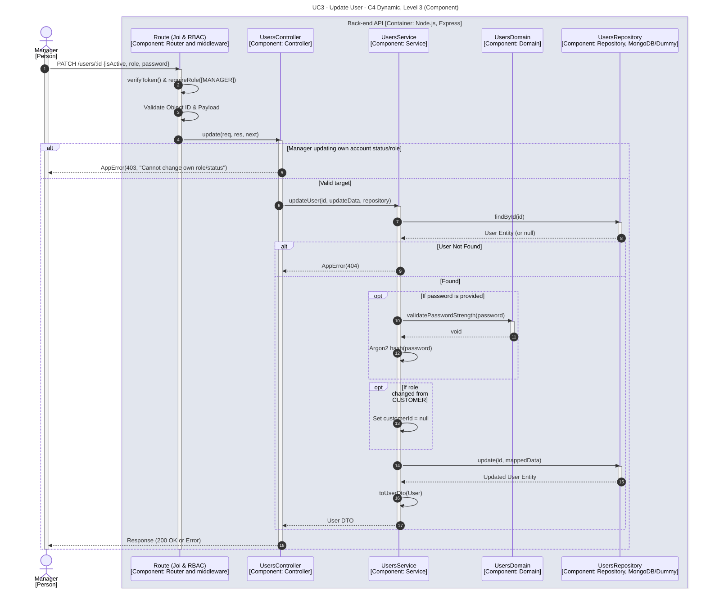

# UC3 - Update User

| Attribute | Value |
|---|---|
| C4 view | Dynamic diagram, Level 3 (Component) |
| SAD view | Process View, Level 3 |
| Container | Back-end API |
| Endpoint | `PATCH /users/:id` |
| Allowed roles | MANAGER |
| Success response | 200 OK |
| Error handling | 403 (manager changing own role or status), 404 (user not found) |

## Description

A Manager partially updates a user (status, role and/or password). A Manager cannot change the status or role of their own account. A new password is validated by the domain and hashed with Argon2, and the customer reference is cleared when the role changes away from CUSTOMER.

## Diagram

See the [README](./README.md) for the notation key and the element catalogue.
