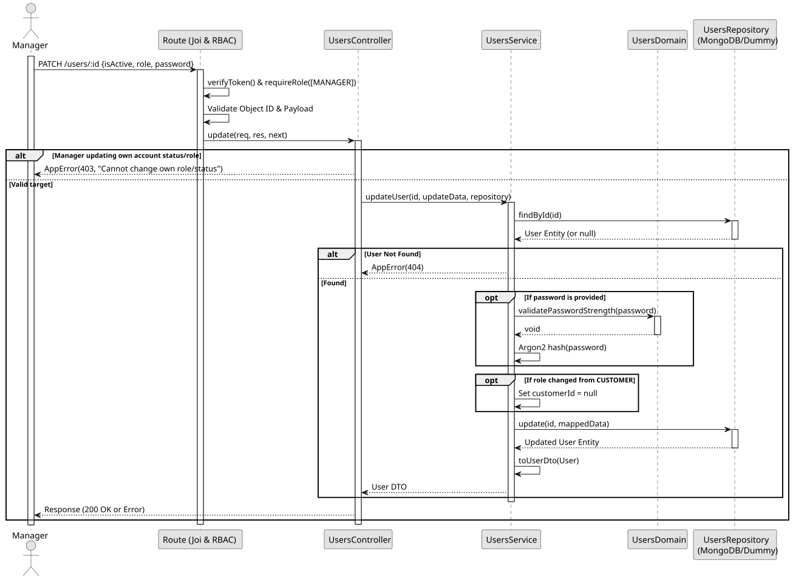

# UC5: Update or Deactivate User

## Use Case View
**Primary Actor:** LaPrizza Manager  
**Description:** Allows a manager to update a user's role, change their password, or logically deactivate their account.

**Preconditions:**
* The Manager must be authenticated and authorized.
* The target user must exist.

**Main Success Scenario:**
1. The Manager provides the user ID and the data to be updated (role, password, or setting `isActive` to false).
2. The System verifies the user exists.
3. The System checks the self-protection rule (a Manager cannot change their own role or deactivate their own account).
4. If a password is provided, the System validates its strength and encrypts it.
5. If the role changes from CUSTOMER to another role, the System nullifies the associated `customerId`.
6. The System persists the changes and returns the updated user record.

**Alternative Flows:**
* *Self-protection rule violated:* The System throws a 403 Forbidden error.
* *User not found:* The System throws a 404 Not Found error.
* *Weak password provided:* The System throws a 400 Bad Request error.

**Postconditions:**
* The targeted user's data is updated in the database. If deactivated, they can no longer authenticate.

## 1. Domain Assumptions
* **Self-protection Rule:** A user with the `MANAGER` role cannot change their own role or deactivate their own account (`isActive: false`);
* If a user's role is updated from `CUSTOMER` to another role, their associated `customerId` is automatically nullified to maintain consistency;
* If a password update is requested, the new password is re-evaluated against NIST rules and securely hashed before persistence.

## 2. Solution Design

## 3. Business Logic Testing Planning
* **Isolation Strategy:** All application tests use dependency injection via isolated in-memory Dummies (`users.dummy.repository.js`), avoiding Mocking libraries entirely.
* **Domain Tests (`users.domain.test.js`):**
    * `Password boundaries and rules`
* **Application Tests (`users.service.test.js`):**
    * `updateUser modifies role, isActive and password securely`
    * `updateUser clears customerId when role changes from CUSTOMER to another role`
    * `updateUser rejects weak passwords`

## 4. Postman E2E Tests
* **Base Endpoint:** `PATCH /api/v1/users/:id`
* **Validated Scenarios:**
  * Request without Bearer Token -> `401 Unauthorized`
  * Request with EMPLOYEE Bearer Token -> `403 Forbidden` (RBAC)
  * Empty JSON payload -> `400 Bad Request` (Requires at least one field to update)
  * Invalid `id` format (CastError prevention) -> `400 Bad Request`
  * Valid update by MANAGER -> `200 OK`