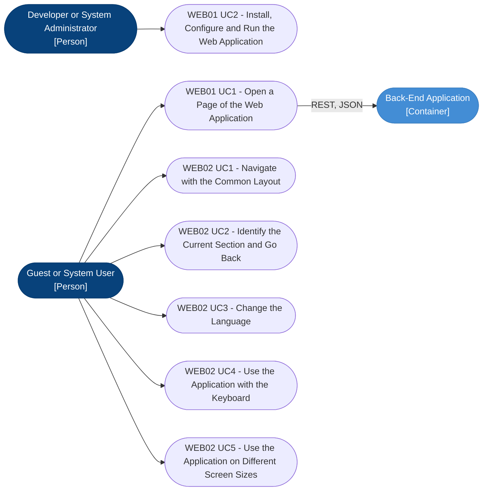
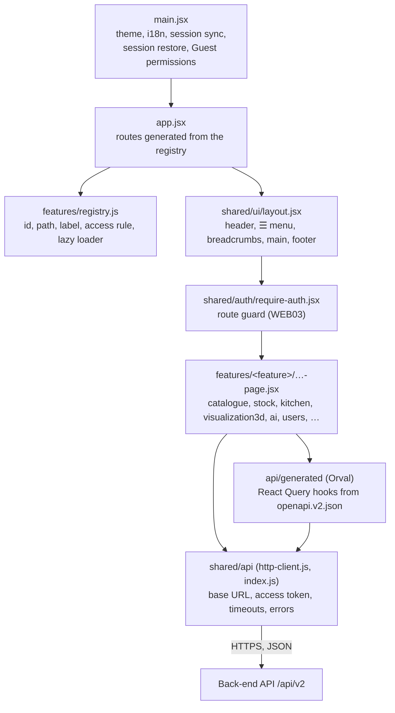
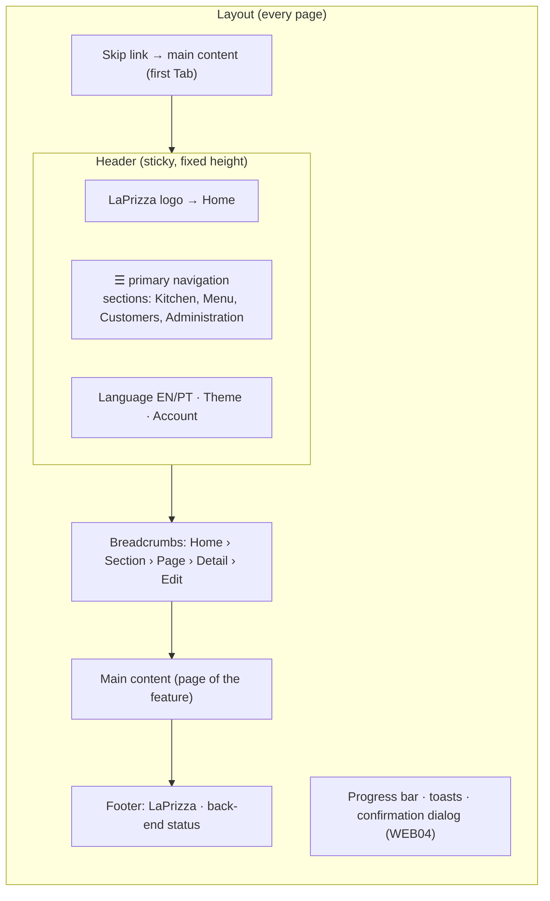

# Web Application - Design Diagrams (Mermaid)

WEB01 and WEB02 define the Web Application itself: one single-page application (SPA) for every role, integrated with the back end (WEB01), with one layout and one navigation structure that every page shares (WEB02). The other WEB user stories build on it: role-based navigation ([WEB03](../role-based-navigation/README.md)), feedback and validation (WEB04, [Use Case Views](../../analysis/use-case-views.md#web04-user-feedback-and-validation)), kitchen configuration and 3D integration ([WEB06](../kitchen-configuration/README.md)) and AI configuration and execution ([WEB07](../ai-planning/README.md)).

Process View (SAD), Level 3, documented as a C4 dynamic diagram of the **Web Application** and **Back-end API** containers. The layout of WEB02 is client-side behaviour, described in [Common layout](#common-layout-web02) without a sequence diagram, as for WEB04.

## Use Cases

The use cases are described in the [Use Case Views](../../analysis/use-case-views.md#web01-spa-setup-and-integration).

## Diagrams

| Use case | Endpoint | Roles | Success | Document |
|---|---|---|---|---|
| [WEB01 UC1 - Open a Page of the Web Application](./open-web-application.md) | Static files of the SPA; then the API routes of the page (for example `GET /products`) | Guest and any authenticated user, as the page allows | The page inside the common layout, with data from the back end | `open-web-application.md` |
| WEB01 UC2 - Install, Configure and Run the Web Application | - | Developer, System Administrator | `npm run dev`, or a build published by the deployment pipeline | [Installation and configuration](#installation-and-configuration-web01), [frontend README](../../../frontend/README.md) |
| WEB02 UC1 to UC5 | - (client-side) | Guest and any authenticated user | - | [Common layout](#common-layout-web02) |

## Structure (WEB01)

The SPA is a React application built with Vite ([ADR-0007](../../adr/0007-web-application-%28spa%29-technology-and-structure.md)). Every page is a **feature** declared in one registry, rendered inside the same layout and calling the back end through the same HTTP client.

| Folder | Contents |
|---|---|
| `src/features/` | One folder per feature (page, its components and its API module); `registry.js` lists them, `navigation.js` builds the menu and the breadcrumbs |
| `src/shared/api/` | The single access point to the REST API: `createHttpClient` with the base URL, the access token, one refresh retry, timeouts and error normalization |
| `src/api/generated/`, `src/api/model/` | Client generated by Orval from `backend/src/api/openapi.v2.json`; its mutator (`orval-mutator.js`) sends every call through `shared/api` |
| `src/shared/auth/` | Session, Guest permissions, route guard, `useCan` (AA04, WEB03) |
| `src/shared/ui/` | Layout, logo, language switcher, theme toggle, breadcrumbs, access-denied and not-found pages, feedback components (WEB04) |
| `src/shared/i18n/` | English and Portuguese dictionaries and the i18next configuration ([ADR-0018](../../adr/0018-internationalization-of-the-web-application-%28english-and-portuguese%29.md)) |
| `src/shared/forms/`, `src/shared/feedback/` | Client-side validation, submit guard, toasts and confirmation dialogs (WEB04) |

A feature is added by creating its folder and one registry entry; no other part of the application changes. The 3D viewer (`/visualization3d`, `/kitchen-configurations`) and the AI pages (`/ai`) are features like any other, so they use the same layout, menu, route guard, session and API client.

## Installation and configuration (WEB01)

| Step | Command |
|---|---|
| Install (Node.js ≥ 22, npm ≥ 10) | `cd frontend && npm ci` |
| Configure | `cp .env.example .env` and adjust it (never committed) |
| Run (development) | `npm run dev` (port `VITE_PORT`, 4200 by default) |
| Build | `npm run build` (output in `dist/`) |
| Check | `npm run lint`, `npm test`, `npm run test:e2e` |
| Regenerate the API client | `npm run generate:api` (after a change to the OpenAPI document) |

| Variable | Purpose | Development | Staging and production |
|---|---|---|---|
| `VITE_API_BASE_URL` | Base URL of the REST API, with the version | `http://localhost:3000/api/v2` | `/api/v2` (same origin, proxied by nginx), set in `WEB_BUILD_ENV` of `deploy-web.conf` |
| `VITE_PORT`, `VITE_ORIGIN` | Development server; the origin must be in `CORS_ORIGIN` of the back end | `4200`, `http://localhost:4200` | Not used (static files served by nginx) |
| `VITE_HTTP_TIMEOUT_MS`, `VITE_HTTP_MUTATION_TIMEOUT_MS` | Timeouts of reads and writes | `.env.example` values | Defaults (15 s and 30 s) |

Every `VITE_*` value is copied into the public JavaScript files, so no secret is ever placed in them. The SPA has no credentials of its own: the access token is kept only in memory and the refresh token in an `HttpOnly` cookie set by the back end (AA04). In staging and production the build is made by `deploy/laprizza-deploy-web.sh`, which runs `npm ci`, lint, tests and the build, and publishes a release with `version.json` ([SYS01](../../sys-admin/automated-deployment/automated-deployment.md), [Production Environment](../../sys-admin/production-environment.md)).

## Common layout (WEB02)

| Element | Behaviour |
|---|---|
| Restaurant identification | The LaPrizza logo is always in the header and links to the home page; the footer repeats the name |
| Primary navigation | The ☰ menu is in the header of every page, grouped in sections (`NAV_GROUPS`) and filtered by the permissions of the session (WEB03). The header is `sticky` and keeps the same height in every state (language, session, theme), so the identification and the menu stay visible while scrolling |
| Current section | The active menu link has `aria-current="page"` and its own style; the breadcrumbs show where the user is and link to every previous level; the last crumb is the current page |
| Return to a starting page | The logo and the first crumb lead to Home; the access-denied and not-found pages have a link to Home; after the login the user returns to the page that was requested |
| Language | English and Portuguese with the same keys; the choice is saved in the browser (`laprizza.language`) and kept across pages and reloads; the first visit follows the browser language, otherwise English; `<html lang>` follows the choice |
| Consistent conventions | Shared button, form, field-error, toast, dialog and loading components; one typeface and one set of colour tokens, in light and dark themes ([ADR-0052](../../adr/0052-ui-consistency-and-input-validation-after-the-sprint-2-review.md)) |
| Keyboard and labels | Skip link to the main content; native links, buttons and radio buttons; the menu button has `aria-expanded` and `aria-controls` and closes with Escape, returning the focus to the button; the navigation, the breadcrumbs and the menu sections have accessible names; form fields have a visible label and are bound to their error text (`fieldProps`: `id`, `aria-invalid`, `aria-describedby`) |
| Screen sizes | Designed for desktop; below 48rem the header is lower and the home page uses one column; below 30rem the controls are smaller and the logo is shown without the name. The menu is behind ☰ at every width, so no section or action is hidden. On short landscape screens (height below 30rem) the header scrolls with the page instead of staying fixed, to leave room for the content |

## Business rules

- **One application for every role.** The same SPA and layout serve Guests, Customers, Employees, Managers and Administrators; what each one sees comes from the permissions returned by the back end (WEB03, AA05), never from separate applications or role names.
- **Business data only from the back end.** Pages read and change data only through the REST API, with the identifiers the back end returns (MongoDB ids, scenario codes); the SPA never creates its own ids nor keeps business data in the browser storage. The browser storage keeps only the language and the theme, never tokens nor business data.
- **One HTTP client.** `shared/api` adds the access token, retries once after a refresh on `401`, applies the timeouts, and turns every failure into an `ApiError` with status and code, translated by WEB04. The Orval client goes through it too.
- **Integrated 3D and AI.** The 3D viewer and the AI pages are features of the registry: same layout, menu, route guard and session; the AI module is reached only through the back end (AI05).
- **Translations are complete.** Every text exists in both languages; tests fail on a missing key or a key used in the code that has no text.

## Acceptance criteria

| US | Criterion | How it is met | Evidence |
|---|---|---|---|
| WEB01 | Single, integrated interface for the different roles | One SPA, one layout; pages and actions filtered by permission | `navigation.test.js`, `web03-role-navigation.spec.js` |
| WEB01 | Appropriate framework, maintainable and extensible structure | React + Vite, feature registry with lazy-loaded pages, shared modules | [ADR-0007](../../adr/0007-web-application-%28spa%29-technology-and-structure.md), `registry.test.js`, `app-routes.test.js` |
| WEB01 | Business information from the back-end services, consistent identifiers | `shared/api` and the Orval client generated from the OpenAPI document | `http-client.test.js`, `orval-mutator.test.js` |
| WEB01 | Reproducible installation, configuration and execution from the repository | `npm ci` with `package-lock.json`, `.env.example`, scripts; same build in the deployment pipeline | [frontend README](../../../frontend/README.md), `deploy/laprizza-deploy-web.sh` |
| WEB01 | 3D viewer and AI keep navigation, authentication and visual identity | Registered as features inside the layout and the route guard | `registry-permissions.test.js`, [WEB06](../kitchen-configuration/README.md), [WEB07](../ai-planning/README.md) |
| WEB01 | Environment configuration documented, no credentials in public files | `VITE_*` table above; no secret in the bundle; tokens in memory and `HttpOnly` cookie | This document, `.env.example`, `.gitignore` |
| WEB02 | Name and logo, primary navigation and main area; identification and navigation always visible | Sticky header with logo and ☰ menu, `main` region | `layout.jsx`, `index.css` |
| WEB02 | Consistent menus, forms, buttons and messages | Shared UI and feedback components | [ADR-0052](../../adr/0052-ui-consistency-and-input-validation-after-the-sprint-2-review.md), `web04-feedback.spec.js` |
| WEB02 | English and Portuguese, language kept during navigation | i18next with the choice saved in the browser | `i18n.test.js`, `used-keys.test.js`, `registry.test.js` |
| WEB02 | Adapts to screen sizes, desktop first, nothing essential hidden | Breakpoints at 48rem and 30rem, menu behind ☰ at every width; the header scrolls away only on short landscape screens | `index.css` |
| WEB02 | Keyboard use and clear labels | Skip link, native controls, Escape closes the menu, labelled navigation and fields | `layout.jsx`, `language-switcher.jsx`, `use-dismiss.js` |
| WEB02 | Identify the current section and return to a starting page | Active menu link, breadcrumbs, logo and Home links | `navigation.test.js` (breadcrumbs) |

## Related ADRs

| ADR | Decision | Status |
|---|---|---|
| [ADR-0007](../../adr/0007-web-application-%28spa%29-technology-and-structure.md) | Web Application (SPA) technology and structure | Accepted, amended |
| [ADR-0009](../../adr/0009-generate-dynamic-http-client-with-orval.md) | Generated HTTP client with Orval | Accepted |
| [ADR-0018](../../adr/0018-internationalization-of-the-web-application-%28english-and-portuguese%29.md) | Internationalization of the Web Application (English and Portuguese) | Accepted |
| [ADR-0029](../../adr/0029-frontend-end-to-end-%28e2e%29-testing-framework.md) | Frontend end-to-end testing framework: Playwright | Accepted |
| [ADR-0032](../../adr/0032-secure-session-handling-in-the-api-and-the-spa.md) | Secure session handling in the API and the SPA | Accepted |
| [ADR-0047](../../adr/0047-permission-driven-navigation-in-the-web-application.md) | Permission-driven navigation in the Web Application | Accepted |
| [ADR-0052](../../adr/0052-ui-consistency-and-input-validation-after-the-sprint-2-review.md) | UI consistency and input validation after the Sprint 2 review | Accepted |

## Notation key

| Notation | Meaning |
|---|---|
| Actor (stick figure) | Person using the system, with the role shown in the label |
| Shaded box "Web Application" | Container (React, Vite) that holds the components of the SPA |
| Shaded box "Back-end API" | Container (Node.js, Express), shown as a whole |
| Participant label | `Name`, followed by `[Type: technology]` |
| Solid arrow | Call or request |
| Dashed arrow | Return value or response |
| Arrow to the same participant | Work done inside that participant |
| Number on an arrow | Order of the interaction (autonumber) |
| `alt` / `else` frame | Alternative flows, only one of them runs |
| `opt` frame | Optional flow |
| `Note` | Reference to another diagram or a remark |

## Element catalogue

| Element | Type | Technology | Responsibility | Used in |
|---|---|---|---|---|
| Guest / System User | Person | - | Person without a session / authenticated user with one or more roles | [WEB01 UC1](./open-web-application.md) |
| Static file server | Component | nginx (staging, production) or the Vite dev server | Serves `index.html` for every SPA path and the hashed JavaScript and CSS files | [WEB01 UC1](./open-web-application.md) |
| Bootstrap | Component | `main.jsx` | Applies the theme, initializes i18n, connects the session sync, restores the session, loads the Guest permissions and renders the router | [WEB01 UC1](./open-web-application.md) |
| App routes | Component | React Router (`app.jsx`) | One route per registry entry inside the layout, wrapped by the route guard when the page needs a session or a permission; catch-all not-found route | [WEB01 UC1](./open-web-application.md) |
| Feature registry | Component | JavaScript module (`registry.js`) | Id, path, label key, menu section, access rule and lazy loader of every page | [WEB01 UC1](./open-web-application.md) |
| Layout | Component | React (`layout.jsx`) | Header with logo, ☰ menu, language, theme and account; breadcrumbs; main region; footer with the back-end status; feedback hosts | [WEB01 UC1](./open-web-application.md), [Common layout](#common-layout-web02) |
| Route guard | Component | React (`require-auth.jsx`, `guard.js`) | `wait`, `login`, `denied` or `allow` for the requested page (WEB03) | [WEB01 UC1](./open-web-application.md) |
| Feature page | Component | React, TanStack Query | The page of the feature; reads and writes data through the API client | [WEB01 UC1](./open-web-application.md) |
| API client | Component | JavaScript module (`shared/api`) | Base URL, access token, refresh retry, timeouts, `ApiError` | [WEB01 UC1](./open-web-application.md) |
| Back-end API | Container | Node.js, Express | REST API `/api/v2`, authorization and business rules | [WEB01 UC1](./open-web-application.md) |

## Notes

- **Known limitation:** on short landscape screens (phones) the header is not sticky, so the menu is reached by scrolling back up; this keeps the content usable on very little height.
- `frontend/README.md` is the installation guide of the repository; this document explains the structure and the decisions.
- Tests:
  - Unit tests with `node:test`: `test/features/registry.test.js` (unique ids and paths, lazy loaders, translated labels), `app-routes.test.js` (catch-all route), `navigation.test.js` (menu sections and breadcrumbs), `test/shared/i18n/i18n.test.js` (same keys and no empty texts in both languages, `pt-PT` → Portuguese, fallback to English), `used-keys.test.js` (every key used in the code exists), `test/shared/api/http-client*.test.js`, `test/api/orval-mutator.test.js`, `test/shared/theme/theme-store.test.js`, `test/health.test.js`.
  - End-to-end (Playwright, [ADR-0029](../../adr/0029-frontend-end-to-end-%28e2e%29-testing-framework.md)): `web03-role-navigation.spec.js` and `web04-feedback.spec.js` use the common layout on every page.
