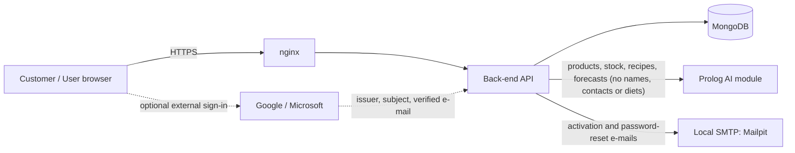

# Personal Data Handling (GDP01, GDP02, GDP03)

This document explains which personal data LaPrizza processes, how it is processed, who is responsible for it, how the data subjects exercise their rights and how a personal data breach is handled. It is the basis of the team's GDPR presentation (`guiao_laprizza_rgpd`). Each processing operation is marked as **implemented** (Sprint 2, with the component that enforces it) or **planned** (required by the business, not yet part of the delivered system).

## 1. Project scope (GDP01)

LaPrizza is a management system for pizza restaurants: a web application, customer and order management, a 3D view of the kitchen and planning with artificial intelligence.

| Area | Core functionality | Who uses it | Status |
|---|---|---|---|
| Catalogue and menu | Products, categories, sizes, allergens, predefined pizzas, public catalogue | Manager (edits), anyone (reads the catalogue) | Implemented |
| Customers | Customer records with contacts, address and dietary restrictions | Manager; a customer reads their own record and creates it if it does not exist | Implemented |
| Orders | Taking, invoicing, preparing and delivering orders | Manager, staff | Planned (order processing is out of the scope of Sprint 2; the AI module uses simulated orders without personal data) |
| Kitchen | Kitchen and assembly line configurations, 3D visualization | Manager, Employee (viewer) | Implemented |
| Stock and planning | Stock levels, consumption forecasts, Bill of Materials, requirements planning and supplier selection (Prolog AI module) | Manager, Employee (stock) | Implemented |
| Accounts and access | Local and external (Google, Microsoft) sign-in, roles, sessions, activation by invitation | Every user; Administrator manages accounts | Implemented |

## 2. Personal data processed (GDP01)

The personal data falls into four groups.

| Group | Data | Where it is stored | Status |
|---|---|---|---|
| **Identification** | Name, e-mail, mobile phone number, postal address | `Customers` collection; e-mail and contact phone of the account in `Users` | Implemented |
| **Health** (special category, GDPR art. 9) | Dietary restrictions: allergies and intolerances, recorded as references to the allergens the customer must avoid | `Customers.dietaryRestrictions` | Implemented; the record of the explicit consent is planned (section 3) |
| **Security** | Password, stored only as an irreversible argon2 hash; or, with an external sign-in, only the identification of the provider (issuer and subject) and the e-mail it confirmed. Session, token and role-change records | `Users`, `External Identities`, `Auth Sessions`, `Password Reset Tokens`, `Activation Invitations`, `Role Changes`, `Login Throttles` | Implemented |
| **Marketing** | Consent to receive marketing communications by e-mail or SMS, always optional, with its date | Customer record | Planned |

Dietary restrictions are health data, because allergies and intolerances reveal information about the customer's health. GDPR forbids processing it by default (art. 9(1)); LaPrizza may only process it with the customer's **explicit consent** (art. 9(2)(a)). The system stores only the list of allergens to avoid: no diagnosis, no reason and no diet labels (halal, kosher, vegetarian). Access is limited to the Manager (`allergens:read`) and to the customer.

Detail of the stored data:

| Data subject | Data | Where it is stored | Purpose | Retention |
|---|---|---|---|---|
| Customer | Name, e-mail, phone number, postal address | `Customers` | Identify and contact the customer; delivery address (orders, planned) | While the customer record exists; erased at the customer's request (section 4) |
| Customer | Dietary restrictions (allergens to avoid) | `Customers.dietaryRestrictions` | Detect incompatible allergens in the products | As above; removed when the consent is withdrawn |
| User (any role) | E-mail, password hash (argon2), roles, account status, activation date, failed-login counter | `Users` | Authentication and authorization (AA01, AA03) | While the account exists |
| User with the Customer role | Contact phone, until a customer record exists | `Users.phoneNumber` | Contact before using the customer features (AA02) | While the account exists |
| User (external sign-in) | Provider, issuer and subject (`sub`) of the identity; the e-mail the provider confirmed | `External Identities` | Link the provider identity to the account (AA02). The provider password is never received | While the account exists |
| User | Session: refresh-token hash, user agent, creation, last use and expiry dates | `Auth Sessions` | Keep the session (AA04) | Deleted automatically at expiry (max. 7 days, TTL index) |
| User | Hash of the e-mail used in failed logins | `Login Throttles` | Slow down password guessing (AA01) | Deleted automatically at expiry (TTL index) |
| User | Hashes of password-reset and activation tokens, invited e-mail | `Password Reset Tokens`, `Activation Invitations` | Single-use links (AA01, AA06/AA07) | Deleted automatically at expiry (TTL index) |
| User | Who changed which role and when | `Role Changes` | Accountability of administrative actions (AA06) | While the account exists |
| User | Security events: event name, user id, session id, e-mail in failed logins, date; never passwords or tokens | Application log (stdout of the service) | Detect unauthorized access and investigate incidents | Rotated with the service logs |
| Any client | Network address of requests refused by the network rules | nginx error log (`access forbidden by rule`) | Deny and log access from unapproved networks (SYS02, SYS03) | Rotated with the nginx logs |

Data that is **not** processed: payment data, identity documents, birth dates, location tracking, analytics or advertising cookies. The only cookies are the session cookie (`lp_rt`, `HttpOnly`) and the short-lived external-login transaction cookie (`lp_oidc`). The back end never writes network addresses to its logs (`security-logger.js`, `request-logger.js`) and the sessions do not store them; the rate limiter uses the address only in memory, for the duration of its window.

## 3. How the data is processed (GDP01)

Processing is any operation on personal data: collecting, consulting, keeping, erasing. LaPrizza has five processing operations.

| Processing | What is done | Data | Legal basis | Status |
|---|---|---|---|---|
| **Account management** | Create the account (Administrator), activate it by invitation, disable it | E-mail, roles, password hash or external identity, account status | Contract (art. 6(1)(b)) | Implemented (AA01, AA02, AA06, AA07) |
| **Customer management** | Keep the contacts and the dietary restrictions, to detect allergens that are incompatible with the customer | Identification, health | Contract; explicit consent for the dietary restrictions (art. 9(2)(a)) | Implemented; the consent record is planned |
| **Orders** | Use name, address, e-mail and phone to invoice, prepare, deliver and contact | Identification | Contract; legal obligation for invoicing (art. 6(1)(c)) | Planned |
| **Marketing** | Send communications by e-mail or SMS only to customers who consented; withdrawing the consent is as easy as giving it (art. 7(3)) | E-mail, phone, consent | Consent (art. 6(1)(a)) | Planned. Activation and sign-in never grant marketing consent (`account-activation.service.js`) |
| **Access records** | Security logs with the actions of the users, never with passwords, to detect unauthorized access | User id, event, date | Legitimate interest in the security of the system (art. 6(1)(f)) | Implemented (`security-logger.js`, AA05) |

- **Processed locally, no third parties.** The SPA, the API, the database, the order management (planned) and the AI module run on the infrastructure operated for LaPrizza, on the virtual machines of the DEI. No third party has access to the personal data. The e-mails go to a local SMTP server (Mailpit, [ADR-0024](../adr/0024-e-mail-delivery-with-nodemailer-and-mailpit.md)) and the postal-code check runs locally.
- **AI module.** The planning snapshot sent to the Prolog module contains products, stock, recipes and forecasts only: no names, contacts or dietary profiles (AI06).
- **External sign-in, the only exception.** When a user chooses "Continue with Google/Microsoft", the provider only confirms the identity. LaPrizza receives the issuer, the subject and the verified e-mail, never the password.
- **Security measures.** HTTPS; passwords hashed with argon2; tokens stored as hashes; permissions checked by the back end on every request (AA03, AA05); revocable sessions limited in time and inactivity (AA04); errors never return internal details; restricted network and SSH access ([SYS03](../sys-admin/allowed-endpoints/allowed-endpoints.md), [SYS05](../sys-admin/ssh-security.md)); backups with restricted access ([SYS08](../sys-admin/backup-strategy/backup-strategy.md)).

## 4. Responsibility and rights of the data subjects (GDP02)

| Role | Entity | Responsibility |
|---|---|---|
| **Controller** | **LaPrizza** (the restaurant) | Decides which data is collected and for what; answers to the data subjects and to the supervisory authority |
| **Processor** | **The development team** | Builds and operates the system on behalf of LaPrizza and only on its instructions, with no purpose of its own for the data (art. 28). Informs LaPrizza without undue delay of any personal data breach on its side (art. 33(2)) |
| Independent controllers | Google, Microsoft | Only for the optional external sign-in that the user chooses to make with them |

**Rights of the data subjects.** In the customer area (`/my-data`) the customer consults the data LaPrizza processes about them (art. 15) and, when the account has no customer record yet, fills it in. Correction (art. 16) and erasure (art. 17) are asked to LaPrizza, which answers **within one month, free of charge** (art. 12(3) and (5)); the Manager corrects or erases the customer record and the Administrator disables the account. **Erased data must not come back through the backups**: when a backup is restored, the erasures completed after it are applied again before the data is used ([SYS08](../sys-admin/backup-strategy/backup-strategy.md)).

## 5. Personal data breach (GDP03)

**Definition.** A breach of security leading to the accidental or unlawful destruction, loss, alteration, unauthorised disclosure of, or access to, personal data (art. 4(12)). Examples: a copy of the `Customers` collection or of a backup leaking (with addresses and allergies); an account with Manager rights used by someone else; customer data deleted without a valid backup.

**When the breach is likely to result in a high risk to the customers' rights and freedoms, three steps:**

1. **Contain.** The compromised accounts are disabled at once (Administrator; disabling revokes their sessions), the sessions are ended (`logout-all`) and the exposed secrets are rotated. If the breach is on the side of the team, the team informs LaPrizza without undue delay.
2. **Notify the supervisory authority.** LaPrizza notifies the **CNPD** (Comissão Nacional de Proteção de Dados) without undue delay and, where feasible, **within 72 hours** of becoming aware of it (art. 33). A later notification must explain the delay. Content: nature of the breach, categories and approximate number of data subjects and records, contact point, likely consequences, measures taken or proposed.
3. **Inform the customers.** Because the risk is high, LaPrizza also informs the affected customers without undue delay (art. 34), in clear and plain language: what happened, the contact point for more information, the likely consequences and the measures taken, including what they can do (for example change the password).

Informing the customers is not required when the data was made unintelligible (for example password hashes), when later measures make the high risk no longer likely, or when it would involve disproportionate effort (then a public communication is used). Every breach, notified or not, is recorded internally with its facts, effects and remedial action (art. 33(5)); the data involved is assessed with the tables of section 2, and the data is restored from backup if needed (SYS08).

## 6. Implementation status

| Item | Status | Where |
|---|---|---|
| Identification and security data, account management, access records | Implemented | `Users`, `Customers`, `security-logger.js`, AA01 to AA07 |
| Customer area: consult the own data and create the customer record | Implemented | `GET`/`POST /customers/me`, My data page |
| Explicit consent for the dietary restrictions (recorded with its date, withdrawable) | Planned | Customer record and forms |
| Marketing consent and communications | Planned | - |
| Order processing | Planned | Out of the scope of Sprint 2 |
| Requests for correction and erasure in the customer area | Through LaPrizza (contact); no in-app request yet | My data shows how to contact LaPrizza |
| Erasures re-applied after a backup restore | Planned | SYS08 |

## Related

- [ADR 0043 - Secure session handling](../adr/0043-secure-session-handling-in-the-api-and-the-spa.md)
- [Operational risk assessment](../sys-admin/operational-risk-assessment.md)
- [HTTPS](../sys-admin/https.md)
