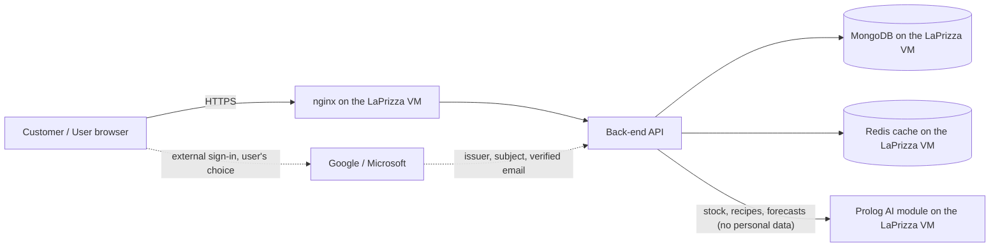

# Personal Data Handling (GDP01, GDP02, GDP03)

This document explains which personal data the LaPrizza integrated system processes, how and where it is processed, who is responsible for it, and how a personal data breach is handled. It describes the code as implemented; every statement below points to the component that enforces it.

## 1. Project scope (GDP01)

LaPrizza is a pizza restaurant. The integrated system supports its daily operation:

| Area | Core functionality | Who uses it |
|---|---|---|
| Catalogue and menu | Products, categories, sizes, allergens, predefined pizzas, public catalogue | Manager (edits), anyone (reads the catalogue) |
| Customers | Customer records with contacts, address and dietary restrictions | Manager; a customer reads their own record |
| Stock and planning | Stock levels, consumption forecasts, Bill of Materials, requirements planning and supplier selection (Prolog AI module) | Manager, Employee (stock) |
| Kitchen | Kitchen and assembly line configurations, 3D visualization | Manager |
| Accounts and access | Local and external (Google, Microsoft) sign-in, roles, sessions, account activation | Every user; Administrator manages accounts |

## 2. Personal data processed (GDP01)

| Data subject | Data | Where it is stored | Purpose | Retention |
|---|---|---|---|---|
| Customer | Name, email, phone number, postal address | `Customers` collection | Identify and contact the customer, delivery address | While the customer record is active |
| Customer | Dietary restrictions: references to allergens the customer wants to avoid | `Customers.dietaryRestrictions` | Warn about products with those allergens | While the customer record is active |
| User (any role) | Email, password hash (argon2), roles, account status, activation date, failed-login counter | `Users` collection | Authentication and authorization (AA01, AA03) | While the account exists |
| User (external sign-in) | Provider, issuer and subject (`sub`) of the identity; the email the provider confirmed | `External Identities` | Link the provider identity to the account (AA02). The provider password is never received | While the account exists |
| User (external sign-in) | Contact phone, until a customer record exists | `Users.phoneNumber` | Contact before using customer features (AA02) | While the account exists |
| User | Session: refresh-token hash, user agent, creation, last use and expiry dates | `Auth Sessions` | Keep the session (AA04) | Deleted automatically at expiry (max. 7 days, TTL index) |
| User | Hash of the email used in failed logins | `Login Throttles` | Slow down password guessing (AA01) | Deleted automatically at expiry (TTL index) |
| User | Hashes of password-reset and activation tokens, invited email | `Password Reset Tokens`, `Activation Invitations` | Single-use links (AA01, AA06/AA07) | Deleted automatically at expiry (TTL index) |
| User | Who changed which role and when | `Role Changes` | Accountability of administrative actions (AA06) | While the account exists |
| User | Security events: event name, user id, session id, email in failed logins, date | Application log (stdout of the service) | Detect attacks and investigate incidents | Rotated with the service logs |

Data that is **not** processed:

- **No IP address is retained.** The security logger drops every network-address field (`security-logger.js`), sessions do not store the client IP (`auth.service.js`), the API access log has no client address, user agent or query string (`request-logger.js`), and nginx writes its access log with a format without the IP (`deploy/nginx/laprizza.conf`, `laprizza_no_ip`). The rate limiter uses the IP only in memory, for the duration of its window.
- No payment data, no identity documents, no birth dates, no location tracking, no cookies for analytics or advertising. The only cookies are the session cookie (`lp_rt`, `HttpOnly`) and the short-lived external-login transaction cookie (`lp_oidc`).
- **No religious, cultural or health information can be identified from the dietary data.** A customer's dietary restrictions are only a list of allergens (from the closed list managed by the restaurant, e.g. gluten, lactose) that the customer chooses to avoid. The system stores no reason for the choice, no diagnosis or medical condition, and no diet labels (such as halal, kosher or vegetarian). Ingredient preferences of orders are not linked to a cultural or religious category. Access to this field is limited to the Manager (`allergens:read`) and to the customer.

## 3. How the data is processed (GDP01)

- **Only on LaPrizza machines.** The SPA, the API, MongoDB, Redis, the Prolog module and the backups run on the virtual machines assigned to LaPrizza (DEI cloud). No personal data is sent to third-party processors: activation and password-reset emails go through the SMTP server configured on the LaPrizza VM (`SMTP_HOST`, a local relay), and the postal-code check runs locally. If an external email service is ever configured, it becomes a processor and needs a contract under GDPR art. 28.
- **AI module.** The planning snapshot sent to the Prolog module contains products, stock, recipes and forecasts only (no customer names, contacts or dietary profiles, see AI06).
- **External identity providers.** When a user chooses "Continue with Google/Microsoft", the authentication happens at the provider, under the user's own relationship with it. LaPrizza receives only the issuer, the subject and the verified email.
- **Security measures.** HTTPS only (`docs/sys-admin/https.md`); passwords hashed with argon2; tokens stored as hashes; role-based access checked by the back end on every request (AA03/AA05); sessions revocable and limited in time and inactivity (AA04); API errors never return internal details; restricted network and SSH access (`allowed-endpoints.md`, `ssh-security.md`); backups with restricted access (SYS08).
- **Rights of the data subject.** The customer can read their own data (`/my-data`); correction and deletion are made by the Manager on request (customer record deactivated, user account disabled by the Administrator).

## 4. Responsibility for the processing (GDP02)

| Role | Entity | Responsibility |
|---|---|---|
| **Controller** | **LaPrizza** (the restaurant) | Decides why and how the data is processed; answers to the data subjects and to the supervisory authority |
| Processors | None external | The system runs on LaPrizza's own infrastructure; the development team builds and operates it on behalf of LaPrizza and has no purpose of its own for the data |
| Independent controllers | Google, Microsoft | Only for the sign-in that the user chooses to make with them |

## 5. Personal data breach (GDP03)

**Definition.** A breach of security leading to the accidental or unlawful destruction, loss, alteration, unauthorised disclosure of, or access to, personal data (GDPR, art. 4(12)). Examples here: a copy of the `Customers` collection or of a backup leaking; an account with Manager rights used by someone else; customer data deleted without a valid backup.

**Notification when the breach is likely to result in a high risk to the customers' rights and freedoms:**

| To whom | When | Content |
|---|---|---|
| Supervisory authority: **CNPD** (Comissão Nacional de Proteção de Dados) | Without undue delay and, where feasible, **within 72 hours** of becoming aware of it (art. 33); a later notification must explain the delay | Nature of the breach, categories and approximate number of data subjects and records; contact of the person responsible (DPO or contact point); likely consequences; measures taken or proposed, including mitigation |
| **The affected customers** | **Without undue delay** (art. 34) | In clear and plain language: what happened, contact point, likely consequences, measures taken and what they can do (e.g. change the password) |

Communication to the customers is not required when the data was protected so that it is unintelligible (e.g. password hashes), when later measures make the high risk no longer likely, or when it would involve disproportionate effort (then a public communication is used). Every breach, notified or not, is recorded internally with its facts, effects and remedial action (art. 33(5)).

**Response steps:** contain (revoke sessions with `logout-all`, disable accounts, rotate secrets), assess the risk from the data involved (table in section 2), notify as above, restore from backup if needed (SYS08) and record the incident.

## Related

- [ADR 0032 - Secure session handling](../adr/0032-secure-session-handling-in-the-api-and-the-spa.md)
- [Operational risk assessment](../sys-admin/operational-risk-assessment.md)
- [HTTPS](../sys-admin/https.md)
