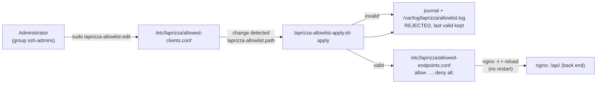
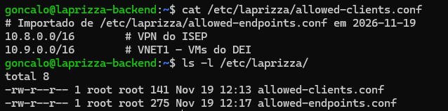
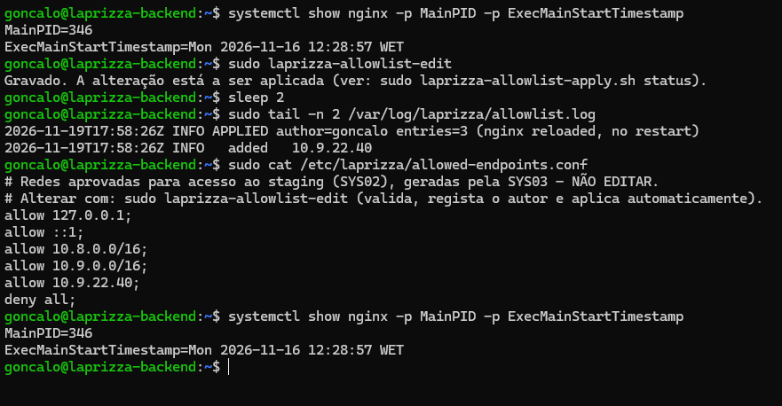
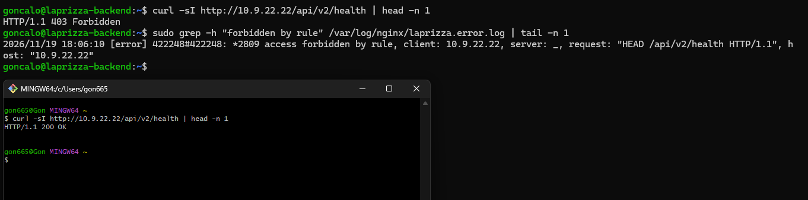
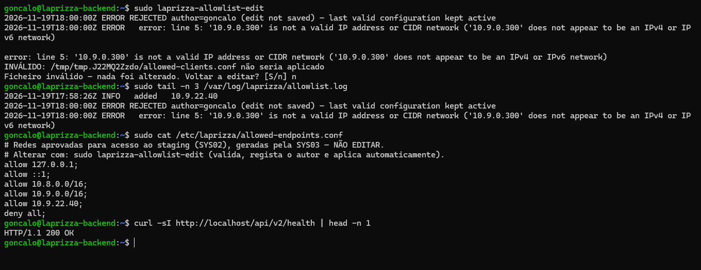
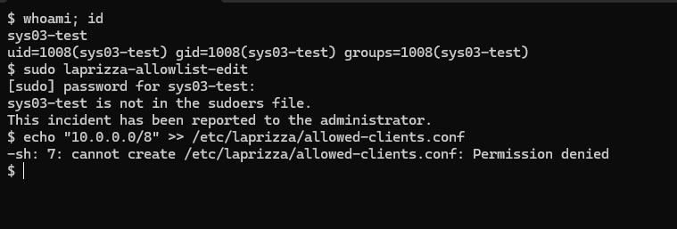
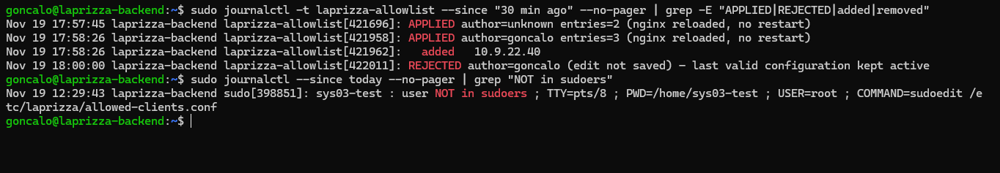

# SYS03 – Configurable Allowed Endpoints

Requirement: a simple configuration file for allowed client endpoints; valid changes are applied without restarting the system; invalid changes are detected and logged while the last valid configuration stays active; only authorized administrators can change the file, and those changes are recorded (Sprint 2 User Stories v1.0, p. 20).

SYS03 builds on SYS02. SYS02 restricts the staging back-end VM (`laprizza-backend`, where nginx exposes the REST API under `/api/`) to the approved networks with nginx `allow`/`deny` rules in `/etc/laprizza/allowed-endpoints.conf`, included by the site (`/etc/nginx/sites-available/laprizza`). SYS03 does not add a second set of rules: that file is now **generated** from a simpler file that administrators edit, and every change is validated, applied without a restart, restricted to administrators and recorded.

SYS03 applies only to staging. Production is public through `vs-gate` and has no allowlist ([Production Environment](../production-environment.md)).

Decisions: [ADR-0050 – Network Restriction at the nginx Reverse Proxy](../../adr/0050-network-restriction-at-the-nginx-reverse-proxy.md), which keeps the rules in their own file so the list can be maintained separately.

## Overview



| Item | Value |
|---|---|
| Configuration file | `/etc/laprizza/allowed-clients.conf` (`root:root`, `644`) |
| Generated nginx rules (SYS02 file) | `/etc/laprizza/allowed-endpoints.conf` (generated, do not edit) |
| Apply script | `/opt/laprizza/bin/laprizza-allowlist-apply.sh` (`deploy/allowlist/` in the repository) |
| Automatic application | `laprizza-allowlist.path` → `laprizza-allowlist.service` (systemd) |
| Change log | `/var/log/laprizza/allowlist.log` and the journal (`-t laprizza-allowlist`) |
| Last valid configuration | `/var/lib/laprizza/allowlist/last-valid.conf` |
| Who may change it | members of `ssh-admins` (same group as SYS05), only with `sudo laprizza-allowlist-edit` |

## Configuration file format

```text
# Comment until the end of the line
10.8.0.0/16      # VPN do ISEP
10.9.0.0/16      # VNET1 – VMs do DEI
10.9.22.40       # single host
2001:db8::/32    # IPv6 network
```

| Rule | Example of an invalid line |
|---|---|
| One IPv4/IPv6 address or CIDR network per line | `10.8.0.0 10.9.0.0` |
| Must be a valid address / prefix | `10.9.0.300`, `10.8.0.0/33`, `localhost` |
| CIDR networks must be aligned | `10.8.3.1/16` (use `10.8.0.0/16`) |
| Catch-all networks are refused | `0.0.0.0/0`, `::/0` |
| At least one entry | a file with only comments |
| `#` starts a comment; empty lines are ignored | – |
| Repeated entries are ignored with a warning | – |

`127.0.0.1` and `::1` are always allowed, so the local deployment and health checks keep working. Any client not listed receives `403 Forbidden`, and nginx records the refusal in `/var/log/nginx/laprizza.error.log` (`access forbidden by rule, client: …`).

## Changing the allowed clients

```bash
sudo laprizza-allowlist-edit                               # edit, validate and save
sudo /opt/laprizza/bin/laprizza-allowlist-apply.sh status  # active rules and last changes
```

Optional check of a draft before saving it:

```bash
/opt/laprizza/bin/laprizza-allowlist-apply.sh check ~/draft.conf
```

When the file is saved, systemd starts `laprizza-allowlist.service`, which:

1. validates every line (with the line number in each error);
2. if **invalid**: records `REJECTED` and the errors, and changes nothing. The nginx rules generated from the last valid file stay active;
3. if **valid**: generates the nginx rules, checks them with `nginx -t` and runs `systemctl reload nginx`. A reload loads the new rules without restarting nginx or dropping open connections; the back end is not touched. If `nginx -t` or the reload fails, the previous rules are restored and the change is recorded as `REJECTED`;
4. records `APPLIED` (or `UNCHANGED`) with the author and the added / removed entries.

## Authorization and change records

* The file belongs to `root` and is not writable by anyone else.
* `/etc/sudoers.d/laprizza-allowlist` lets only the `ssh-admins` group run `/usr/local/sbin/laprizza-allowlist-edit` (and the `status` command). Other users get `… is not in the sudoers file. This incident has been reported to the administrator.`, and sudo logs the attempt.
* `laprizza-allowlist-edit` copies the file to a private temporary folder and opens it with the administrator's own account (never as root, so the editor cannot be used to get a root shell). When the editor closes, the copy is validated: an invalid copy is not saved, its errors are shown and `REJECTED author=<user>` is recorded; a valid copy replaces the file and the systemd path unit applies it.
* The author is `$SUDO_USER`, set by sudo and not by the user. Administrative accounts are individual (SYS05), so the author is always a person. (On the staging VM sudo records denied attempts but not allowed commands, and `auditd` cannot run because the DEI virtual server is a container, so the author is recorded by the edit command itself.)

| Record | Command |
|---|---|
| Applied / rejected changes, author and diff | `sudo tail -n 30 /var/log/laprizza/allowlist.log` or `journalctl -t laprizza-allowlist` |
| Who wrote the file (audit, where `auditd` runs) | `sudo ausearch -k laprizza-allowlist -i` |
| Refused attempts (users outside `ssh-admins`) | `sudo journalctl --since today \| grep 'NOT in sudoers'` |
| Clients refused by nginx | `sudo grep 'forbidden by rule' /var/log/nginx/laprizza.error.log` |

Example of `allowlist.log`:

```text
2026-11-19T11:42:07Z INFO APPLIED author=goncalo entries=3 (nginx reloaded, no restart)
2026-11-19T11:42:07Z INFO   added   10.9.22.40
2026-11-19T11:45:31Z ERROR REJECTED author=goncalo file=/etc/laprizza/allowed-clients.conf – last valid configuration kept active
2026-11-19T11:45:31Z ERROR   error: line 3: '10.9.0.300' is not a valid IP address or CIDR network (…)
```

## Installation (back-end VM `laprizza-backend`, once)

```bash
cd /opt/laprizza/repo && git pull
sudo ./deploy/allowlist/install.sh    # idempotent
```

The script installs the apply script, the edit command (`/usr/local/sbin/laprizza-allowlist-edit`), the example configuration (only if none exists), the sudoers rule and the systemd units, and applies the file once. It also installs an `auditd` rule when `auditd` is available; on the staging VM it is not (the DEI virtual server is a container), so the author comes from the edit command, as described above. The nginx site already includes `/etc/laprizza/allowed-endpoints.conf` (SYS02); `deploy/nginx/laprizza.conf` in the repository now mirrors that line.

## Migration from the SYS02 file

`install.sh` converts the existing `allow …;` lines of `/etc/laprizza/allowed-endpoints.conf` into `/etc/laprizza/allowed-clients.conf` (`laprizza-allowlist-apply.sh import`), keeps a copy of the original in `/var/lib/laprizza/allowlist/allowed-endpoints.conf.sys02-original`, and regenerates the same rules. From then on `allowed-endpoints.conf` must not be edited by hand.

| SYS02 (before) | SYS03 (after) |
|---|---|
| `allow 127.0.0.1;` | always added by the script |
| `allow 10.8.0.0/16;  # VPN do ISEP` | `10.8.0.0/16  # VPN do ISEP` |
| `allow 10.9.0.0/16;  # VNET1 – VMs do DEI` | `10.9.0.0/16  # VNET1 – VMs do DEI` |
| `deny all;` | always added by the script |

## Tests

`bash deploy/allowlist/test/test-allowlist.sh` runs the validation and application rules without root or nginx (24 checks: valid file, invalid lines, catch-all networks, empty file, duplicates, unchanged file, added / removed entries, `nginx -t` failure with rollback, import of the SYS02 file).

## Evidence

Screenshots in `docs/sys-admin/allowed-endpoints/img/sys03/`.

| # | Acceptance criterion | Evidence | How to obtain it |
|---|---|---|---|
| 1 | Simple configuration-file format |  | `cat /etc/laprizza/allowed-clients.conf` |
| 2 | Valid change applied without restarting |  | Note `systemctl show nginx -p ExecMainStartTimestamp`; add an entry with `sudo laprizza-allowlist-edit`; show `tail allowlist.log` (APPLIED, added) and the same `ExecMainStartTimestamp` (nginx was not restarted) |
| 3 | Rule in effect |  | After removing `10.9.0.0/16`: `curl -I http://10.9.22.22/api/v2/health` on the VM (source 10.9.22.22) → 403 and the `forbidden by rule` line in `laprizza.error.log`; from a PC on the VPN (10.8.0.0/16) the same request → 200 |
| 4 | Invalid change detected, logged, last valid kept |  | With `sudo laprizza-allowlist-edit` add `10.9.0.300` and answer `n`; show `allowlist.log` (REJECTED, line number), `cat /etc/laprizza/allowed-endpoints.conf` unchanged, and `curl -I http://localhost/api/v2/health` still 200 |
| 5 | Only authorized administrators can change it |  | As a user outside `ssh-admins`: `sudo laprizza-allowlist-edit` → refused; `echo x >> /etc/laprizza/allowed-clients.conf` → Permission denied |
| 6 | Changes are recorded |  | `sudo journalctl -t laprizza-allowlist` (APPLIED / REJECTED with `author=`) and `sudo journalctl --since today \| grep 'NOT in sudoers'` (refused user) |

## Traceability

| Acceptance criterion | Where |
|---|---|
| Document a simple configuration-file format | This document, `deploy/allowlist/allowed-clients.conf.example` |
| Apply valid changes without restarting the system | `laprizza-allowlist.path`, `nginx -t` + `systemctl reload nginx` in `laprizza-allowlist-apply.sh`; evidence 2 and 3 |
| Detect and log invalid changes, keeping the last valid configuration active | `validate()` and `REJECTED` in `laprizza-allowlist-apply.sh`, `test-allowlist.sh`; evidence 4 |
| Only authorized administrators change the configuration | `root:root 644`, `sudoers-laprizza-allowlist` (`ssh-admins`), `laprizza-allowlist-edit`; evidence 5 |
| Record those changes | `allowlist.log` and journal, author from `$SUDO_USER` in `laprizza-allowlist-edit`; evidence 6 |

## Known limitations

| Item | Impact | Mitigation |
|---|---|---|
| Only the HTTP rules (nginx) are generated | The SSH rules of SYS02 (`AllowUsers` in `/etc/ssh/sshd_config.d/99-laprizza.conf`) keep their own copy of the networks ([ADR-0051](../../adr/0051-ssh-restricted-to-approved-networks-with-allowusers.md)) | Change both when a network is added or removed; SSH changes need `sudo sshd -t && sudo systemctl reload ssh` |
| The author is recorded by `laprizza-allowlist-edit` | A change made as `root` without the edit command is still validated and applied, but recorded as `author=unknown` | Administrators use individual accounts and the edit command (SYS05); `root` login is disabled (SYS02) |
| `auditd` does not run on the staging VM | No kernel-level record of who wrote the file | The edit command, the change log and the sudo refusals in the journal |
| `10.9.0.0/16` still allows every DEI virtual server | Other teams' VMs could reach the API (authentication still applies) | Narrow the list to the team's VMs with `laprizza-allowlist-edit` when their addresses are stable (SYS02) |

## Related

- [SYS02 – Institutional Network Access Restriction](../network-access-restriction/network-access-restriction.md): the nginx site that includes the generated rules, and the SSH rules.
- [SYS05 – SSH Security and Access Control](../ssh-security.md): the `ssh-admins` group and the individual administrative accounts.
- [Production Environment](../production-environment.md): production is public and does not install the allowlist.
