# SYS01 – Automated Deployment and Validation

Requirement: a repeatable deployment pipeline for a system module in a controlled DEI environment; validation based on the project test plan; deployment logs and test results archived; configurable schedule; a failed validation never presented as a successful deployment; identifiable deployed version and configuration, with a documented recovery to a previously working version; sensitive configuration kept apart from published source and deployment logs (Sprint 2 User Stories v1.0, p. 19).

The deployed module is the **back end** (`backend/`, Node.js + Express). It runs on the staging VM `laprizza-backend` and uses the MongoDB server of the DEI (`10.9.22.16`). The same model was later reused for the front end (`deploy/laprizza-deploy-web.sh`) and for production (`DEPLOY_TAG`, see [production-environment.md](../production-environment.md)).

Decisions: [ADR-0034 – Pull-Based Deployment from the Staging VM](../../adr/0034-pull-based-deployment-from-the-staging-vm.md) and [ADR-0035 – Release Directories and systemd instead of Containers](../../adr/0035-release-directories-and-systemd-instead-of-containers.md).

## Overview

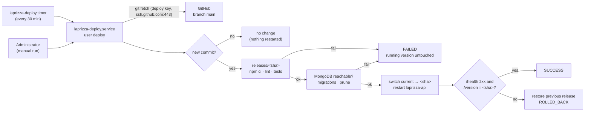

| Item                                | Value                                                                                                 |
| ----------------------------------- | ----------------------------------------------------------------------------------------------------- |
| Environment                         | DEI virtual server `vs534` (`laprizza-backend`, `10.9.22.22`), Ubuntu 24.04 LXD container, Node.js 24 |
| Pipeline script                     | `/opt/laprizza/bin/laprizza-deploy.sh` (`deploy/laprizza-deploy.sh` in the repository)                |
| Pipeline configuration (no secrets) | `/opt/laprizza/deploy.conf` (`deploy/deploy.conf.example`)                                            |
| Schedule                            | `laprizza-deploy.timer` → `laprizza-deploy.service` (`deploy/systemd/`)                               |
| Releases                            | `/opt/laprizza/releases/<sha>/`; the running one is the symlink `/opt/laprizza/current`               |
| Application service                 | `laprizza-api.service` (`WorkingDirectory=/opt/laprizza/current`, user `deploy`)                      |
| Secrets                             | `/opt/laprizza/.env` (`deploy:deploy`, `600`), outside the repository and the releases                |
| Logs and test results               | `/var/log/laprizza/deploys/<timestamp>-<action>-<sha>/` and `/var/log/laprizza/deploys/history.log`   |
| Version endpoint                    | `GET /api/v2/version` (`VERSION.json` written by the pipeline) and `GET /api/v2/health`               |

## Controlled, reproducible environment

- **Dedicated account.** The pipeline and the API run as `deploy`, a system account without password and without general `sudo`. Its only privilege is `/etc/sudoers.d/deploy-laprizza`: `systemctl restart|status|is-active laprizza-api`.
- **Reproducible build.** Each release is extracted from the exact commit with `git archive` (no local changes, no untracked files) and its dependencies are installed with `npm ci` from `package-lock.json`. Development dependencies are removed with `npm prune --omit=dev` before the release is activated.
- **Isolation.** Each release has its own folder; activating one only changes the `current` symlink (atomic `mv -T`). The API listens on `127.0.0.1:3000` behind nginx (SYS02).
- **Pinned runtime.** Node.js 24 (NodeSource), compatible with the project requirement `"engines": { "node": ">=22" }`.
- **One run at a time.** The script takes a lock (`flock /opt/laprizza/.deploy.lock`); a second run exits without doing anything.

## Pipeline steps

| #   | Step                                                                                                    | Log file                                             | On failure                                  |
| --- | ------------------------------------------------------------------------------------------------------- | ---------------------------------------------------- | ------------------------------------------- |
| 1   | `git fetch` of the configured branch (`DEPLOY_BRANCH`, default `main`)                                  | journal (`journalctl -u laprizza-deploy`) and `history.log`                                            | `FETCH_FAILED`; nothing changes             |
| 2   | Same commit already running → stop                                                                      | journal only                                         | no restart, no record                       |
| 3   | Extract `backend/` into `releases/<sha>/`, write `VERSION.json` (sha, branch, commit date, deploy date) | `run.log`                                            | `FAILED`                                    |
| 4   | `npm ci`                                                                                                | `npm-ci.log`                                         | `FAILED`, release removed                   |
| 5   | `npm run lint`                                                                                          | `lint.log`                                           | `FAILED`, release removed                   |
| 6   | `npm test` (Node test runner)                                                                           | `tests.log` (per-test results and pass/fail summary) | `FAILED`, release removed                   |
| 7   | MongoDB reachable (`nc -z 10.9.22.16 27017`)                                                            | `run.log`                                            | `DB_UNAVAILABLE`; running version untouched |
| 8   | `npm run migrate:up` with `/opt/laprizza/.env`                                                          | `migrations.log`                                     | `FAILED`                                    |
| 9   | `npm prune --omit=dev`                                                                                  | `prune.log`                                          | `FAILED`                                    |
| 10  | Switch `current`, `systemctl restart laprizza-api`                                                      | `run.log`                                            | automatic rollback                          |
| 11  | Health check: `/api/v2/health` 2xx **and** `/api/v2/version` contains the new sha, within 60 s          | `run.log`                                            | automatic rollback (`ROLLED_BACK`)          |
| 12  | Keep the last 5 releases (always the current and the previous one)                                      | `run.log`                                            | –                                           |

Validation (steps 4–6 and 11) follows the project test plan ([Project Test Plan](../test-plan.md)). The tests run **before** the staging variables are loaded, so they never touch the staging database.

## Outcomes and records

Every run that finds a new commit creates its own folder and appends one line to `history.log`; a `FETCH_FAILED` run only appends the line.

```text
20261106-094702  deploy    main  b8b1eb5  FAILED
20261106-104357  deploy    main  0ec4bfa  ROLLED_BACK
20261106-110239  deploy    main  de97ffe  SUCCESS
20261105-151210  rollback  main  db42ce9  SUCCESS
```

| Status            | Meaning                                                           | Running version  |
| ----------------- | ----------------------------------------------------------------- | ---------------- |
| `SUCCESS`         | Validated, activated and healthy                                  | the new one      |
| `FAILED`          | Validation, build or migration failed before activation           | unchanged        |
| `DB_UNAVAILABLE`  | Database not reachable before activation                          | unchanged        |
| `FETCH_FAILED`    | GitHub not reachable                                              | unchanged        |
| `ROLLED_BACK`     | Activated, but not healthy; previous release restored and healthy | the previous one |
| `ROLLBACK_FAILED` | Previous release also unhealthy: manual intervention              | –                |

Any status other than `SUCCESS` makes the script exit with code 1, so `systemctl status laprizza-deploy` and `systemctl --failed` also show the failure. A failed release is deleted, so it can never be chosen by a later rollback.

## Schedule

The timer runs the pipeline every 30 minutes (`OnCalendar=*:0/30`, `RandomizedDelaySec=60`, `Persistent=true`). When no new commit exists the run ends without restarting anything.

```bash
systemctl list-timers laprizza-deploy.timer --no-pager   # next run
sudo systemctl edit laprizza-deploy.timer                # change the schedule (drop-in)
#   [Timer]
#   OnCalendar=
#   OnCalendar=Mon..Fri 08..20:00
sudo systemctl stop laprizza-deploy.timer                # pause (e.g. during a demonstration)
sudo systemctl start laprizza-deploy.timer               # resume
```

## Operation

```bash
sudo -u deploy /opt/laprizza/bin/laprizza-deploy.sh deploy                    # publish the branch now
sudo -u deploy FORCE=true /opt/laprizza/bin/laprizza-deploy.sh deploy         # publish the same commit again
sudo -u deploy DEPLOY_BRANCH=<branch> /opt/laprizza/bin/laprizza-deploy.sh deploy   # test a branch before merging
sudo -u deploy /opt/laprizza/bin/laprizza-deploy.sh status                    # running version, releases, history
sudo cat /var/log/laprizza/deploys/latest/run.log                             # last run
sudo journalctl -u laprizza-api -n 40 --no-pager                              # start-up errors after ROLLED_BACK
```

## Recovery to a previous version

```bash
sudo -u deploy /opt/laprizza/bin/laprizza-deploy.sh status            # list kept releases
sudo -u deploy /opt/laprizza/bin/laprizza-deploy.sh rollback          # most recent release other than the current
sudo -u deploy /opt/laprizza/bin/laprizza-deploy.sh rollback <sha>    # a specific release
curl -s http://localhost:3000/api/v2/version                          # confirm
```

The rollback switches `current`, restarts the API and runs the same health check; if it fails, the release that was running is restored. **Database migrations are not reverted**: they must be backward compatible with the previous release (one release back). If a rollback across an incompatible migration is ever needed, run `npm run migrate:down` from the newer release before switching, and record it.

## Sensitive configuration

- Secrets (`MONGODB_URI`, `JWT_SECRET`, `SEED_MANAGER_PASSWORD`, SMTP) exist only in `/opt/laprizza/.env` (`600`, owner `deploy`) and in the team password manager. The file is loaded by systemd (`EnvironmentFile=`) and never copied into a release.
- `.env` files are ignored by Git; the repository only contains `backend/.env.example` and `deploy/deploy.conf.example` without values.
- The pipeline never prints environment variables; migration and test logs contain no secrets.
- GitHub access uses a **read-only deploy key** for this repository (`/home/deploy/.ssh/github_deploy`) over `ssh.github.com:443`, because the DEI network blocks outbound port 22. Self-hosted GitHub runners are disabled by the organization ([ADR-0034](../../adr/0034-pull-based-deployment-from-the-staging-vm.md)).

## Evidence

Screenshots in `docs/sys-admin/automated-deployment/img/sys01/`.
Screenshots 01, 06, 07 and 08 were taken on 2026-11-05/06, before the API moved from `/api/v1` to `/api/v2`.

| #   | Acceptance criterion                          | Evidence                                                                                                                                                                          | How to obtain it                                                                                                                                         |
| --- | --------------------------------------------- | --------------------------------------------------------------------------------------------------------------------------------------------------------------------------------- | -------------------------------------------------------------------------------------------------------------------------------------------------------- |
| 1   | Automated pipeline to an isolated environment | 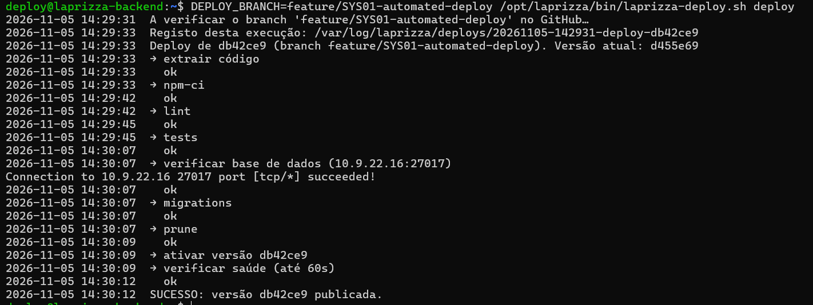                                                                                                                                    | `sudo -u deploy DEPLOY_BRANCH=… laprizza-deploy.sh deploy` (first automated deploy, `db42ce9`, 2026-11-05): all steps `ok`, `SUCCESS`                    |
| 2   | Isolated runtime                              | 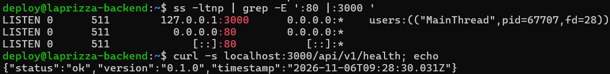 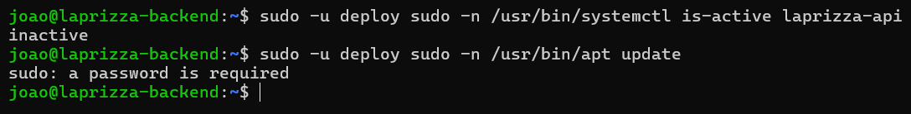 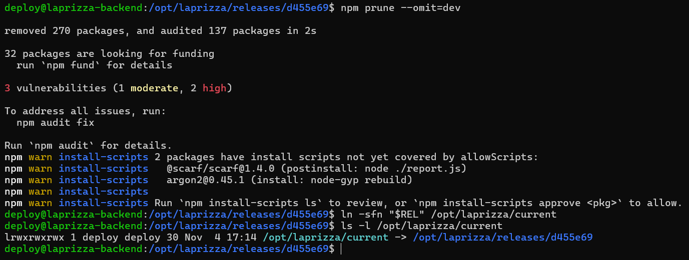 | `ls -l /opt/laprizza`, `systemctl status laprizza-api`, `ss -ltnp \| grep 3000` (127.0.0.1 only), `sudo -u deploy sudo -n /usr/bin/apt update` → refused |
| 3   | Validation based on the test plan             | 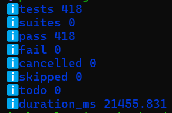                                                                                                                                   | `ls /var/log/laprizza/deploys/latest/` and the summary of `tests.log` (`# pass … # fail 0`)                                                              |
| 4   | Logs and test results archived                | 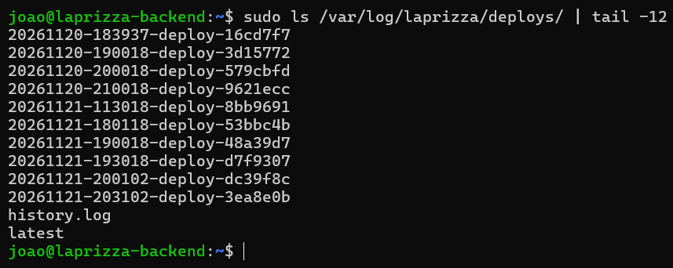 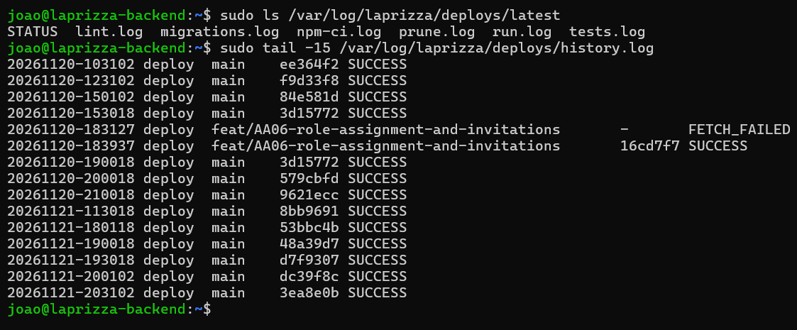 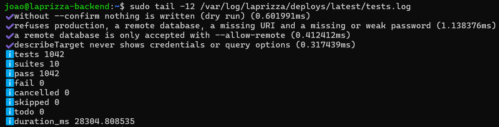                              | `ls /var/log/laprizza/deploys/ \| tail -12`, `tail -15 history.log`, `tail -12 latest/tests.log` (1042 pass, 0 fail)                                     |
| 5   | Configurable schedule                         | 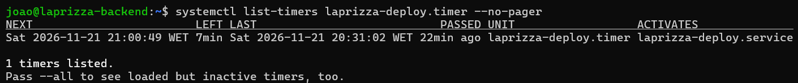 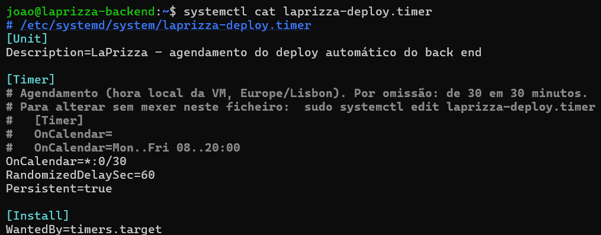                                                                                                                                               | `systemctl list-timers laprizza-deploy.timer` and `systemctl cat laprizza-deploy.timer`                                                                  |
| 6   | Failed validation not presented as success    | 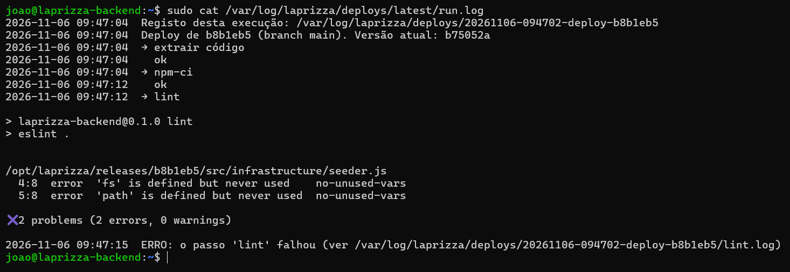 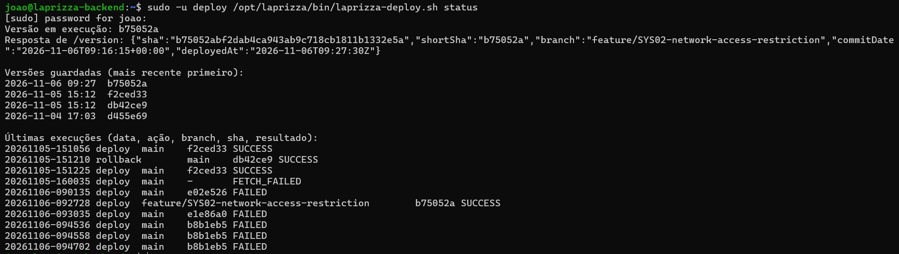                                                                 | `run.log` of `b8b1eb5` (lint error, 2026-11-06): `ERRO: o passo 'lint' falhou`; `status` still shows the previous version                                |
| 7   | Unhealthy release rolled back automatically   | 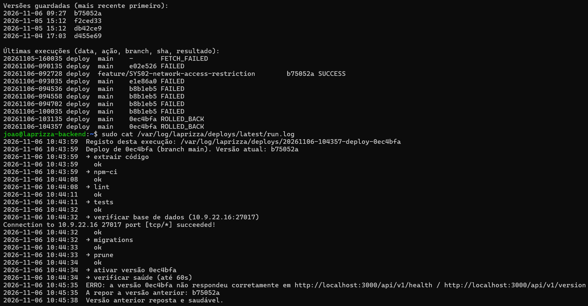 ([journal](img/sys01/07-automatic-rollback-b-journal.txt))                                                              | `run.log` of `0ec4bfa` (missing `ajv` dependency) and `journalctl -u laprizza-api` (`ERR_MODULE_NOT_FOUND`); `Versão anterior reposta e saudável`        |
| 8   | Deployed version identifiable                 | 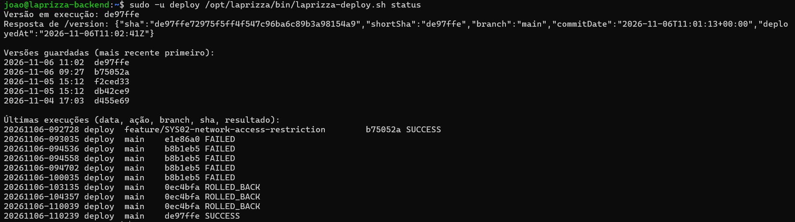 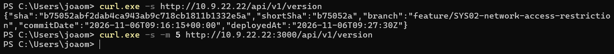                                                                                    | `laprizza-deploy.sh status` and `curl http://10.9.22.22/api/v2/version` from a PC on the VPN                                                             |
| 9   | Documented recovery to a previous version     | 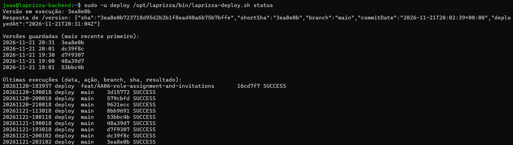 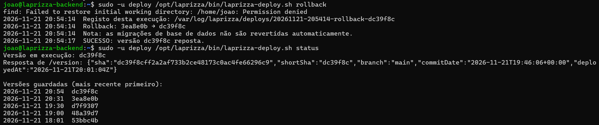                                                                                                                              | `laprizza-deploy.sh status`, `rollback` (most recent release other than the current: `3ea8e0b` → `dc39f8c`), `status`; `main` restored by the next timer run                                                                                                 |
| 10  | Sensitive configuration kept apart            | 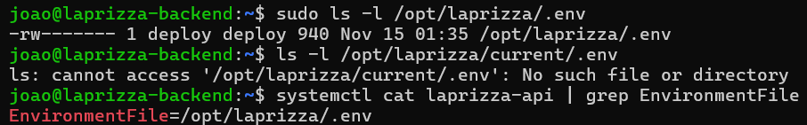 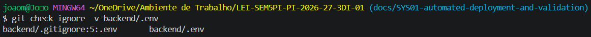                                                                                                                                              | `sudo ls -l /opt/laprizza/.env` (`-rw------- deploy deploy`), `ls /opt/laprizza/current/.env` → not found, `EnvironmentFile=/opt/laprizza/.env`, `git check-ignore -v backend/.env` → `backend/.gitignore:5`            |

## Traceability

| Acceptance criterion                                                                             | Where                                                                                                                    |
| ------------------------------------------------------------------------------------------------ | ------------------------------------------------------------------------------------------------------------------------ |
| Deploy at least one module through an automated pipeline to a reproducible, isolated environment | `deploy/laprizza-deploy.sh`, `deploy/systemd/`, `laprizza-api.service`, `deploy` account and sudoers rule; evidence 1, 2 |
| Execute validation based on the project test plan                                                | Steps 4–6 and 11, [Project Test Plan](../test-plan.md); evidence 3                                                         |
| Archive deployment logs and test results                                                         | `/var/log/laprizza/deploys/`, `history.log`, `tests.log`; evidence 4                                                     |
| Make the deployment schedule configurable                                                        | `laprizza-deploy.timer` (`systemctl edit`); evidence 5                                                                   |
| A failed validation must prevent a deployment from being presented as successful                 | Status values, exit code 1, automatic rollback, failed release removed; evidence 6, 7                                    |
| Deployed version and configuration identifiable; documented recovery                             | `VERSION.json`, `/api/v2/version`, `status`, `rollback`; this document; evidence 8, 9                                    |
| Sensitive configuration managed separately from source and logs                                  | `/opt/laprizza/.env`, `.gitignore`, deploy key; evidence 10                                                              |

## Known limitations

| Item                                                  | Impact                                               | Mitigation                                                                                                                     |
| ----------------------------------------------------- | ---------------------------------------------------- | ------------------------------------------------------------------------------------------------------------------------------ |
| Pull model: up to 30 min between merge and deployment | Changes are not visible immediately                  | Manual run (`sudo systemctl start laprizza-deploy.service`)                                                                         |
| Migrations are not reverted by a rollback             | A rollback across an incompatible migration may fail | Backward-compatible migrations; `migrate:down` procedure above                                                                 |
| Restart causes a few seconds of unavailability        | Requests fail during the restart                     | Schedule outside working hours if needed                                                                                       |
| The timer retries a failed commit on every run        | Repeated `FAILED` lines until the commit is fixed    | Fix forward on `main`                                                                                                          |
| The staging MongoDB is a standalone server            | Multi-document transactions are not available        | Code must not use transactions (team rule)                                                                                     |
| No machine-readable (JUnit) test report               | Test results exist only as text in `tests.log`       | The reporter options are placed after the file pattern of `npm test` and ignored by Node; to be fixed in the deployment script |
| Deployment logs are not pruned                        | `/var/log/laprizza/deploys/` keeps growing           | Remove old run directories manually                                                                                            |
