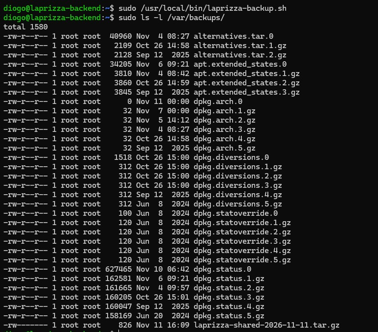
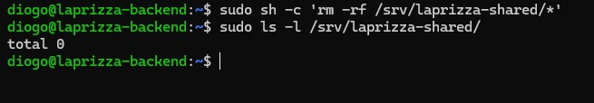
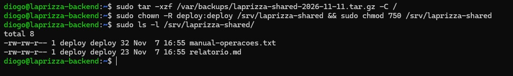

# SYS08 - Backup Strategy and Recovery Validation

## 1. Backup Strategy Parameters

* **Separation of Source Code and Persistent Data:**

  * **Source Code:** Handled via an automated deployment script (cron job) that fetches the latest backend version directly from the project's repository every 30 minutes. Therefore, application source code is *excluded* from local VM backups, relying on Git as the source of truth.

  * **Persistent Data:** Only dynamic application state, specifically the `/srv/laprizza-shared` directory and environment files (`/opt/laprizza/.env`), are included in the local backup routine.

* **Frequency:** Daily at 03:00 AM (off-peak hours) for persistent data.

* **Retention:** 90 days for all files within `/srv/laprizza-shared`.

* **Storage Locations:** Secure off-site storage or a secondary dedicated backup partition on the DEI infrastructure.

* **Recovery Point Objective (RPO):**

  * 24 hours for operational documents (`/srv/laprizza-shared`).

  * Up to 30 minutes (or instant if manually triggered) for backend application code.

* **Work Recovery Time (WRT):** 1 hour.

  * *Justification:* Restoring a folder structure via `tar` extraction is an almost instant OS-level operation. Re-deploying the backend is handled entirely by the automated fetch script.

## 2. Implementation and Recovery Validation

* **Backup Procedure (Persistent Data):**

  * Automated script executing daily to create a compressed archive of the shared directory and its environment configuration:
    `tar -czf /var/backups/laprizza-shared-$(date +%F).tar.gz /srv/laprizza-shared /opt/laprizza/.env`

  * Old backups are automatically erased to enforce the 90-day retention policy.

* **Restore Procedure:**

  * **Application Code:** Manually trigger the deployment script to immediately fetch the latest backend from the repository, bypassing the 30-minute interval.

  * **Shared Resources:** Extract the backup archive to the original location (`sudo tar -xzf /var/backups/laprizza-shared-[DATE].tar.gz -C /`) and reapply strict permissions (`sudo chown -R deploy:deploy /srv/laprizza-shared && sudo chmod 750 /srv/laprizza-shared`).

* **Validation Exercise Results:**

  * Test restores successfully recovered `manual-operacoes.txt` and `relatorio.md`. Ownership and read/write capabilities were verified as consistent. WRT achieved was under 15 minutes.

  **Evidence 1: Backup Execution and Security**
  *(Shows the created `.tar.gz` file with correct `600` permissions and `root` ownership)*
  

  **Evidence 2: Disaster Simulation**
  *(Shows the shared folder completely empty after accidental deletion)*
  

  **Evidence 3: Successful Recovery**
  *(Shows the restored files with their original `deploy` ownership and `750` folder permissions)*
  

## 3. Access Control and Data Protection

* **Backup Security:** Backup archives are stored with `600` permissions, accessible only by `root` or authorized backup operators, ensuring the confidentiality of internal operational documents.