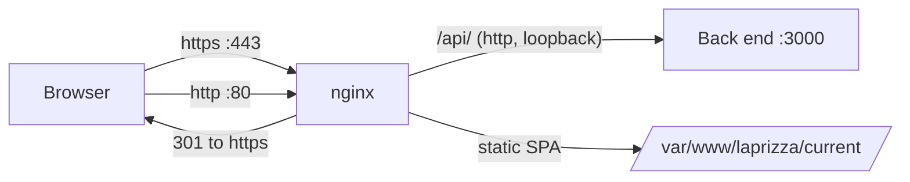

# HTTPS on the staging and production VMs (AA04)

## Why it is required

| Need | Without HTTPS |
|---|---|
| The refresh cookie (`lp_rt`) is `Secure` (ADR 0011/0032) | The browser drops it on `http://` (except `localhost`): every F5 or new tab ends the session |
| The SPA serializes token refreshes across tabs with Web Locks (`refresh-lock.js`) | Web Locks only exist in secure contexts: two tabs refreshing at once look like token reuse and the back end revokes the session |

Turning `REFRESH_COOKIE_SECURE` off is **not** the fix: the cookie would travel in clear text.



## Environments

| Environment | Host | Access |
|---|---|---|
| Development | `localhost` | HTTP is fine (`localhost` is a secure context) |
| Staging | `uvmXXX.dei.isep.ipp.pt` | VPN only |
| Production | `vs-gate.dei.isep.ipp.pt` | Public |

## Certificate

nginx reads `/etc/laprizza/tls/fullchain.pem` and `/etc/laprizza/tls/privkey.pem`
(`deploy/nginx/laprizza.conf`).

1. **Preferred:** a certificate issued for the host (ask the DEI services whether they provide
   one for the VM hostnames). Copy the chain and the key to the paths above.
2. **Fallback (self-signed):** the browser shows a warning once per device; after accepting it
   the page is a secure context and the cookie works.

```bash
sudo install -d -m 755 /etc/laprizza/tls
HOST=uvmXXX.dei.isep.ipp.pt   # or vs-gate.dei.isep.ipp.pt
sudo openssl req -x509 -newkey rsa:2048 -nodes -days 365 \
  -keyout /etc/laprizza/tls/privkey.pem -out /etc/laprizza/tls/fullchain.pem \
  -subj "/CN=$HOST" -addext "subjectAltName=DNS:$HOST"
sudo chmod 600 /etc/laprizza/tls/privkey.pem
sudo nginx -t && sudo systemctl reload nginx
```

`Strict-Transport-Security` stays commented in the nginx site until a trusted certificate is
installed (browsers remember HSTS and would then refuse the self-signed certificate).

## Back-end variables per environment (`/opt/laprizza/.env`)

| Variable | Staging | Production |
|---|---|---|
| `CORS_ORIGIN` | `https://uvmXXX.dei.isep.ipp.pt` | `https://vs-gate.dei.isep.ipp.pt` |
| `APP_BASE_URL` | `https://uvmXXX.dei.isep.ipp.pt` | `https://vs-gate.dei.isep.ipp.pt` |
| `API_PUBLIC_URL` | `https://uvmXXX.dei.isep.ipp.pt` | `https://vs-gate.dei.isep.ipp.pt` |
| `REFRESH_COOKIE_SECURE` | `true` | `true` |
| `TRUST_PROXY` | `loopback` | `loopback` |
| `SESSION_IDLE_TIMEOUT_MINUTES` | `30` | `30` |

- `CORS_ORIGIN` is also the CSRF allow-list of `POST /auth/refresh` and `/auth/logout`: without
  the exact origin the refresh answers `403 ORIGIN_NOT_ALLOWED`.
- The external providers must have `<API_PUBLIC_URL>/api/v2/auth/external/<provider>/callback`
  registered as a redirect URI.
- The SPA is built with `VITE_API_BASE_URL=/api/v2` (`deploy/deploy-web.conf.example`): the
  refresh cookie of the external login is scoped to `/api/v2/auth`.

## Checks

```bash
curl -sI http://<host>/ | grep -i '^location: https://'       # port 80 redirects
curl -skI https://<host>/api/v2/health | head -1              # API through TLS
```

In the browser (DevTools → Application → Cookies) the `lp_rt` cookie must appear after login,
with `Secure`, `HttpOnly`, `SameSite=Strict` and path `/api/v2/auth`; F5 and a new tab keep the
session, and a logout in one tab ends it in the others.
