# SYS02 – Institutional Network Access Restriction

Requirement: development and staging access restricted to the DEI internal network or VPN, using appropriate host or proxy rules; application authentication and role checks kept active in addition to the network restrictions; access from unapproved network contexts denied and logged; configuration documented, with a demonstration of permitted internal access and denied external access (Sprint 2 User Stories v1.0, p. 20).

The restriction described here applies to the staging back-end VM `laprizza-backend` (`vs534`, `10.9.22.22`), which hosts the REST API; the staging front-end VM (`vs814`) reaches the API through it.

Decisions: [ADR-0050 – Network Restriction at the nginx Reverse Proxy](../../adr/0050-network-restriction-at-the-nginx-reverse-proxy.md) and [ADR-0051 – SSH Restricted to Approved Networks with AllowUsers](../../adr/0051-ssh-restricted-to-approved-networks-with-allowusers.md).

## Approved network contexts

| Network | Range | Who |
|---|---|---|
| ISEP VPN | `10.8.0.0/16` | Team members working from outside ISEP (OpenVPN client of the DEI) |
| DEI internal network (VNET1) | `10.9.0.0/16` | DEI virtual servers (front-end VM, database VM) and the DEI internal network |
| Loopback | `127.0.0.1`, `::1` | The VM itself: deployment health checks (SYS01) and nginx → API |

Everything else is refused. The DEI VMs only have private addresses, so a PC on the Internet without the VPN cannot even reach them. The rules below are the team's own layer on top of that, and they are the layer that logs the refusals.

## Overview

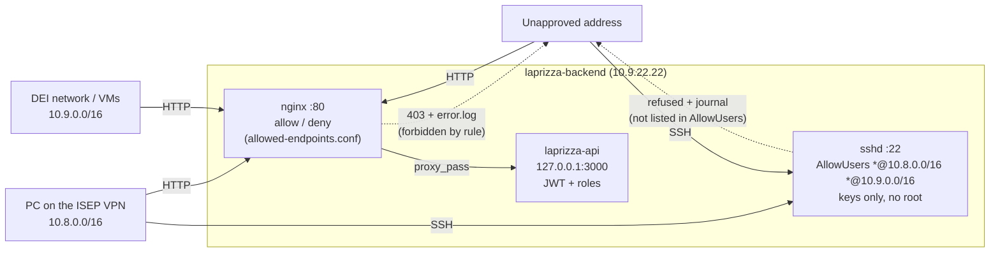

| Item | Value |
|---|---|
| Reverse proxy | nginx, site `/etc/nginx/sites-available/laprizza` (`deploy/nginx/laprizza.conf` in the repository), port 80, `/api/` → `http://127.0.0.1:3000` |
| HTTP rules | `/etc/laprizza/allowed-endpoints.conf` (`allow 127.0.0.1; allow ::1; allow 10.8.0.0/16; allow 10.9.0.0/16; deny all;`), included by the site; generated by SYS03 since 2026-11-19 |
| API binding | `HOST=127.0.0.1`, `PORT=3000` in `/opt/laprizza/.env`: the API cannot be reached without nginx |
| Front-end VM | The nginx of the staging front-end VM (`vs814`) forwards `/api/` to `http://10.9.22.22` (port 80), so its requests go through the same rules |
| Client address | `TRUST_PROXY=loopback,10.9.23.46`: Express accepts `X-Forwarded-For` only from the local nginx and the front-end VM, for rate limits and security logs |
| SSH rules | `/etc/ssh/sshd_config.d/99-laprizza.conf`: `AllowUsers *@10.8.0.0/16 *@10.9.0.0/16`, `PermitRootLogin no`, `PasswordAuthentication no`, `PubkeyAuthentication yes`; plus `AllowGroups ssh-admins` from SYS05 |
| Denial logs | HTTP: `/var/log/nginx/laprizza.error.log` (`access forbidden by rule`); SSH: `journalctl -u ssh` (`not allowed because not listed in AllowUsers`) |
| Access logs | `/var/log/nginx/laprizza.access.log` (client address, path, status) |

## HTTP: nginx rules

The site includes the rules file before passing the request to the API:

```nginx
server {
    listen 80 default_server;
    listen [::]:80 default_server;
    server_name _;

    access_log /var/log/nginx/laprizza.access.log;
    error_log  /var/log/nginx/laprizza.error.log;

    include /etc/laprizza/allowed-endpoints.conf;   # SYS02 (generated by SYS03)

    location /api/ {
        proxy_pass         http://127.0.0.1:3000;
        proxy_http_version 1.1;
        proxy_set_header   Host              $host;
        proxy_set_header   X-Real-IP         $remote_addr;
        proxy_set_header   X-Forwarded-For   $proxy_add_x_forwarded_for;
        proxy_set_header   X-Forwarded-Proto $scheme;
    }

    location / {
        return 404;
    }
}
```

Only `/api/` is forwarded; any other path returns `404`. `X-Forwarded-For` uses `$proxy_add_x_forwarded_for`, so the address sent by the front-end VM is kept and the API (with `TRUST_PROXY=loopback,10.9.23.46`) sees the real client.

```nginx
# /etc/laprizza/allowed-endpoints.conf (generated by SYS03 – do not edit)
allow 127.0.0.1;
allow ::1;
allow 10.8.0.0/16;
allow 10.9.0.0/16;
deny all;
```

nginx checks the rules in order; the first match wins. A request from any other address gets `403 Forbidden` without reaching the API, and nginx writes `access forbidden by rule, client: <address>` to the error log.

Because the API listens only on `127.0.0.1`, the rule cannot be bypassed by calling port 3000 directly from another host.

## SSH: sshd rules

```text
# /etc/ssh/sshd_config.d/99-laprizza.conf
PermitRootLogin no
PasswordAuthentication no
PubkeyAuthentication yes
AllowUsers *@10.8.0.0/16 *@10.9.0.0/16
```

SYS05 later added `AllowGroups ssh-admins` ([ssh-security.md](../ssh-security.md)). sshd applies both: a login must come from an approved network **and** belong to `ssh-admins` (`sudo sshd -T` shows `allowusers *@10.8.0.0/16`, `allowusers *@10.9.0.0/16` and `allowgroups ssh-admins`).

`AllowUsers user@network` accepts a login only when the source address is in one of the networks; `*` keeps the check per network, and the accounts themselves are controlled by SYS05 ([ssh-security.md](../ssh-security.md)). A connection from any other address is refused whatever key is used, and sshd logs `User <name> from <address> not allowed because not listed in AllowUsers`.

Every team member has an individual account with key authentication (one key per device). A change is checked with `sudo sshd -t` before `sudo systemctl reload ssh`, with a second SSH session kept open, so a mistake cannot lock everyone out.

## Correction made during the verification

When the evidence was collected (2026-11-21), the API was listening on `0.0.0.0:3000` (`HOST=0.0.0.0` in `/opt/laprizza/.env`, left from before nginx was installed) and the front-end VM called `http://10.9.22.22:3000` directly. Any client on the VPN could therefore reach the API without the nginx rules. Both were corrected: the front-end VM now uses `http://10.9.22.22`, and `HOST=127.0.0.1` (evidence 2).

With the front-end VM going through the back-end nginx, every request made through the website now crosses two proxies. `TRUST_PROXY=1` would make the API see the front-end VM as the client of all of them, so it was changed to `TRUST_PROXY=loopback,10.9.23.46` (the local nginx and the front-end VM `vs814`). Requests made directly from the VPN keep their `10.8.x.x` address, and an `X-Forwarded-For` header sent by them is ignored.

The back-end nginx also replaced `X-Forwarded-For` with `$remote_addr`, which discarded the address sent by the front-end VM; it now uses `$proxy_add_x_forwarded_for`.

## Authentication and roles stay active

The network rule only decides who may **reach** the API. Every request that passes it still goes through the application checks of Sprint 1/2:

* protected endpoints require a valid access token (JWT) → `401 Unauthorized` without one;
* the role and permission matrix (AA05, [ADR-0046](../../adr/0046-permission-based-authorization-matrix.md)) → `403 Forbidden` for a role without the permission;
* login lockout ([ADR-0043](../../adr/0043-local-login-without-account-enumeration-and-with-progressive-lockout.md)) and rate limits ([ADR-0008](../../adr/0008-implement-rate-limiting-policies.md)) use the real client address (`TRUST_PROXY`, see above).

## Operation

```bash
sudo nginx -t && sudo systemctl reload nginx                 # after changing the site (no restart)
sudo laprizza-allowlist-edit                                 # change the allowed networks (SYS03)
sudo sshd -t && sudo systemctl reload ssh                    # after changing the SSH rules
sudo tail -f /var/log/nginx/laprizza.error.log | grep forbidden   # refused HTTP clients
sudo journalctl -u ssh --since today | grep "not allowed"        # refused SSH logins
```

## Evidence

Screenshots in `docs/sys-admin/network-access-restriction/img/sys02/`.

| # | Acceptance criterion | Evidence | How to obtain it |
|---|---|---|---|
| 1 | HTTP restricted with proxy rules | 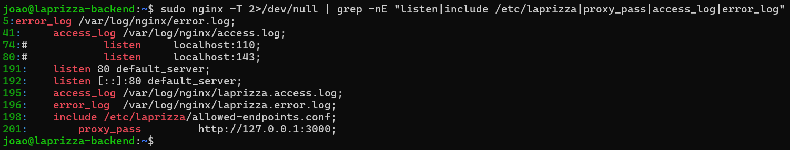 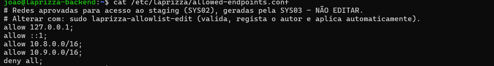 | `sudo nginx -T 2>/dev/null \| grep -nE "listen\|include /etc/laprizza\|proxy_pass\|access_log\|error_log"` (port 80, `include /etc/laprizza/allowed-endpoints.conf`, `proxy_pass http://127.0.0.1:3000`); `cat /etc/laprizza/allowed-endpoints.conf` |
| 2 | API only behind nginx | 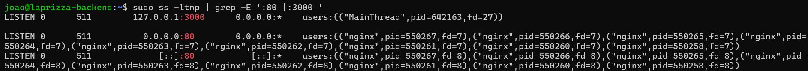 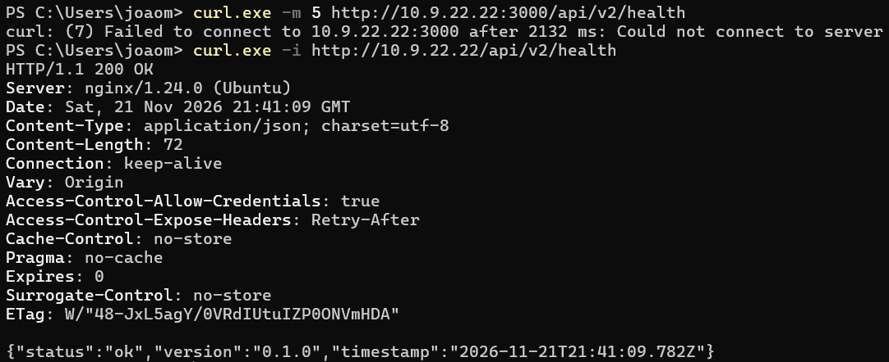 | `sudo ss -ltnp \| grep -E ':80 \|:3000 '` (nginx on `0.0.0.0:80`, node on `127.0.0.1:3000`); from the VPN PC `curl.exe -m 5 http://10.9.22.22:3000/api/v2/health` → `Failed to connect` and `curl.exe -i http://10.9.22.22/api/v2/health` → `200` |
| 3 | SSH restricted with host rules | 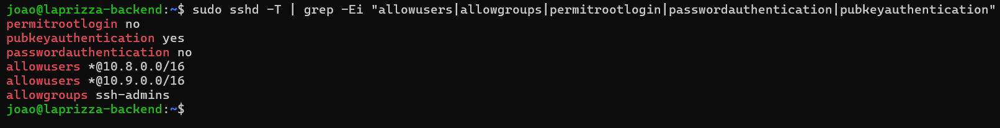 | `sudo sshd -T \| grep -Ei "allowusers\|allowgroups\|permitrootlogin\|passwordauthentication\|pubkeyauthentication"` (`allowusers *@10.8.0.0/16`, `*@10.9.0.0/16`, `allowgroups ssh-admins`) |
| 4 | Permitted internal access (VPN) | 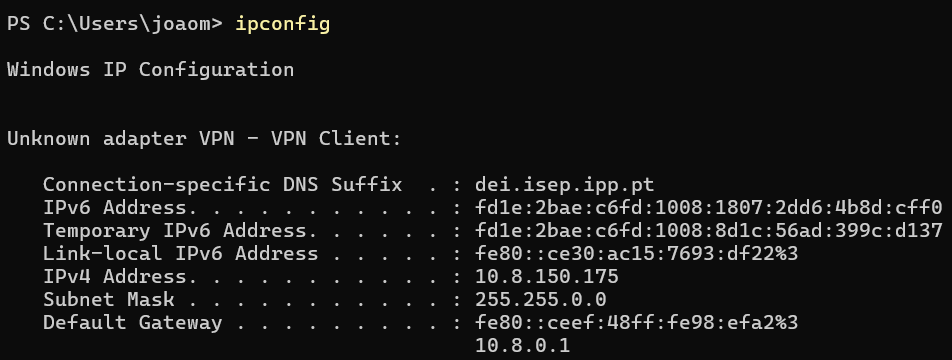 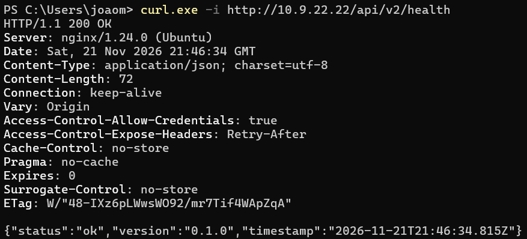 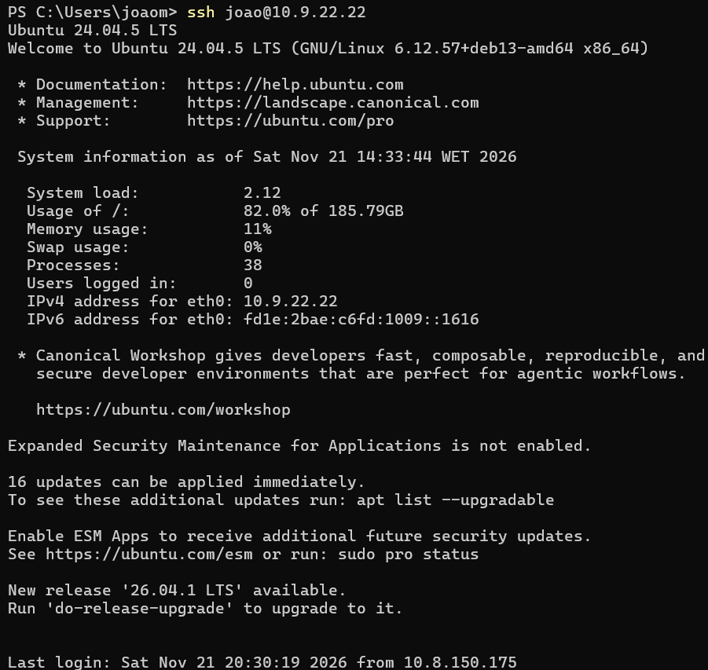 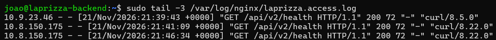 | From the VPN PC: `ipconfig` (`10.8.150.175`), `curl.exe -i http://10.9.22.22/api/v2/health` → `200`, `ssh joao@10.9.22.22` → session opened; on the VM `sudo tail -3 /var/log/nginx/laprizza.access.log` (client `10.8.150.175`, `200`) |
| 5 | Denied access – HTTP, logged | 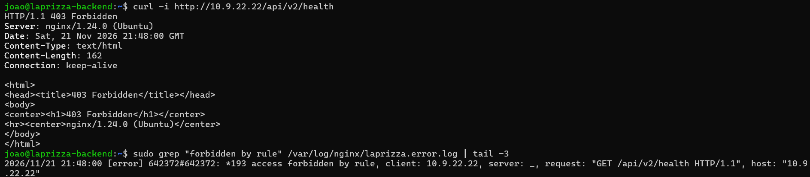 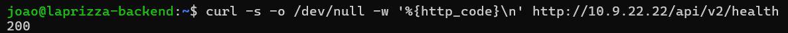 | `10.9.0.0/16` removed with `sudo laprizza-allowlist-edit`; on the VM `curl -i http://10.9.22.22/api/v2/health` (source `10.9.22.22`) → `403 Forbidden`; `sudo grep "forbidden by rule" /var/log/nginx/laprizza.error.log \| tail -3` → `access forbidden by rule, client: 10.9.22.22`; range added back → `200` |
| 6 | Denied access – SSH, logged | 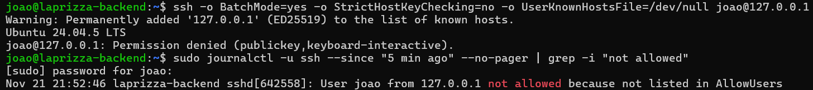 | On the VM: `ssh -o BatchMode=yes -o StrictHostKeyChecking=no -o UserKnownHostsFile=/dev/null joao@127.0.0.1` (source `127.0.0.1`, not approved) → `Permission denied`; `sudo journalctl -u ssh --since "5 min ago" \| grep -i "not allowed"` → `User joao from 127.0.0.1 not allowed because not listed in AllowUsers` |
| 7 | Outside the VPN the VM is unreachable | 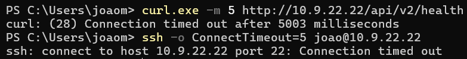 | VPN disconnected: `curl.exe -m 5 http://10.9.22.22/api/v2/health` → timeout; `ssh -o ConnectTimeout=5 joao@10.9.22.22` → timeout |
| 8 | Authentication still enforced | 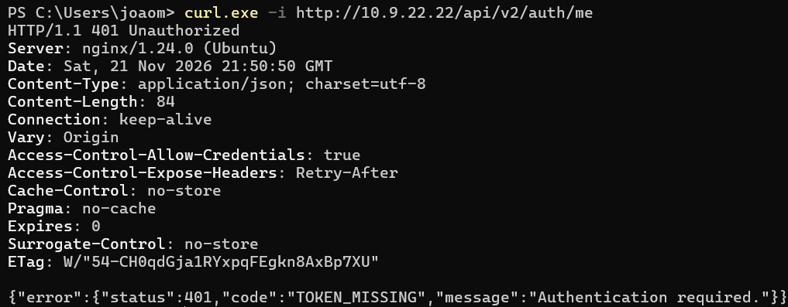 | From the VPN PC: `curl.exe -i http://10.9.22.22/api/v2/auth/me` → `401 Unauthorized` (`TOKEN_MISSING`) |

## Traceability

| Acceptance criterion | Where |
|---|---|
| Restrict development and staging access to the DEI network or VPN with host or proxy rules | nginx `allow`/`deny` (`allowed-endpoints.conf`), `HOST=127.0.0.1`, sshd `AllowUsers`; evidence 1, 2, 3 |
| Keep authentication and role checks active | JWT and permission matrix unchanged (AA01, AA05); evidence 8 |
| Deny and log access from unapproved network contexts | nginx `403` + `laprizza.error.log`; sshd refusal + journal; evidence 5, 6, 7 |
| Document the configuration and demonstrate permitted and denied access | This document; evidence 4 (permitted), 5–7 (denied) |

## Known limitations

| Item | Impact | Mitigation |
|---|---|---|
| A PC outside the DEI network and VPN cannot reach the VM at all | Its attempts never reach nginx or sshd, so they are refused by the DEI network and not logged by the team | Demonstrated separately (evidence 7); the team's rules log every refused address that reaches the VM |
| `10.9.0.0/16` allows every DEI virtual server, not only the team's | Other teams' VMs could reach the API (authentication still applies) | Narrow the range to the team's VMs with SYS03 when the addresses are stable |
| HTTP only, no TLS on staging | Traffic inside the VPN is not encrypted | VPN tunnel is encrypted; production uses HTTPS through `vs-gate` |
| The front-end VM address is fixed in `TRUST_PROXY` | If `vs814` gets another address, requests through the website are seen with the front-end VM address | Update `TRUST_PROXY` in `/opt/laprizza/.env` and restart `laprizza-api` |
| The rules apply per VM | The database VM (DEI template, no SSH) is protected only by the private DEI network and MongoDB authentication | Separate database user per purpose (`laprizza_app`, `laprizza_backup`) |