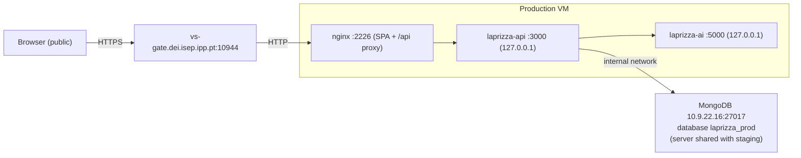

# Production Environment

There are three environments (teacher's clarification, Sprint 2):

| Environment | Where | Access | Domain |
|---|---|---|---|
| Development | Developers' machines | `localhost` | - |
| Staging | DEI VMs (`laprizza-backend` and the front-end VM) | ISEP VPN only (SYS02/SYS03 allowlist) | `uvmXXX.dei.isep.ipp.pt` (private) |
| Production | One new DEI VM | Public, no VPN | `vs-gate.dei.isep.ipp.pt` (public) |

Production must be available for the teacher outside the VPN. When the Sprint 2 submission tag is created, production is reset ("clean") and published from that tag.

### Public access (VM `vs944`)

Static TCP mappings assigned by the DEI to the production VM:

| Public address | VM port | Used | Purpose |
|---|---|---|---|
| `https://vs-gate.dei.isep.ipp.pt:10944` (vs-gate terminates HTTPS, forwards HTTP) | 2226 | **Yes** | The website and the API (`/api/v2`) |
| `vsgate-ssh.dei.isep.ipp.pt:10944` | 2222 | **No: disable it** | External SSH, exposed to internet attacks. Administer through the VPN |
| `vsgate-http.dei.isep.ipp.pt:10944` | 2224 | No | Plain HTTP: nothing listens on 2224 |
| `vs-gate.dei.isep.ipp.pt:30944`, `:40944` | 2228, 2229 | No | Free |
| `vsgate-s1/s2/s3.dei.isep.ipp.pt:10944` | 2223, 2225, 2227 | No | Free |

nginx listens only on 2226. The browser always talks HTTPS to `vs-gate`, so the refresh cookie stays `Secure`, nginx sends `X-Forwarded-Proto: https`, and external login (AA02) can be enabled with the redirect URI `https://vs-gate.dei.isep.ipp.pt:10944/api/v2/auth/external/<provider>/callback` (to be confirmed in each provider console).

Disable the external SSH mapping in the DEI panel (**DISABLE** next to "External SSH/SFTP access"): administration goes through the VPN, as in staging (SYS05).

## Architecture



* One VM for the application. Only nginx is reachable from outside; the API process and the Prolog service listen on `127.0.0.1`.
* MongoDB cannot run on `vs944`: its CPU (Intel Pentium G3220) has no AVX, which MongoDB 5.0+ requires on x86_64 (`mongod` stops with `signal=ILL`). Production uses the staging MongoDB server (`10.9.22.16`, 9.0.4) through the DEI internal network, with its own database (`laprizza_prod`) and its own user (`laprizza_prod_app`, `dbOwner` on `laprizza_prod` only). The staging user only has `readWrite` on `laprizza`, so neither application can reach the other's data.
* The SPA and the API share the same origin (`/api/v2` relative), so no CORS is needed in the browser.
* The SYS02/SYS03 allowlist is **not** installed: production is public. Staging keeps it.

## Differences from staging

| Item | Staging | Production |
|---|---|---|
| Network access | VPN only | Public through `vs-gate` |
| Published code | Branch `main` every 30 minutes | `main` until the submission tag; then only the tag (`DEPLOY_TAG`), timers off |
| Database | `laprizza` on `10.9.22.16` | `laprizza_prod` on the same server, own user with `dbOwner` on that database only |
| Secrets | Staging values | New values (`JWT_SECRET`, `AI_SERVICE_KEY`, `SEED_MANAGER_PASSWORD`, MongoDB) |
| `NODE_ENV` | development/staging | `production` (the dev-users seed refuses to run) |
| Swagger UI | Available | Blocked by nginx (404) |
| Versions | Ubuntu 24.04, Node 24.22.2, nginx 1.24.0, MongoDB 9.0.4, mongosh 2.14.1 | Same versions, held with `apt-mark hold`; SWI-Prolog 9.x from Ubuntu (staging has none: the Prolog service runs locally) |
| E-mail | Mailpit | Real SMTP (activation invitations, password recovery) |

Files: `deploy/production/` (nginx site, systemd units, configuration examples and scripts). The deploy scripts are the same as staging (`deploy/laprizza-deploy.sh`, `deploy/laprizza-deploy-web.sh`); they now also accept `DEPLOY_TAG`.

## Setup

Commands for Ubuntu (check `lsb_release -a` on the VM). Run with `sudo`. SSH administration can still go through the VPN; only the website is public.

### 1. Packages

Same versions as staging (`laprizza-backend`, 2026-11-21): Ubuntu 24.04 LTS (x86_64), Node.js 24.22.2 (NodeSource), nginx 1.24.0 (Ubuntu), mongosh 2.14.1 (the MongoDB 9.0.4 server is the staging one). SWI-Prolog is not installed in staging (the Prolog service runs locally there), so production uses the Ubuntu 24.04 package (9.x).

```bash
sudo apt-get update
sudo apt-get install -y nginx git curl rsync netcat-openbsd gnupg swi-prolog-nox

# Node.js 24.22.2 (same as staging)
curl -fsSL https://deb.nodesource.com/setup_24.x | sudo -E bash -
sudo apt-get install -y nodejs=24.22.2-1nodesource1

# mongosh 2.14.1 only (same as staging; Ubuntu 24.04 = noble). No MongoDB server on this VM (no AVX)
curl -fsSL https://pgp.mongodb.com/server-9.asc | sudo gpg -o /usr/share/keyrings/mongodb-server-9.gpg --dearmor
echo "deb [ arch=amd64,arm64 signed-by=/usr/share/keyrings/mongodb-server-9.gpg ] https://repo.mongodb.org/apt/ubuntu noble/mongodb-org/9.0 multiverse" \
  | sudo tee /etc/apt/sources.list.d/mongodb-org-9.0.list
sudo apt-get update
sudo apt-get install -y mongodb-mongosh=2.14.1

# Keep these versions: apt upgrade must not change them
sudo apt-mark hold nodejs mongodb-mongosh

node -v; nginx -v; mongosh --version; swipl --version
nc -zv -w 5 10.9.22.16 27017      # the production database server must answer
```

* If `apt-get` reports that a pinned version no longer exists, list the available ones with `apt-cache madison nodejs mongodb-mongosh` and pick the closest one with the same major.
* If the key URL answers 404, copy the current one from the official MongoDB page "Install MongoDB Community Edition on Ubuntu".

### 2. MongoDB (database on the staging server)

Run from `vs944` with the MongoDB administrator account of `10.9.22.16` (the team keeps its credentials as secrets, ADR 0017). mongosh asks for the administrator password and then for the new password of `laprizza_prod_app`:

```bash
mongosh "mongodb://<admin user>@10.9.22.16:27017/admin" --quiet --eval '
  db.getSiblingDB("admin").createUser({
    user: "laprizza_prod_app",
    pwd: passwordPrompt(),
    roles: [{ role: "dbOwner", db: "laprizza_prod" }]
  })'

# Check: only dbOwner on laprizza_prod
mongosh "mongodb://laprizza_prod_app@10.9.22.16:27017/laprizza_prod?authSource=admin" --quiet \
  --eval 'db.runCommand({connectionStatus: 1}).authInfo.authenticatedUserRoles'
```

`dbOwner` lets the application run the migrations and lets the reset script drop `laprizza_prod` (the user is kept: it lives in `admin`). The database itself is created by the first migration. Keep the password of `laprizza_prod_app` with the team secrets and in `/opt/laprizza/.env` (step 4).

### 3. User, folders and scripts

```bash
sudo adduser --system --group --home /home/deploy --shell /bin/bash deploy
sudo mkdir -p /opt/laprizza/bin /var/www/laprizza /var/log/laprizza /srv/laprizza-shared
sudo chown -R deploy:deploy /opt/laprizza /var/www/laprizza /var/log/laprizza /srv/laprizza-shared
sudo chmod 750 /srv/laprizza-shared
sudo -u deploy git clone <URL do repositório> /opt/laprizza/repo   # deploy key read-only, as in staging

cd /opt/laprizza/repo
sudo install -m 755 deploy/laprizza-deploy.sh deploy/laprizza-deploy-web.sh \
  deploy/production/laprizza-update-ai.sh deploy/production/laprizza-reset-production.sh /opt/laprizza/bin/
echo 'deploy ALL=(root) NOPASSWD: /usr/bin/systemctl restart laprizza-api' | sudo tee /etc/sudoers.d/laprizza-deploy
sudo chmod 440 /etc/sudoers.d/laprizza-deploy && sudo visudo -c
```

### 4. Configuration

```bash
sudo install -o deploy -g deploy -m 640 deploy/production/deploy.conf.example /opt/laprizza/deploy.conf
sudo install -o deploy -g deploy -m 640 deploy/production/deploy-web.conf.example /opt/laprizza/deploy-web.conf
sudo install -o deploy -g deploy -m 600 deploy/production/backend.env.production.example /opt/laprizza/.env
sudo -u deploy nano /opt/laprizza/.env     # secrets, MongoDB password, public URL, SMTP
```

`backend.env.production.example` explains every value. New secrets: `node -e "console.log(require('crypto').randomBytes(32).toString('hex'))"`.

### 5. Services

```bash
sudo install -m 644 deploy/production/laprizza-api.service deploy/production/laprizza-ai.service /etc/systemd/system/
sudo install -m 644 deploy/systemd/laprizza-deploy*.service deploy/systemd/laprizza-deploy*.timer /etc/systemd/system/
sudo systemctl daemon-reload
sudo systemctl enable laprizza-api laprizza-ai
```

### 6. nginx

```bash
sudo install -m 644 deploy/production/nginx-laprizza-prod.conf /etc/nginx/sites-available/laprizza
sudo ln -sf /etc/nginx/sites-available/laprizza /etc/nginx/sites-enabled/laprizza
sudo rm -f /etc/nginx/sites-enabled/default
sudo nginx -t && sudo systemctl reload nginx
```

### 7. First publication

```bash
sudo -u deploy /opt/laprizza/bin/laprizza-deploy.sh deploy       # migrations + API (creates admin@laprizza.pt)
sudo -u deploy /opt/laprizza/bin/laprizza-deploy-web.sh deploy   # SPA
sudo -u deploy mkdir -p /opt/laprizza/ai-scheduling
sudo -u deploy install -m 600 /opt/laprizza/repo/deploy/production/ai.env.production.example /opt/laprizza/ai-scheduling/.env
sudo -u deploy nano /opt/laprizza/ai-scheduling/.env             # same AI_SERVICE_KEY as the back end
sudo /opt/laprizza/bin/laprizza-update-ai.sh main                # Prolog service
sudo systemctl enable --now laprizza-deploy.timer laprizza-deploy-web.timer   # until the submission tag
```

### 8. Checks

```bash
curl -s http://localhost:2226/api/v2/health
curl -s http://localhost:2226/version.json
curl -s -o /dev/null -w '%{http_code}\n' http://localhost:2226/api/v2/docs/  # 404
ss -ltnp | grep -E ':(3000|5000)\b'                                          # only 127.0.0.1
```

### Client IP (`TRUST_PROXY`)

Rate limits and security logs need the real client IP. Open `https://vs-gate.dei.isep.ipp.pt:10944` from a phone (mobile data) and look at the last lines of the nginx log:

```bash
sudo tail -n 5 /var/log/nginx/laprizza.access.log
```

* `xff="<public IP of the phone>"`: `vs-gate` sends `X-Forwarded-For`; set `TRUST_PROXY=2` (vs-gate + nginx) and restart `laprizza-api`.
* `xff="-"`: `vs-gate` does not send it; keep `TRUST_PROXY=1`. Every public client then shares the `vs-gate` address, so the per-IP rate limits count all users together: known limitation, the per-account lockout (AA01) still applies.

From a phone without the VPN: open `https://vs-gate.dei.isep.ipp.pt:10944`, sign in with `admin@laprizza.pt`, and create a user (the invitation needs the SMTP settings).

## Submission (Sprint 2 tag)

```bash
sudo /opt/laprizza/bin/laprizza-reset-production.sh <tag> --confirm
```

It stops the services, drops the production database, empties the shared folder (`--keep-shared` keeps it), publishes the tag in the back end, the front end and the Prolog service, and disables the deploy timers. The seeder creates `admin@laprizza.pt` again with `SEED_MANAGER_PASSWORD`. The script refuses to run unless `/opt/laprizza/.env` has `NODE_ENV=production`, `MONGODB_DB_NAME` is not `laprizza` (staging), and `MONGODB_URI` points to the host of `MONGO_HOST` (`/opt/laprizza/deploy.conf`) and to the database of `MONGODB_DB_NAME`.

## Security notes

* Development accounts (`seed:dev-users`) never exist in production: the script refuses `NODE_ENV=production`.
* Rate limits are on (`RATE_LIMIT_ENABLED=true`); `TRUST_PROXY` must match the proxies in front of the API, or every client shares one limit.
* HTTPS ends at `vs-gate`; the hop from `vs-gate` to the VM is HTTP inside the DEI network (outside the team's control).
* Only port 2226 is served. The external SSH mapping must stay disabled.
* Website roles are independent of the Linux accounts of this VM (AA06).

## Known limitations

| Item | Impact | Proposal |
|---|---|---|
| Production and staging share the MongoDB server (`10.9.22.16`) | Separate databases and users, but the same `mongod`: an outage or overload of that server stops both, and its administrator account reaches both | A MongoDB VM only for production, on a DEI host with AVX |
| The connection to `10.9.22.16` is not encrypted | Inside the DEI internal network only, never through `vs-gate` | Enable TLS on the MongoDB server |
