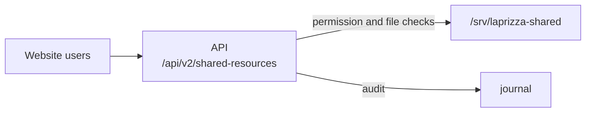
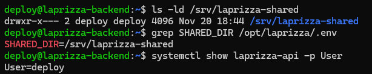
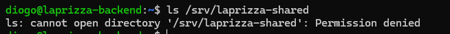
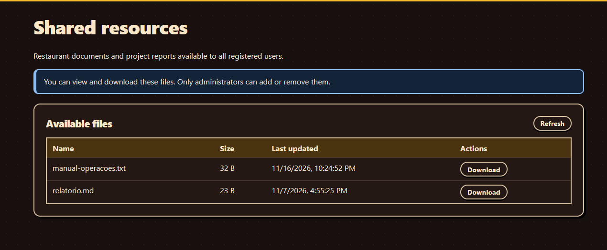
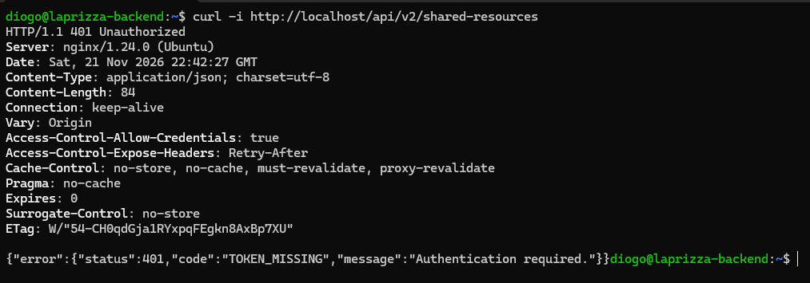
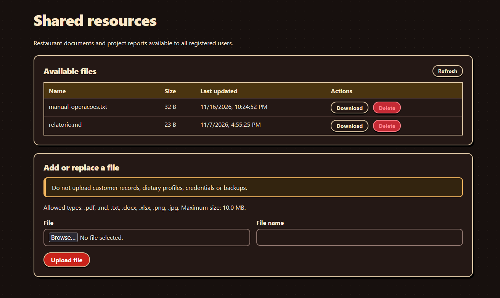
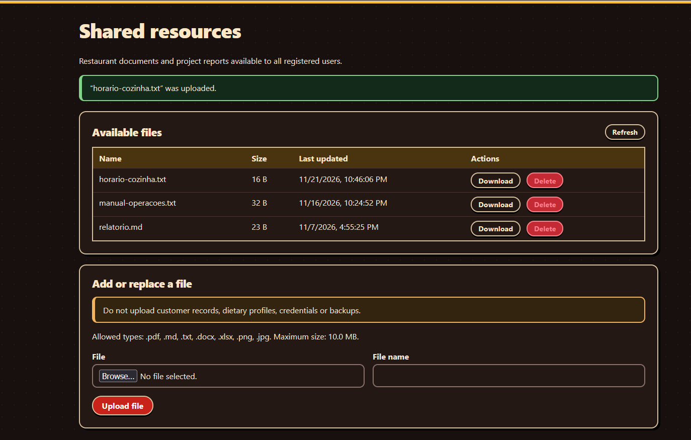
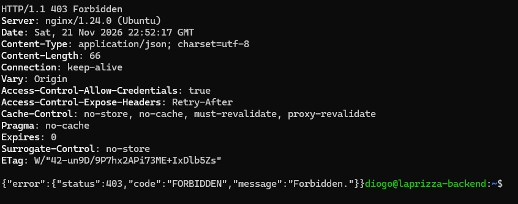
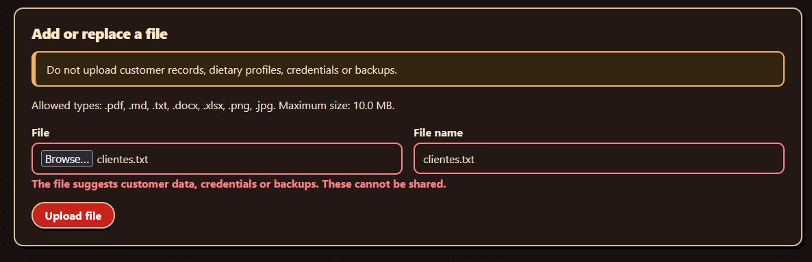
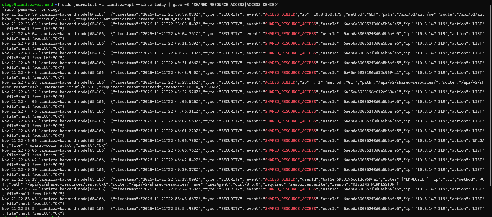

# SYS04 – Shared Resource Folder

Requirement: a shared folder for operational resources, with its location and permissions documented; all authenticated users can read it, only authorized administrators can write to it, access is audited, and restricted information must not be placed in it (Sprint 2 User Stories v1.0, p. 20).

The folder lives on the staging back-end VM and is used only through the REST API (`/api/v2/shared-resources`) and the **Shared Resources** page of the website. It is not exported as a network share (no SMB/NFS), so the API is the single point where permissions, content checks and auditing are enforced. The endpoints are documented in OpenAPI (`/api/v2/docs`).

## Overview



## Location

| Item              | Value                                                                                                                                                                                |
| ----------------- | ------------------------------------------------------------------------------------------------------------------------------------------------------------------------------------ |
| Path (staging VM) | `/srv/laprizza-shared`                                                                                                                                                               |
| Configuration     | `SHARED_DIR=/srv/laprizza-shared` in `/opt/laprizza/.env` (`backend/.env.example`)                                                                                                   |
| Owner / mode      | `deploy:deploy`, `750` (owner reads/writes, group reads, others nothing)                                                                                                             |
| Accessed by       | `laprizza-api.service`, which runs as user `deploy`                                                                                                                                  |
| Code              | `backend/src/api/shared-resources/`, `application/shared-resources/`, `domain/shared-resources/`, `infrastructure/shared-resources/`; page `frontend/src/features/shared-resources/` |

The folder is outside `/opt/laprizza/releases`, so deployments and rollbacks (SYS01) do not touch it. It is included in the daily backup ([SYS08](../backup-strategy/backup-strategy.md)). In production the folder is created the same way ([production environment](../production-environment.md)).

Creating it (once, on the VM):

```bash
sudo mkdir -p /srv/laprizza-shared
sudo chown deploy:deploy /srv/laprizza-shared
sudo chmod 750 /srv/laprizza-shared
grep SHARED_DIR /opt/laprizza/.env        # SHARED_DIR=/srv/laprizza-shared
sudo systemctl restart laprizza-api
```

If `SHARED_DIR` is missing, every request to the folder fails with an error instead of writing to an unexpected location.

## API

| Method and path                          | Permission        | Result                                                                                                                                                 |
| ---------------------------------------- | ----------------- | ------------------------------------------------------------------------------------------------------------------------------------------------------ |
| `GET /api/v2/shared-resources`           | `resources:read`  | `200`, list of `{ name, size, updatedAt }`, sorted by name                                                                                             |
| `GET /api/v2/shared-resources/{name}`    | `resources:read`  | `200`, the file as a download (`X-Content-Type-Options: nosniff`); `404` if it does not exist                                                          |
| `PUT /api/v2/shared-resources/{name}`    | `resources:write` | Body: the raw file (`Content-Type: application/octet-stream`). `201` created, `200` replaced, `400` invalid name/type/content, `413` larger than 10 MB |
| `DELETE /api/v2/shared-resources/{name}` | `resources:write` | `204` removed, `404` if it does not exist                                                                                                              |

Files are written to a temporary hidden file and then renamed, so a reader never sees a half-written file. Hidden files (starting with `.`) and folders are never listed.

## Permissions

"All authenticated users can read" and "only authorized administrators can write" (SYS04). On the website the role that administers is `ADMINISTRATOR` (AA06). The Manager reads but does not write: this is a team decision, because Table 1 does not list the shared folder.

| Actor                            | List / download (`resources:read`)       | Upload / replace / delete (`resources:write`) |
| -------------------------------- | ---------------------------------------- | --------------------------------------------- |
| Guest (no session)               | No (`401`)                               | No (`401`)                                    |
| Customer, Employee, Manager      | Yes                                      | No (`403`)                                    |
| Administrator                    | Yes                                      | Yes                                           |

The permissions are defined in `backend/src/domain/auth/permissions.domain.js` and checked by `requirePermission` on every route. Roles are read on every request (AA03/AA04), so a removed role or a disabled account loses access on its next request. On the website the upload and delete controls are only shown to users with `resources:write`, but the back end enforces the rule anyway.

At the operating-system level only `deploy` (and root) can open the folder: other accounts on the VM get `Permission denied`.

## Restricted content

Customer records, dietary profiles, credentials, backup contents and other restricted information must not be placed in the folder. Only an Administrator can add files, and the upload form shows this warning. In addition, every upload is checked before it is saved (`shared-resources.domain.js`). The page repeats the type, name and size checks before sending the file (`shared-resources.utils.js`), so the user gets the message at once, but the back end checks are the ones that count:

| Check                          | Rule                                                                                                                                                                                                                                                 | Rejected example                          |
| ------------------------------ | ---------------------------------------------------------------------------------------------------------------------------------------------------------------------------------------------------------------------------------------------------- | ----------------------------------------- |
| File type                      | Only `.pdf`, `.md`, `.txt`, `.docx`, `.xlsx`, `.png`, `.jpg`                                                                                                                                                                                         | `clients.bson`, `export.csv`, `script.sh` |
| File name                      | Letters, digits, space, `.`, `_`, `-`; up to 100 characters; must start with a letter or digit (no paths)                                                                                                                                            | `../etc/passwd`, `.env`                   |
| Restricted terms in the name   | Not accepted (case and accents ignored): `cliente`, `customer`, `dietary`, `perfil alimentar`, `perfis alimentares`, `backup`, `dump`, `password`, `palavra passe`, `credencia`, `credential`; nor 9 consecutive digits (e.g. a NIF or phone number) | `Clientes_2026.pdf`, `backup-mongo.docx`  |
| Restricted terms in text files | `.md` and `.txt` must be UTF-8 text and are checked for the same terms and numbers                                                                                                                                                                   | a `.txt` with `password: …`               |
| Content matches the type       | `.pdf`, `.png`, `.jpg`, `.docx`, `.xlsx` must start with the signature of that format                                                                                                                                                                | a `.bson` dump renamed to `.pdf`          |
| Size                           | At most 10 MB                                                                                                                                                                                                                                        | –                                         |

These checks reduce mistakes but cannot read the inside of PDFs, images or Office files (see [Known limitations](#known-limitations)). The administrator remains responsible for what is uploaded, which is why only administrators can write and every upload is audited with the author.

## Audit

Each operation is recorded by the security logger (`backend/src/infrastructure/logging/security-logger.js`) as one JSON line:

```json
{
  "timestamp": "2026-11-19T10:15:02.114Z",
  "type": "SECURITY",
  "event": "SHARED_RESOURCE_ACCESS",
  "userId": "6731…",
  "ip": "10.8.0.14",
  "action": "UPLOAD",
  "file": "manual.txt",
  "result": "OK"
}
```

| Field          | Values                                                                         |
| -------------- | ------------------------------------------------------------------------------ |
| `action`       | `LIST`, `DOWNLOAD`, `UPLOAD`, `DELETE`                                         |
| `file`         | file name (`null` for `LIST`)                                                  |
| `result`       | `OK` or `ERROR_<status>` (e.g. `ERROR_400` for a rejected upload, `ERROR_404`) |
| `userId`, `ip` | who made the request and from where                                            |

- Requests without a valid session or without the required permission do not reach the folder and are recorded as `ACCESS_DENIED` (authentication and authorization middleware), with the method, path, required permission and reason (`TOKEN_MISSING`, `MISSING_PERMISSION`), and the user id and roles when there is a session.
- Fields whose name contains `pass`, `token`, `secret`, `cookie`, `authorization` or `hash`, and values that look like tokens or password hashes, are never logged.
- The file contents are never logged.

The lines go to the journal of `laprizza-api.service`:

```bash
sudo journalctl -u laprizza-api --since today | grep -E 'SHARED_RESOURCE_ACCESS|ACCESS_DENIED'
sudo journalctl -u laprizza-api | grep SHARED_RESOURCE_ACCESS | grep '"action":"UPLOAD"'   # who uploaded what
```

Retention: 90 days (persistent journal, `MaxRetentionSec=90day`).

## Tests

| Test                                                                                | What it covers                                                                                                                                                  |
| ----------------------------------------------------------------------------------- | --------------------------------------------------------------------------------------------------------------------------------------------------------------- |
| `backend/test/domain/shared-resources.domain.test.js`                               | Names, types, restricted terms, text and binary content checks                                                                                                  |
| `backend/test/application/shared-resources.service.test.js`                         | Upload, replace, download, delete, size limit, not found                                                                                                        |
| `backend/test/api/api.shared-resources.test.js`, `api.authorization-matrix.test.js` | Status codes per role (`401`/`403`/`200`) and audit lines                                                                                                       |
| `frontend/test/e2e/shared-resources.spec.js`                                        | Page: read-only view (download, no upload or delete) for the Employee; upload, replace warning, rejected file type and delete for a user with `resources:write` |
| `backend/test-flows/shared-resources-test-flow.http`                                | Manual flow against a running API                                                                                                                               |

## Evidence

Screenshots in `docs/sys-admin/shared-resources/img/sys04/`.

| #   | Acceptance criterion                       | Evidence                                                                                                                                      | How to obtain it                                                                                                                                                                                                                                                                                                                                                            |
| --- | ------------------------------------------ | --------------------------------------------------------------------------------------------------------------------------------------------- | --------------------------------------------------------------------------------------------------------------------------------------------------------------------------------------------------------------------------------------------------------------------------------------------------------------------------------------------------------------------------- |
| 1   | Location and permissions documented        |                                                                                      | On the VM: `ls -ld /srv/laprizza-shared`, `grep SHARED_DIR /opt/laprizza/.env`, `systemctl show laprizza-api -p User`                                                                                                                                                                                                                                                       |
| 2   | Folder not reachable outside the API       |                                                                                                       | As another VM user: `ls /srv/laprizza-shared` → Permission denied                                                                                                                                                                                                                                                                                                           |
| 3   | Authenticated users can read               |                                                                                                        | Shared Resources page as Employee (or Customer): list and download, no upload form                                                                                                                                                                                                                                                                                          |
| 4   | Guests and users without roles cannot read |                                                                                                        | On the VM: `curl -i http://localhost/api/v2/shared-resources` without a token → `401 TOKEN_MISSING`                                                                                                                                                                                                                                                                         |
| 5   | Only administrators can write              |    | Page as Administrator: Delete buttons and the upload form with the restricted-content warning (compare with evidence 3); upload a file → it appears in the list (`201`); `PUT` as Employee (`curl -i -X PUT http://localhost/api/v2/shared-resources/teste.txt` with the Employee token) → `403 FORBIDDEN`                                                                  |
| 6   | Restricted information is rejected         |                                                                                     | As Administrator, choose a file named `clientes.txt` → the page refuses it with the restricted-information message and sends nothing. The back end applies the same rule (`400`), and a `.bson` dump renamed to `.pdf` is rejected by the content check (`shared-resources.domain.test.js`, `shared-resources.service.test.js`)                                             |
| 7   | Access is audited                          |                                                                                                           | `sudo journalctl -u laprizza-api --since today \| grep -E 'SHARED_RESOURCE_ACCESS\|ACCESS_DENIED'` after the steps above: `LIST` and `UPLOAD` (`horario-cozinha.txt`, `OK`) with `userId` and IP, `ACCESS_DENIED` `TOKEN_MISSING` for the guest request (evidence 4) and `ACCESS_DENIED` `MISSING_PERMISSION` with `roles:["EMPLOYEE"]` for the Employee `PUT` (evidence 5) |

## Traceability

| Acceptance criterion                               | Where                                                                                               |
| -------------------------------------------------- | --------------------------------------------------------------------------------------------------- |
| Document the folder location and permissions       | This document (Location, Permissions); evidence 1 and 2                                             |
| All authenticated users can read                   | `resources:read` for every role in `permissions.domain.js`, `GET` routes; evidence 3 and 4          |
| Only authorized administrators can write           | `resources:write` only for `ADMINISTRATOR`, `PUT`/`DELETE` routes, `deploy:deploy 750`; evidence 5  |
| Audit access                                       | `SHARED_RESOURCE_ACCESS` and `ACCESS_DENIED` in the security log, journal retention; evidence 7     |
| Restricted information is not placed in the folder | Upload checks in `shared-resources.domain.js`, form warning, administrator-only uploads; evidence 6 |

## Known limitations

| Limitation                                                                                                                                                                                                                  | Impact                                                                                                            | Mitigation                                                                                                   |
| --------------------------------------------------------------------------------------------------------------------------------------------------------------------------------------------------------------------------- | ----------------------------------------------------------------------------------------------------------------- | ------------------------------------------------------------------------------------------------------------ |
| Restricted terms are only searched **inside** `.md` and `.txt` files. For `.pdf`, `.docx`, `.xlsx`, `.png` and `.jpg` only the **file name** is checked for restricted terms, and the content only for the format signature | A PDF or spreadsheet with customer data and a neutral name (e.g. `report-november.xlsx`) is accepted              | Only administrators upload; the form warns about restricted content; every upload is audited with the author |
| The restricted terms are a fixed list of keywords                                                                                                                                                                           | False negatives (other words, other languages) and false positives (e.g. `customer-service-guide.pdf` is refused) | The list is in one place (`FORBIDDEN_NAME_TERMS`) and can be extended                                        |
| Any 9 consecutive digits in a name or text file are refused (NIF, phone number)                                                                                                                                             | Legitimate numbers (e.g. an order or invoice number) are refused too                                              | Rename the file or remove the number                                                                         |
| Replacing or deleting a file is immediate and has no version history                                                                                                                                                        | A wrong replace or delete loses the previous file                                                                 | Daily backup of the folder ([SYS08](../backup-strategy/backup-strategy.md)); the change is in the audit log  |
| No total quota for the folder (only 10 MB per file)                                                                                                                                                                         | Many uploads can fill the disk                                                                                    | Disk monitoring ([SYS06](../operational-risk-assessment.md))                                                 |

## Related

- [SYS08 - Backup Strategy and Recovery Validation](../backup-strategy/backup-strategy.md): daily archive of `/srv/laprizza-shared`.
- [SYS06 - Operational Risk Assessment](../operational-risk-assessment.md) and [SYS07 - Minimum Business Continuity Objective](../minimum-business-continuity-objective.md): disk space, corruption and unauthorized deletion of the folder.
- [Role assignment and invitations](../../flows/authentication/role-assignment-and-invitations.md): `resources:read` / `resources:write`.
