# SYS05 – Controlled Linux Remote Shell Access

**Host:** `laprizza-backend.dei.isep.ipp.pt` · **OS:** Ubuntu Server 24.04 · **Timezone:** `Europe/Lisbon`

**Requirement:** control and monitor remote SSH logins: allow authentication only between 08:00 and 22:00, require MFA after a failed attempt, alert the administrator by email after more than three consecutive failures, use individual administrative accounts, and protect login/alert records with a documented retention period.

> Website roles (Table 1 of the Sprint 2 specification) are unrelated to this US. Infrastructure administration is an operational responsibility and grants no access to website functionality.

## 1. Authentication flow

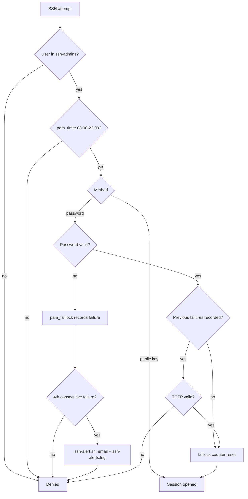

## 2. Access control (SSH daemon)

File: `/etc/ssh/sshd_config.d/10-sys05.conf`

```conf
UsePAM yes
PasswordAuthentication no
KbdInteractiveAuthentication yes
PermitRootLogin no
AllowGroups ssh-admins
LogLevel VERBOSE
```

* Only members of `ssh-admins` may log in; other users are denied even with valid credentials.
* `PermitRootLogin no`: privileged actions go through `sudo`, attributable to a named account.
* `PasswordAuthentication no` + `KbdInteractiveAuthentication yes`: passwords are validated by PAM, so PAM modules apply to password logins.
* `LogLevel VERBOSE` records the method and source address in `/var/log/auth.log`.

Validation: `sudo sshd -T | grep -Ei 'allowgroups|permitroot|passwordauth'`

## 3. Login time window (08:00–22:00)

* **Mechanism:** `pam_time.so`, account phase. Applies to every authentication method, including public keys.
* `/etc/pam.d/sshd`, before `@include common-account`:

```conf
account required pam_time.so
```

* `/etc/security/time.conf`:

```conf
sshd;*;*;Al0800-2200
```

* `Al` = every day. `pam_time` does not resolve Unix groups, so the user field is a wildcard; `AllowGroups` already restricts who reaches this stage.
* Outside the window, sshd logs `Access denied for user <user> by PAM account configuration`.
* **Timezone:** `Europe/Lisbon` (`timedatectl`). The window is evaluated in server local time.

## 4. Failure tracking and MFA

Authentication stack in `/etc/pam.d/sshd` (`@include common-auth` is commented out):

```conf
auth [success=3 default=ignore] pam_unix.so
auth [default=ignore]           pam_faillock.so authfail
auth optional                   pam_exec.so quiet /usr/local/sbin/ssh-alert.sh
auth requisite                  pam_deny.so
auth [success=1 default=ignore] pam_exec.so quiet /usr/local/sbin/ssh-no-failures.sh
auth required                   pam_google_authenticator.so
auth [default=ignore]           pam_faillock.so authsucc
auth required                   pam_permit.so
```

| Situation | Behaviour |
|---|---|
| Wrong password | Failure recorded by `pam_faillock`; `ssh-alert.sh` runs; login denied |
| Correct password, no previous failures | Login accepted, no TOTP |
| Correct password, previous failures recorded | `ssh-no-failures.sh` fails, so TOTP is **required** |
| Valid TOTP | Login accepted and failure counter reset (`authsucc`) |

* **MFA:** Google Authenticator (TOTP). The `nullok` option is omitted: after a failure, a user without `~/.google_authenticator` cannot log in. Every administrator must enrol before the module is active. Secret file mode `600`.
* **`/etc/security/faillock.conf`:**

```conf
dir = /var/lib/faillock
fail_interval = 86400
deny = 10
```

* `pam_faillock` is used **only to count failures; there is no lockout** (the US does not require one). `deny = 10` is set explicitly because with the default (`deny = 3`) the counter stops at 3 and the 4th failure is never recorded, so the alert could not fire.
* `fail_interval = 86400`: failures are kept for 24 hours.
* Administration: `sudo faillock --user <user>` (audit) and `--reset`.

## 5. Automated alert (more than 3 consecutive failures)

`/usr/local/sbin/ssh-alert.sh` (mode `750`, `root`), called by `pam_exec.so` after `pam_faillock authfail`:

```bash
#!/bin/bash
ADMIN_MAIL="laprizzag01@gmail.com"
LOG="/var/log/ssh-alerts.log"

n=$(/usr/sbin/faillock --user "$PAM_USER" 2>/dev/null | awk '$NF=="V"' | wc -l)

# Alert once, on the 4th consecutive failure
if [ "$n" -eq 4 ]; then
  MSG="$(date -Is) user=$PAM_USER from=${PAM_RHOST:-?} service=${PAM_SERVICE:-?} falhas_consecutivas=$n"
  echo "$MSG" >> "$LOG"
  printf 'Alerta SYS05: mais de 3 falhas consecutivas de autenticacao SSH.\n\nUtilizador: %s\nIP de origem: %s\nServico: %s\nFalhas: %s\nData e hora: %s\n' \
    "$PAM_USER" "${PAM_RHOST:-?}" "${PAM_SERVICE:-?}" "$n" "$(date)" \
    | /usr/bin/mail -s "[ALERTA SYS05] SSH: $n falhas consecutivas ($PAM_USER)" "$ADMIN_MAIL"
fi
exit 0
```

* Context captured: `$PAM_USER`, `$PAM_RHOST`, `$PAM_SERVICE`, timestamp. The event is also appended to `/var/log/ssh-alerts.log`.
* **Delivery:** local Postfix (loopback only) relaying through Google SMTP, port 587, SASL with an App Password stored in `/etc/postfix/sasl_passwd` (mode `600`, never in the repository).
* The alert fires once per series, on the 4th failure; the 5th and later failures do not send another email.

## 6. Individual accounts

* One personal account per administrator, all in `ssh-admins` (`getent group ssh-admins`), no shared credentials, no direct root login.
* Creation: `sudo adduser --gecos "Full Name" <username>` and `sudo usermod -aG ssh-admins <username>`.

## 7. Log protection and retention

| Record | Location | Owner / mode (observed) | Retention |
|---|---|---|---|
| SSH login events | `/var/log/auth.log` | `syslog:adm`, `640` | 90 days (`weekly`, `rotate 13` in `/etc/logrotate.d/rsyslog`) |
| Alert records | `/var/log/ssh-alerts.log` | `root:root`, `600` | 90 days (`weekly`, `rotate 13` in `/etc/logrotate.d/ssh-alerts`) |
| Failure counters | `/var/lib/faillock` | `root` | `fail_interval` (24 h) or `--reset` |

`/etc/logrotate.d/ssh-alerts`:

```conf
/var/log/ssh-alerts.log {
  weekly
  rotate 13
  compress
  missingok
  create 600 root root
}
```

* `ssh-alerts.log` is rotated **only** by its own file; it must not also be listed in `/etc/logrotate.d/rsyslog` (duplicate entries are rejected by `logrotate`).
* In `/etc/logrotate.d/rsyslog`, the block containing `/var/log/auth.log` uses `weekly` and `rotate 13` (13 weeks, about 90 days). The default was `rotate 4`.
* Only `root` and the `adm` group can read `auth.log`; only `root` can read `ssh-alerts.log`.

## 8. Acceptance criteria and evidence

Images in `img/sys05/`.

### 8.1 Individual accounts and SSH configuration

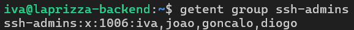

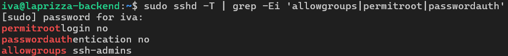

### 8.2 Timezone

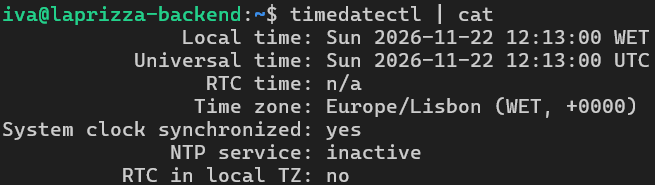

### 8.3 Login allowed inside the window (08:00–22:00)

Accepted at 11:51:16, `date` 12:10:12.

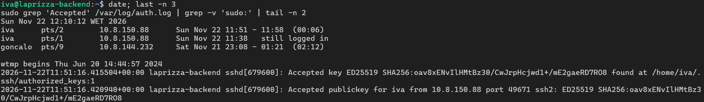

### 8.4 Login denied outside the window

The window was changed to `Al0800-1100` at about 11:45 (current time later than 11:00).

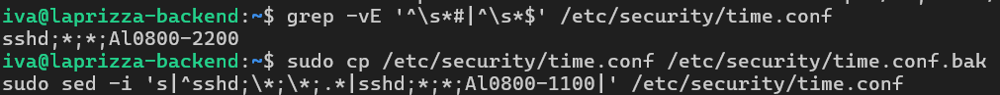

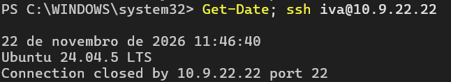

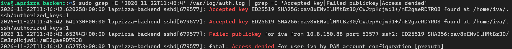

The same user, key and source address were accepted at 11:38 with `Al0800-2200`, so the only variable was `time.conf`. The window was restored afterwards.

### 8.5 MFA after a failed attempt

Wrong password, then correct password: the `Verification code` prompt appears.

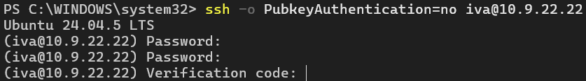

### 8.6 Email alert after more than three consecutive failures

3 failures: no alert, no email queued.

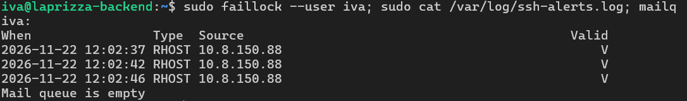

4th failure (12:03:23): entry in `ssh-alerts.log`.

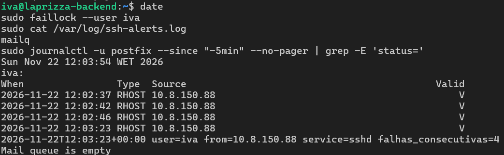

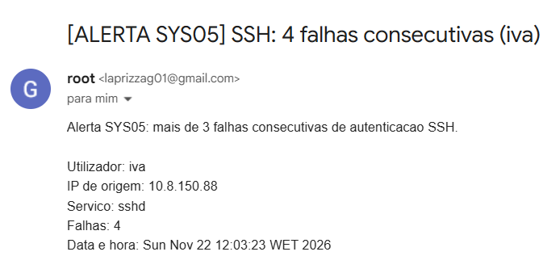

### 8.7 Log protection and retention

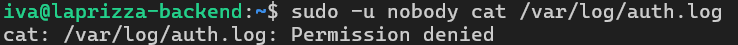

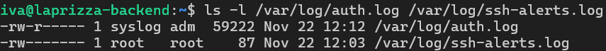

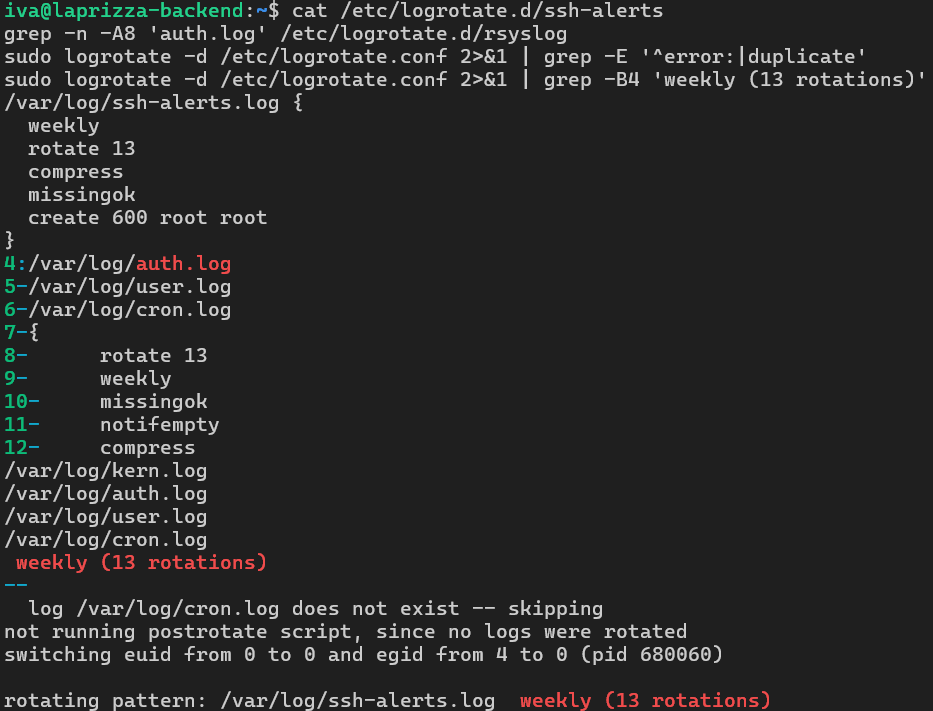

### 8.8 Summary

| Criterion | Section | Evidence |
|---|---|---|
| Authentication only 08:00–22:00, denied outside | 3 | 8.3, 8.4 |
| Timezone | 3 | 8.2 |
| MFA after a failed attempt | 4 | 8.5 |
| Email alert after more than 3 consecutive failures | 4, 5 | 8.6 |
| Individual accounts | 6 | 8.1 |
| Restricted logs and retention | 7 | 8.7 |

## 9. Limitations and decisions

* **Public keys bypass the PAM `auth` phase.** MFA, failure counting and the alert apply to password logins only. The time window (`account` phase) applies to all methods. Keys exist only on individual admin accounts under `AllowGroups`.
* A TOTP failure is not counted by `pam_faillock` (the flow has already passed `authfail`).
* TOTP is mandatory after a failure: administrators without enrolment are locked out until enrolled.
* No lockout is implemented; `pam_faillock` is only a counter (`deny = 10`).
* `timedatectl` reports `NTP service: inactive` (`systemd-timesyncd` and `chrony` are inactive) while the clock is reported as synchronized; the synchronization source was not identified. TOTP and `pam_time` depend on a correct clock.
* The alert depends on the external Google relay. If it is unreachable, Postfix queues the message (`mailq`) and the event is still recorded in `ssh-alerts.log`.

## 10. Incidents during implementation

1. **`pam_time` did not apply.** `time.conf` used `ssh-admins` in the user field, but `pam_time` does not resolve Unix groups; logins at 22:20–23:01 were accepted. Fixed with a wildcard (`sshd;*;*;Al0800-2200`) and validated (accepted at 11:38, denied at 11:46 with the window changed).
2. **Alert script sent an email on every failure** instead of after more than three. Replaced by the counting script of section 5.
3. **4th failure not recorded.** With the default `deny = 3` the counter stopped at 3. Fixed with `deny = 10`.
4. **Retention did not match the documented 90 days.** `/etc/logrotate.d/rsyslog` used `rotate 4` for `auth.log` and also listed `ssh-alerts.log`, duplicating its dedicated file. Fixed by setting `rotate 13` in the `auth.log` block and removing the duplicate entry.
5. **Lost SSH access** after a PAM/group change without a spare session. Procedure adopted: keep a second session open, back up `/etc/pam.d/sshd`, validate with `sshd -t`.

## 11. Use of AI

Tool: Claude (Anthropic). Purpose: draft the PAM/sshd configuration. All settings were applied and tested on the VM by the team, and checked against the manual pages (`pam_time`, `pam_faillock`, `faillock.conf`, `pam_google_authenticator`, `sshd_config`).